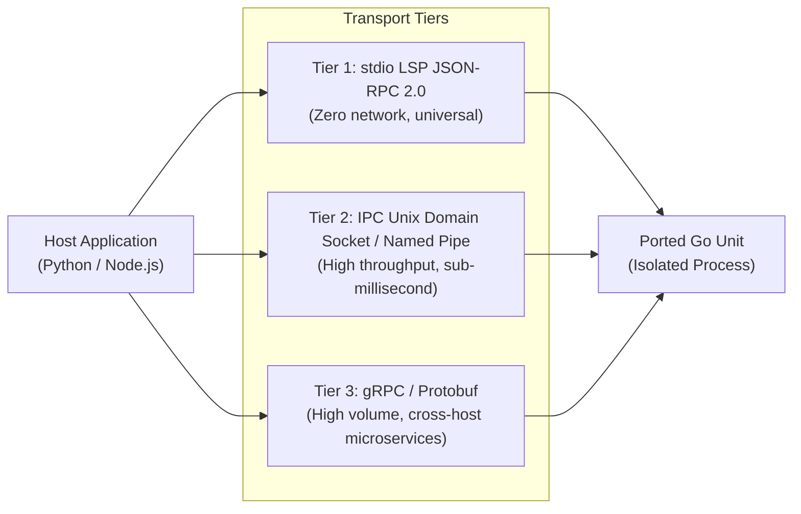
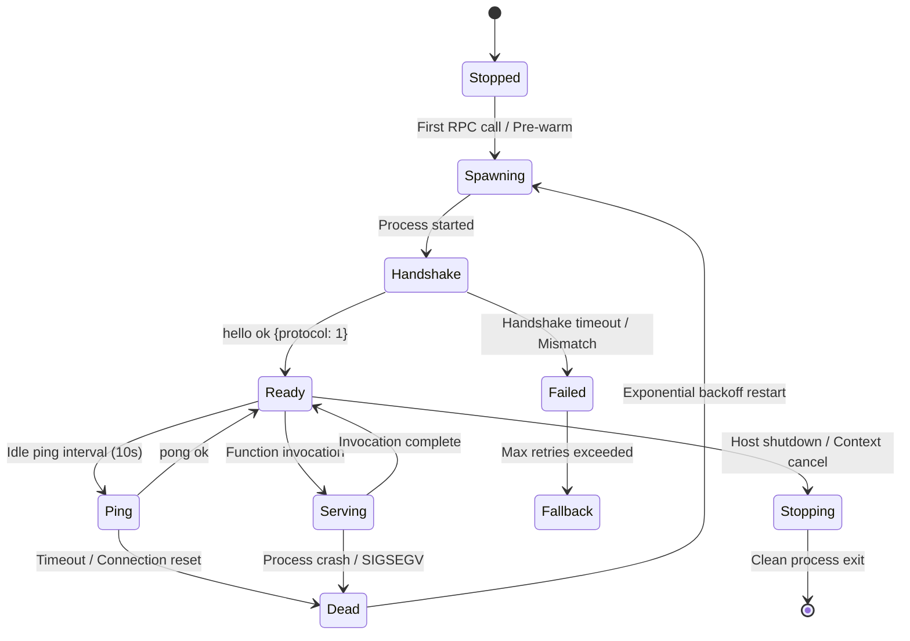

# ADR-005: Hot-Path Sidecar Protocol & Inter-Process Communication Contract

* **Status:** Resolved
* **Date:** 2026-11-23
* **Deciders:** go-anything core team / Task B1
* **Consulted:** Architecture Plan v3, ADR-001, ADR-002, Task Plan v3.1, `adapters/source/python/cshared/DECISION.md`

---

## 1. Context & Problem Statement

`go-anything` migrates monolithic or multi-service applications to Go one unit at a time following the strangler pattern. In polyglot environments (such as Python, TypeScript/Node.js, or Ruby hosts), ported Go units must be invoked from the legacy runtime before full cutover is complete.

Two architectural models exist for cross-language execution:
1. **In-Process FFI (Foreign Function Interface / C-Shared / CGO):** Compiling Go into a shared library (`.so`, `.dylib`, `.dll`) via `c-shared` build mode and loading it into the host runtime via `ctypes`, `cffi`, or Node N-API.
2. **Out-of-Process Sidecar IPC (Inter-Process Communication):** Executing the ported Go unit as an isolated subprocess or background daemon, communicating over standard communication channels.

### The Pitfalls of In-Process FFI
Research and benchmarking documented in `adapters/source/python/cshared/DECISION.md` demonstrated fatal operational hazards when embedding the Go runtime directly inside CPython or Node runtimes:
- **CGO Prerequisites & Portability:** CGO requires a platform C compiler (GCC, Clang, MinGW), violating `go-anything`'s core commitment to pure statically compiled, zero-dependency release binaries (`CGO_ENABLED=0`).
- **GIL Contention & Deadlocks:** Go goroutines calling back into Python or holding resources across Python C-API calls frequently deadlock against the Python Global Interpreter Lock (GIL).
- **Runtime Signal Collisions:** The Go runtime uses Unix signals (`SIGURG` for non-cooperative goroutine preemption, `SIGIO`) that conflict with host language signal handlers, causing unpredictable process crashes.
- **Unsafe `fork()` Semantics:** Go runtimes are multi-threaded from inception. Invoking `os.fork()` without an immediate `exec()` in common application servers (e.g., Gunicorn, uWSGI, Celery) leaves the Go runtime in an undefined, corrupted state.
- **Memory Management & GC Clashes:** Unclear ownership of heap-allocated memory across FFI boundaries introduces memory leaks and double-free vulnerabilities.

### Decision Rationale
To ensure absolute reliability, cross-platform portability, crash isolation, and zero host C-compiler dependencies, `go-anything` adopts an **Out-of-Process Sidecar Protocol First** architecture. The sidecar isolates memory, lifecycle, and runtime schedulers while exposing a deterministic, schema-validated communication channel.

---

## 2. Transport Hierarchy

Transports are implemented in a three-tiered evolutionary hierarchy balancing simplicity, latency, and throughput:



### Tier 1: Standard I/O with Length-Prefixed JSON-RPC 2.0 (Baseline Default)
- **Protocol:** JSON-RPC 2.0 framed with Language Server Protocol (LSP) header framing:
  ```http
  Content-Length: 142\r\n
  \r\n
  {"jsonrpc":"2.0","id":1,"method":"calculate_tax","params":{"amount":100.50,"currency":"USD"}}
  ```
- **Characteristics:**
  - Zero external network ports, zero loopback socket permissions, zero firewall friction.
  - Subprocess stdin/stdout lifecycle is inherently tied to the host process.
  - Latency: 0.8ms – 2.0ms per invocation.
  - Ideal for development, CLI invocations, and low-to-medium frequency calls.

### Tier 2: Local IPC — Unix Domain Socket & Windows Named Pipes (High Performance)
- **Protocol:** JSON-RPC 2.0 or MessagePack over local IPC streams:
  - Linux & macOS: Unix Domain Sockets (`/tmp/go-anything-<unit>.sock` or `$XDG_RUNTIME_DIR`).
  - Windows: Named Pipes (`\\.\pipe\go-anything-<unit>`).
- **Characteristics:**
  - Bypasses kernel TCP/IP network stack overhead.
  - Supports connection pooling, multiplexed concurrent requests, and streaming responses.
  - Latency: < 150µs per invocation; throughput exceeding 80,000 requests/sec.
  - Default production target for co-located sidecar processes.

### Tier 3: gRPC over HTTP/2 (Enterprise & Distributed Scale)
- **Protocol:** Protocol Buffers v3 binary serialization over HTTP/2.
- **Characteristics:**
  - Strongly typed code generation across all languages.
  - Streaming, bi-directional flow control, and distributed tracing metadata propagation.
  - Latency: < 300µs local, horizontally scalable to remote network sidecars.

---

## 3. Function Contract Specification (`bridge.yaml`)

Every ported unit exposing a sidecar bridge declares its interface contract in `.go-anything/bridge.yaml`. Both Go sidecar generators and host client wrappers compile against this manifest.

### Schema Definition

```yaml
version: "v1alpha1"
unit: "pkg/billing"
service: "billing-bridge"
transport:
  default: "stdio"
  socket_path: "/tmp/go-anything-billing.sock"
  pipe_name: "\\\\.\\pipe\\go-anything-billing"
functions:
  - name: "calculate_tax"
    description: "Computes sales tax based on currency and customer jurisdiction."
    idempotent: true
    timeout_ms: 1500
    params:
      - name: "amount"
        type: "float64"
        required: true
      - name: "currency"
        type: "string"
        required: true
      - name: "customer_id"
        type: "string"
        required: false
    returns:
      type: "object"
      properties:
        tax_amount: "float64"
        rate_applied: "float64"
        exemption: "boolean"
    errors:
      - code: -32001
        name: "InvalidCurrencyError"
        description: "Provided currency code is not supported."
      - code: -32002
        name: "JurisdictionLookupError"
        description: "Customer tax jurisdiction could not be resolved."
```

---

## 4. Type Mapping Table (JSON ⇄ Go)

Because JSON does not natively distinguish integer types from IEEE-754 double-precision floating-point numbers, the protocol enforces strict serialization and deserialization boundaries to eliminate silent truncation and semantic drift.

| Data Type | JSON Representation | Go Target Type | Python Client Type | TypeScript Client Type | Notes & Invariants |
| :--- | :--- | :--- | :--- | :--- | :--- |
| **Integer (Safe)** | Number (e.g. `42`) | `int`, `int32`, `uint32` | `int` | `number` | Restricted to safe integer range ($-2^{53} + 1$ to $2^{53} - 1$). |
| **Integer (Large)**| String or RawNumber (`"9223372036854775807"`) | `int64`, `uint64` | `int` | `bigint` | Integers $> 2^{53}$ must be serialized as strings to prevent precision loss in JS/JSON parsers. |
| **Floating Point** | Number (e.g. `123.456`) | `float64`, `float32` | `float` | `number` | NaN and $\pm\infty$ are strictly rejected by JSON-RPC parsers. |
| **String** | String (`"hello"`) | `string` | `str` | `string` | Must be valid UTF-8. Control characters are stripped or escaped. |
| **Boolean** | Boolean (`true` / `false`) | `bool` | `bool` | `boolean` | Strict boolean literal; integer coercion (`0`/`1`) forbidden. |
| **Null / Optional**| `null` | `nil` pointer, `any` | `None` | `null` / `undefined` | Omitted fields default to zero-value or `nil`. |
| **Array / List** | Array (`[1, 2, 3]`) | Slice `[]T` | `list[T]` | `Array<T>` | Preserves order. Empty arrays serialize as `[]`, nil slices serialize as `null` unless flagged. |
| **Map / Dict** | Object (`{"k":"v"}`) | `map[string]T` | `dict[str, T]` | `Record<string, T>` | Keys must be strings. Map iteration is non-deterministic; comparator normalizes key sorting. |
| **Binary Data** | Base64 String (`"SGVsbG8="`) | `[]byte` | `bytes` | `Uint8Array` / `Buffer`| Standard Base64 (RFC 4648). |
| **Date & Time** | RFC 3339 String (`"2026-11-23T12:00:00Z"`) | `time.Time` | `datetime.datetime` | `Date` / ISO string | Strict RFC 3339 format with explicit UTC offset. |
| **Decimal/Currency**| String (`"199.99"`) | `apd.Decimal` / `string` | `decimal.Decimal` | `string` / `Decimal` | Exact decimal arithmetic for financial units. |

---

## 5. Error Model

Errors adhere strictly to the JSON-RPC 2.0 specification, using the standard reserved error codes for protocol-level issues and a designated partition for application-level domain errors.

### Protocol Error Codes

| Code | Constant | Meaning |
| :---: | :--- | :--- |
| `-32700` | `CodeParseError` | Invalid JSON received by the sidecar. |
| `-32600` | `CodeInvalidRequest` | JSON sent is not a valid JSON-RPC 2.0 request. |
| `-32601` | `CodeMethodNotFound` | The requested bridge function does not exist. |
| `-32602` | `CodeInvalidParams` | Invalid method parameter types or missing required fields. |
| `-32603` | `CodeInternalError` | Internal sidecar runtime error or panic recovered. |

### Application Domain Error Partition (`-32000` to `-32099`)
Application-specific errors return a structured payload in the `data` field of the JSON-RPC error response:

```json
{
  "jsonrpc": "2.0",
  "id": 42,
  "error": {
    "code": -32001,
    "message": "Currency 'XYZ' is not supported for VAT calculation",
    "data": {
      "kind": "InvalidCurrencyError",
      "currency": "XYZ",
      "allowed": ["USD", "EUR", "GBP"],
      "stack": "pkg/billing/tax.go:84"
    }
  }
}
```

### Client Exception Reconstruction
Host wrappers intercept JSON-RPC errors and re-raise native language exceptions:
- **Python Wrapper:**
  ```python
  if "error" in response:
      err = response["error"]
      if err["code"] == -32001:
          raise InvalidCurrencyError(err["message"], **err.get("data", {}))
      raise BridgeExecutionError(f"RPC Error {err['code']}: {err['message']}")
  ```
- **TypeScript Wrapper:**
  ```typescript
  if (response.error) {
      const { code, message, data } = response.error;
      if (code === -32001) throw new InvalidCurrencyError(message, data);
      throw new BridgeExecutionError(`RPC Error ${code}: ${message}`);
  }
  ```

---

## 6. Process Lifecycle & Health Management

To ensure zero-touch operations and instant recovery from transient failures, the host bridge client manages the sidecar process lifecycle automatically:



### 1. Lazy Spawning & Pre-Warming
- By default, the sidecar binary is spawned lazily upon the first RPC function invocation.
- For latency-critical deployments, host applications invoke `bridge.warmup()` during service boot.

### 2. Handshake Protocol (`hello`)
Immediately upon establishing communication, the host sends a handshake:
```json
{"jsonrpc":"2.0","id":0,"method":"hello","params":{"protocol":1,"unit":"pkg/billing","build":"v1.0.1"}}
```
The sidecar returns supported functions, transport versions, and process PID:
```json
{"jsonrpc":"2.0","id":0,"result":{"status":"ready","protocol":1,"functions":["calculate_tax"],"pid":41209}}
```

### 3. Health Monitoring & `ping`
- If the bridge is idle for $> 10$ seconds, the host client issues a `ping` probe:
  ```json
  {"jsonrpc":"2.0","id":999,"method":"ping","params":{}}
  ```
- If no response is received within `timeout_ms` (default: 500ms), the connection is marked dead.

### 4. Crash Recovery & Exponential Backoff
- If the sidecar crashes or terminates unexpectedly, the client captures stderr diagnostics.
- Automatic restart triggers with exponential backoff: $50\text{ms}, 100\text{ms}, 200\text{ms}, 400\text{ms}, 800\text{ms}$ (up to $2.0\text{s}$, maximum 5 attempts).
- While reconnecting, inflight requests transparently route to the strangler fallback kill-switch.

### 5. Deterministic Process Termination
- Upon host process termination or context cancellation:
  1. The host sends a `shutdown` notification.
  2. The host closes `stdin` / IPC socket.
  3. If the process does not terminate within 1.0 second, a force-kill signal is issued (`SIGKILL` on Unix; `TerminateProcess` / `taskkill /T /F` on Windows).

---

## 7. Strangler Fallback & Kill-Switch

The core requirement of the strangler pattern is instant, zero-downtime reversibility without deploying new code.

### Kill-Switch Activation
The bridge client checks for kill-switch activation via environment variables:
1. **Global Kill-Switch:** `GO_ANYTHING_BRIDGE=off` disables all sidecar invocations across the application.
2. **Per-Unit Kill-Switch:** `GO_ANYTHING_UNIT_<unit_id>=original` (e.g. `GO_ANYTHING_UNIT_pkg_billing=original`) disables the specific unit bridge.

### Client Fallback Pattern
The host client wraps the original implementation using a clean fallback delegate:

```python
# Python Client Implementation Pattern
def calculate_tax(amount: float, currency: str, customer_id: str = None) -> dict:
    # 1. Kill-switch check
    if os.getenv("GO_ANYTHING_BRIDGE", "on").lower() == "off" or \
       os.getenv("GO_ANYTHING_UNIT_pkg_billing", "go").lower() == "original":
        _record_fallback_metric("pkg/billing", "kill_switch_active")
        return _original_calculate_tax(amount, currency, customer_id)

    # 2. Sidecar RPC invocation
    try:
        return _bridge_client.call("calculate_tax", {
            "amount": amount,
            "currency": currency,
            "customer_id": customer_id
        })
    except (BridgeConnectionError, BridgeTimeoutError) as ex:
        # 3. Transparent fallback on bridge fault
        logger.warning(f"Bridge fault in pkg/billing: {ex}. Falling back to original.")
        _record_fallback_metric("pkg/billing", "sidecar_fault")
        return _original_calculate_tax(amount, currency, customer_id)
```

### Fallback Telemetry
Every execution of `_original_<name>` increments the unit's local fallback counter (`FallbackCount`). This ensures that Milestone M2 and M7 `lift` commands will strictly reject removing the bridge until fallback traffic is proven to be zero.

---

## 8. Summary of ADR-005 Decisions

1. **Architecture:** Adopt an out-of-process sidecar protocol as the primary cross-language integration pattern; reject in-process FFI/CGO due to GIL, signal, fork, and toolchain hazards.
2. **Transports:** Implement Tier 1 (`stdio` length-prefixed JSON-RPC 2.0) first, followed by Tier 2 (Unix Domain Sockets / Named Pipes) for high-throughput production, and Tier 3 (gRPC) for distributed architectures.
3. **Contract:** Manifest defined via `bridge.yaml` specifying functions, typed parameters, error codes, and timeouts.
4. **Precision:** Enforce string serialization for integers $> 2^{53}$, Base64 for binary data, and RFC 3339 for timestamps.
5. **Errors:** Protocol errors map to JSON-RPC standard codes; application errors map to $-32000 \dots -32099$ and re-raise native exceptions in host clients.
6. **Resilience:** Lazy process spawning, `ping` health checks, exponential restart backoff, and clean process tree termination.
7. **Strangler Guarantee:** Reversible fallback via `GO_ANYTHING_BRIDGE=off` calling `_original_<name>` and tracking fallback counters.
