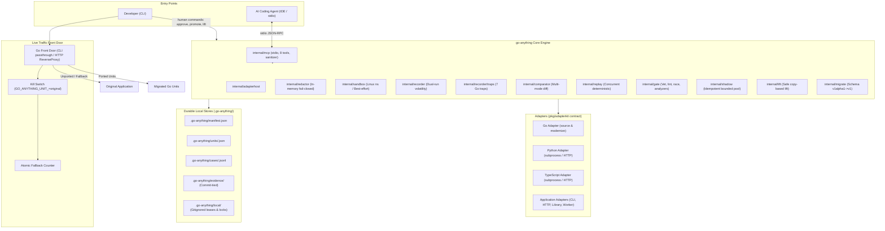
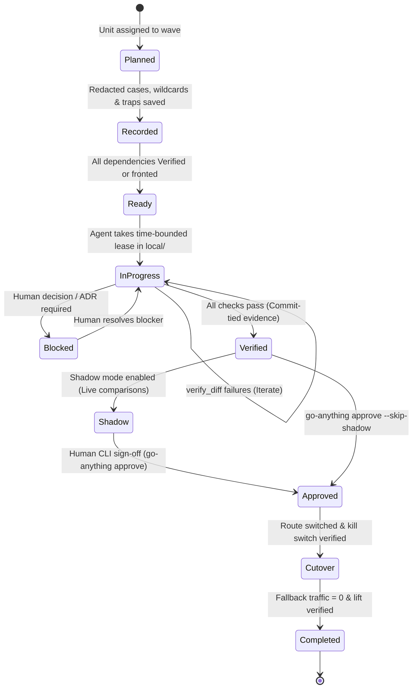

# go-anything: Architecture & Implementation Plan (v3)

Nov 18, 2026 · @mohammed refat

## Vision and scope

`go-anything` migrates an application to Go one unit at a time and proves each unit matches the original's recorded behavior before it ships.

It is not a code translator. The coding agent writes the Go; `go-anything` orders the work, records evidence, replays it, enforces gates, and keeps the migration state outside any chat session.

**Tagline:** Rewrite your app in Go, one piece at a time, with behavior proven against recorded cases. Parity is claimed only for recorded and fuzzed inputs, never for unobserved behavior.

**Goals**

- Incremental migration, one unit at a time, with fallback to the original
- Behavioral evidence from recorded cases, stored locally, git-friendly and reproducible
- Agent-driven development with any coding agent and any AI provider
- App-level support for CLIs, HTTP servers, libraries and workers
- Reversible cutover with a kill switch per unit
- Open source from day one: a versioned `pkg/adapterkit` contract (unstable until v1.0), fail-closed security and zero telemetry

**Non-goals**

- Translating code without an agent
- Guaranteeing equivalence for behavior nobody observed
- Deploying to production or replacing CI/CD
- Forcing a Go framework on the migrated app
- Sandboxing untrusted code: running the original is code execution, and the user must trust the repository

The design follows the strangler pattern and is inspired by `rust-anything` (MIT, by Erkam Yaman); `README.md` and `NOTICE` credit it.

## Changes since v2

v2 added security, governance and decisions. v3 fixes eight design problems found in review and restores material v2 dropped.

| v2 | v3 | Why |
| --- | --- | --- |
| Redaction strips secrets from recorded inputs | Format-preserving substitution, then the original runs on the substituted input and its output becomes the expected value | Stripped tokens or card numbers make the original fail on replay |
| Leases live in the tracked `manifest.json` | Durable state in one file per unit; leases and locks in a gitignored `local/` folder | Leases in git cause merge conflicts and stale claims in pull requests |
| `Redactor` and `ShadowPolicy` in `adapterkit` | Core owns redaction and shadow policy; adapters only declare field meaning | An external adapter must not be able to bypass fail-closed redaction |
| No adapter threat model | Adapters are executables with the user's privileges: explicit install, pinned checksums, declared capabilities | A malicious adapter is a supply-chain risk |
| `record_cases` runs the original freely | Recording runs in a restricted environment: no network, env allowlist, temp working copy, time and memory limits | An agent request must not become unrestricted code execution |
| Prompt-injection guardrails presented as a fix | Stated as risk reduction; the main control is that no agent tool can promote or lift | Delimiters do not make untrusted text safe |
| "Stable `adapterkit`" and schema `v1alpha1` together | "Versioned, unstable until v1.0" | The two claims contradicted each other |
| M0 and M1 in one milestone | Split into six smaller milestones before the freeze; weeks restored as estimates; `lift` proven by M2 | One milestone held half the project |
| Scorecard shows `Mismatches: 0` | Scorecard shows cases by kind and coverage of the original | A bare zero reads as proof of parity |
| Python via `c-shared` first | Subprocess or HTTP transport first; `c-shared` only after it is tested | Embedding the Go runtime in CPython raises GIL, fork and signal problems |
| Go-to-Go traps, shadow warning, risk table, capture design dropped | Restored below | They were load-bearing |

## Architecture



People use the CLI and agents use the MCP server; both call the same core, so rules are enforced in one place. State and evidence stay in stores outside any agent session, and only the Go front door sits in front of live traffic.

**Workspace in the migrated project:**

```text
.go-anything/
  manifest.json   index of units, schema_version
  units/          one durable state file per unit
  local/          leases and locks (gitignored)
  rules.json      auto-detected wildcards and normalizers
  cases/          redacted cases, one JSONL per unit
  reports/        diffs, benchmarks, shadow mismatches, scorecard
  evidence/       gate reports tied to a git commit
```

**Repository layout of `go-anything` itself:**

- `cmd/go-anything/` for the CLI and `go-anything mcp`
- `pkg/adapterkit/` for the public adapter contract, schema Go types, and `pkg/adapterkit/conformance/`
- `internal/`:
  - Core lifecycle & stores: `state`, `frontdoor`, `lift`, `migrate`
  - Engine & security: `redactor`, `sandbox`, `adapterhost`
  - Analysis & planning: `analyzer`, `planner`
  - Behavioral verification: `recorder` (with `traps` and `capture`), `comparator`, `replay`
  - Quality & telemetry-free ops: `gate` (with `analyzers` and `scorecard`), `bench`, `shadow`, `mcp` (with `sanitize`)
- `adapters/source/` with `golang` first, then `python`, `typescript` and others
- `adapters/application/` with `cli`, `http`, `library`, `worker`
- `schemas/` with versioned JSON Schemas (`v1alpha1` and frozen `v1`) for manifest, units, rules, cases, reports and evidence
- `skills/`, `templates/`, `Docs/decisions/`, `Docs/case-studies/`

## Extensibility: `pkg/adapterkit`

`pkg/adapterkit` and `schemas/` are a versioned public contract that lets contributors write adapters without forking the core; the contract may change until v1.0.

1. **Transport-agnostic:** `LanguageAdapter` and `Replay` work over an abstract `Transport` (`InProcess`, `Subprocess`, `HTTP`, `CShared`), never assuming in-process execution.
2. **Schema versioning:** every JSON or JSONL file in `.go-anything/` carries a `schema_version` header. A breaking change needs a major bump and a `go-anything migrate` command.
3. **Pluggable agent templates:** `CLAUDE.md`, `.cursorrules` and Codex or Gemini skill files are loaded as templates, not hardcoded strings.

**Who owns what:**

| Owner | Responsibility |
| --- | --- |
| Adapter | Parsing, dependency discovery, types, running the original, test discovery, replay driver, coverage limits, and declaring what each field means (secret, volatile, ordered) |
| Core | Redaction, shadow policy, comparison, state machine, evidence, sandbox, quality gate |

The split matters for safety: an adapter describes the data and the core decides what to do with it, so no adapter can switch off fail-closed redaction.

**Adapter protocol:** external adapters run as subprocesses speaking JSON over `stdio` and declare their capabilities up front (read the repository, run the original, use the network). The core refuses any action an adapter did not declare.

## Unit lifecycle



Every unit has its own state file under `.go-anything/units/`, never in an agent conversation. The server rejects any transition whose evidence is missing; a failed verification sends the unit back to In progress, and the original stays authoritative until Completed.

**Claims:** an agent claims a unit with a lease (`owner` and `expires_at`) kept in the gitignored `local/` folder, so claims never appear in pull requests. An expired lease returns the unit to Ready, so a crashed agent never blocks the migration. State files are written atomically under a file lock.

| State | Evidence required to enter it |
| --- | --- |
| Planned | Unit sits in a wave; dependencies and risk recorded |
| Recorded | Redacted cases with wildcards and traps saved for the unit |
| Ready | Every dependency is Verified or fronted by the original |
| In progress | A claim with a live local lease; Blocked when the agent needs a human decision |
| Verified | Build, test, replay, API and gate reports plus the commit they ran on |
| Shadow | Shadow mode switched on for the unit |
| Approved | A recorded human sign-off from the CLI |
| Cutover | Route switched and the kill switch tested |
| Completed | Fallback traffic at zero and the gate re-run on the final code |

**Evidence profiles:** each unit is verified under one of two profiles recorded in its state file. `replay` needs zero mismatches on the recorded cases and is used until the full gate exists in M4. `full` needs every check in the quality gate and is the default from M4 on. A tagged release counts a unit as Completed only under `full`.

## Security and data safety

`go-anything` records traffic and shows diffs to AI agents, so these controls are on by default; none of them is a guarantee.

1. **Fail-closed redaction (core, `internal/redactor`).** It runs in memory before anything reaches disk. Built-in detectors cover `Authorization`, `Cookie`, `Set-Cookie`, JWTs, API keys, PEM blocks, emails and card-number patterns. If a payload cannot be parsed, or a high-confidence secret appears in an unexpected field, the case is dropped and the recording step fails unless `--unsafe-allow-unredacted` is passed.
2. **Format-preserving substitution.** A redacted value is replaced by a synthetic one of the same shape: a token of the same length and prefix, a card number that passes the Luhn check on a test BIN, an email on a reserved domain. The original then runs on the substituted input and its response is recorded, so replay compares like with like. A field the original checks against real data (a signature or MAC) is marked `unreplayable` and excluded, not faked.
3. **Restricted recording and replay.** The original runs with no network (`--allow-network` opts in), an environment allowlist, a temporary working copy, and time and memory limits. Where Linux namespaces are available the runner uses them; elsewhere it warns that isolation is best effort. Running the original is still code execution, so the repository must be trusted first.
4. **Adapter threat model.** External adapters are executables with the user's privileges. They are installed explicitly, never downloaded automatically, checked against a pinned checksum, and limited to the capabilities they declare.
5. **Prompt-injection risk.** Recorded traffic can carry instructions aimed at the agent. When `inspect_unit` or `verify_diff` returns payloads, strings are truncated, control characters are stripped, and values are wrapped in data delimiters with a warning. That lowers the risk without removing it. The real control is that no MCP tool can promote, lift or change routing.
6. **Local only.** `go-anything mcp` speaks `stdio` with no network listener, and the tool sends no telemetry and uploads nothing. `go-anything doctor` checks for committed secrets, gitignore coverage of raw captures, and unsafe settings.

## Recording and verification

A unit is verified by replaying recorded cases against the port, so the quality of the recording decides how much a pass is worth.

**Where cases come from:** examples in the docs (`curl` lines, CLI commands), existing tests, an inputs file the user supplies, captured traffic after redaction, and generated edge cases and fuzz inputs.

**How a case is recorded:** the original runs each case twice, on the redacted and substituted input. Fields that differ between the two runs (timestamps, UUIDs, request ids) become wildcards stored with the cases. Cases are versioned JSONL carrying `source_revision`, `runtime` and `captured_at`, and each one has a `kind`: happy path, edge, trap, fuzz or captured.

**Semantic traps for a Go target** are generated as extra cases so the diff can catch them:

| Trap | Why it bites |
| --- | --- |
| Empty collections | A nil slice marshals to `null`, an empty one to `[]` |
| HTML escaping | `encoding/json` escapes `<`, `>` and `&` by default |
| Map key order | Go sorts keys on marshal; the original may keep insertion order |
| Numbers | Untyped JSON numbers decode to `float64`; int64 overflow, `-0`, NaN, float formatting |
| Strings | UTF-16 vs UTF-8 offsets, rune vs byte slicing, `\r\n` vs `\n` |
| Time | Formats, zones, and sub-second precision |
| Error paths | Malformed input, missing fields, non-zero exit codes |

**Comparator modes:** exact, structural JSON, numeric tolerance, error equivalence (type or message), HTTP contract, and filesystem snapshot. It tells apart missing vs null, integer vs float, and ordered vs unordered data. Every mismatch is saved as a reproducible case.

**What a pass means:** all recorded cases passed, not coverage of all behavior. Where the runtime supports it, recording also measures coverage of the original, so untested code is visible, and `unreplayable` fields are listed instead of hidden.

## Front door and bridges

The default is a Go front door: it becomes the app's entry point, serves migrated units itself, and forwards everything else to the original, so the external contract never changes.

| App type | Mechanism | Unported traffic |
| --- | --- | --- |
| CLI | Go binary parses `argv`, runs ported subcommands natively | `os/exec` of the original with the same `argv`, `stdin` and env; `stdout`, `stderr` and exit code pass through |
| HTTP server | `httputil.ReverseProxy` with a route table | Proxied to the original on a local port; auth and CORS middleware wrap both paths |
| Go library | Facade package with mode `old`, `shadow` or `new` | Calls the original package in process |
| Foreign library | Subprocess or HTTP first; `c-shared` via cgo or wazero later; koffi or N-API for Node | Stays in the original language behind the wrapper |
| Worker or service | Separate Go process over HTTP, gRPC, Unix socket, `stdio` or a broker | Original keeps consuming what Go does not |

**Python bridge order:** the first transport is a subprocess (or HTTP for services). `c-shared` embeds the Go runtime inside CPython, which raises GIL, fork and signal-handling problems, so it ships only after those cases are tested.

Each adapter picks its bridge and declares limits: ABI compatibility, memory ownership, error mapping and concurrency are checked per bridge, and C ABI is never assumed.

Every wired unit has a kill switch, `GO_ANYTHING_UNIT_<id>=original`, that sends it back to the original without a redeploy. The front door counts each fallback, and `lift` requires that count to be zero.

## Go source adapter: legacy Go to modern Go

Go is the first source adapter (`go-anything init --source=go`, aliased as `go-anything modernize`) because both sides are Go: old and new run in one process, with no bridge and none of the cross-language traps.

**Analysis** uses `go/packages`, `go/types` and the call graph from `golang.org/x/tools`. A unit is a package, waves come from the import graph, and import cycles move together.

**Three tiers of change**, so the tool does not compete with existing ones:

| Tier | What | Done by |
| --- | --- | --- |
| 1. Mechanical | `go fix`, modernize analyzers, `golangci-lint --fix`; run first on a branch and checked by existing tests | Tools |
| 2. Idiomatic | `%w` with `errors.Is/As`, `context` plumbing, `slog`, modern `net/http` routing, generics, fewer globals and `init` | Agent |
| 3. Architectural | Monolith to Clean or Hexagonal, new package boundaries | Agent |

**Workspace:** the frozen original lives in `legacy/` (module `replace` or a separate import path) and the new code in `modern/`.

**Verification:** a generated parity driver calls the public API of both versions with the same inputs and compares results and errors with `go-cmp`, catching panics with `recover`. Differential fuzzing with `go test -fuzz` feeds both versions and saves any difference as a case. Characterization cases recorded from the legacy code are stored as JSONL.

**Traps specific to Go to Go:**

- Raising the `go` directive in `go.mod` changes behavior (loop variable semantics, `GODEBUG` defaults, `ServeMux` patterns), so it is its own unit with replay before and after
- Map iteration order is random: sort before comparing
- `time.Now`, randomness and environment must be injected so results are deterministic
- Functions that mutate their arguments need a deep copy per version
- Goroutines: `-race` is mandatory and comparison waits for all of them to finish
- Code relying on `reflect`, struct tags or unexported behavior needs explicit cases

**Integration:** the old package becomes a facade routing to old or new by mode, HTTP handlers switch through a registry per route, and in-process shadow is a generic `Shadow[T](old, new)` with a bounded worker pool and a cloned input.

## Concurrency model

Concurrency speeds up recording, replay and analysis, but results must stay deterministic and cases must not interfere with each other.

| Area | Design |
| --- | --- |
| Replay | Worker pool with `errgroup` and `SetLimit`; each case gets its own temp dir and port; results sorted by `case_id` |
| Record | Cases run in parallel; each case runs twice to find volatile fields |
| HTTP cases with state | Serial inside one sequence, parallel across independent sequences; every sequence starts a fresh server instance |
| Batch fan-out | Items enter once, the function runs over all of them on every core, results return in input order |
| Analysis | Units in the same wave are independent and can be analyzed and ported in parallel |
| Shadow | Bounded worker pool, cloned request; overflow is dropped and counted, never queued without limit |
| Front door | `net/http` handles concurrency natively; an unported route costs one proxy hop |
| State files | One file per unit, written to a temp file, synced, then renamed, under an OS file lock |

**Rules**

- `--jobs N` limits parallelism, default `runtime.NumCPU()`, because dozens of interpreter processes can choke a machine
- Reports and diffs are ordered by `case_id`, never by completion time
- Leases and locks live in the gitignored `local/` folder and coordinate agents on one machine; teams on several machines coordinate through pull-request ownership of a unit
- `go test -race` is part of the gate for every ported unit

## Quality gate and parity scorecard

A unit reaches `verified` only when every check below passes and its report is stored in `.go-anything/evidence/`, tied to the current git commit.

| Check | Tool |
| --- | --- |
| Build and format | `go build ./...` and `gofmt -s` |
| Static analysis | `go vet`, `staticcheck`, `golangci-lint` with `errcheck` and `forcetypeassert` |
| Custom rules | Own analyzers for `panic` in handlers and goroutines without context or a pool |
| Tests and races | `go test -race ./...` |
| Vulnerabilities | `govulncheck` |
| Recorded behavior | Replay of every case with zero mismatches, plus a failing case for every error the original returns |
| API compatibility | `apidiff` or `gorelease` for Go to Go; contract checks elsewhere |
| Benchmark | `bench` records latency and allocations; informational, never blocking |

**Scorecard:** after a pass, `.go-anything/reports/scorecard.md` summarizes each unit so it can go into a pull request. It shows cases by kind, mismatches, coverage of the original where the runtime supports it, the race detector result, and the fields marked `unreplayable`.

Example line: `Units 12/12 · Cases 4,820 (happy, edge, trap, fuzz, captured) · Mismatches 0 · Original coverage 71%`. A zero for mismatches is never shown alone, because it says nothing about behavior nobody recorded.

## Shadow mode and production capture

Shadow mode runs the Go handler beside the original on real requests, returns the original's response, and logs every difference; it checks recorded confidence against live traffic.

**Modes:** `GO_ANYTHING_MODE=old|shadow|new`, set globally or per unit.

**Defaults:**

- Only idempotent requests (`GET`, `HEAD`) are shadowed
- A bounded worker pool runs the clone; overflow is dropped and counted
- A sample rate limits load
- Mismatches are redacted in memory before they are appended to `shadow_mismatches.jsonl`

**Side effects:** `--allow-side-effects` enables shadowing of non-idempotent requests and prints this warning at startup:

> Shadow execution runs the Go handler on real requests. Non-idempotent handlers may repeat writes or external calls. Run against isolated data or stubs. You are responsible for the consequences.

**State caveat:** the shadow reads state after the original has already written it, which can produce false mismatches. Compare idempotent reads, or give the shadow a snapshot.

**Production capture:** traffic mirroring at the gateway or a sidecar, broker consumers and traces feed the recorder, and everything passes through fail-closed redaction first. A read-only observability source such as `platform-mcp` can supply decoded traffic. `go-anything` stays a separate engine, so the observability tool never gains control over routing.

## MCP server and agent workflow

`go-anything mcp` exposes the migration to any coding agent over `stdio`, and the server enforces the state machine, so an agent cannot skip a gate or promote unverified code.

| Tool | Purpose |
| --- | --- |
| `status` | Progress, next unit in dependency order, active leases, blockers |
| `claim_unit` | Takes a unit with a time-bounded local lease so agents on one machine never collide |
| `inspect_unit` | Original source, sanitized sample cases, detected traps, constraints |
| `record_cases` | Runs the original in the restricted environment, applies fail-closed redaction, saves JSONL |
| `verify_diff` | Builds the port, replays all cases, returns `PASS` or the top sanitized mismatches |
| `run_gate` | Runs the quality gate, writes the scorecard, stores evidence |
| `mark_verified` | Moves the unit to `verified` only if evidence tied to the commit exists |
| `handoff` | Writes `HANDOFF.md` with state and next steps for the next session |

`promote` and `lift` are CLI-only commands reserved for a human.

**Agent loop:** claim, inspect, port, `verify_diff`, fix, `run_gate`, `mark_verified`, handoff. Instruction templates tell the agent to follow this loop and to ask a human about any decision the plan does not settle.

**Decision log:** choices only a human can make are recorded as short ADRs in `DECISIONS.md`, with the recommended answer beside each question.

## Open-source release and governance

The rollout is lean: enough to earn trust without drowning an early project in process.

1. **Day-1 files:** `LICENSE` (Apache-2.0), `NOTICE` crediting `rust-anything`, `README.md` with an explicit parity disclaimer and a five-minute vertical-slice quickstart, `SECURITY.md` with the threat model and disclosure policy, and a short `CONTRIBUTING.md`.
2. **Supply chain:** releases built by `goreleaser` in GitHub Actions, checksums and binaries signed with `cosign`, `govulncheck` in CI, and Dependabot.
3. **Evidence over claims:** no "100% magic rewrite" wording. Each major release ships with a public dogfooding case study that shows commits, recorded cases and the scorecard.
4. **Governance:** `GOVERNANCE.md` arrives with the v1.0 freeze of `pkg/adapterkit` and the schemas, once there are outside contributors to govern.

## Decisions and risks

All foundational and architectural pre-M0 decisions are settled and documented in `DECISIONS.md`.

- [x] **License:** Apache-2.0, for its explicit patent grant while staying permissive
- [x] **State store:** JSON and JSONL files with atomic writes and file locks, so state is reviewable in pull requests
- [x] **First non-Go adapter:** Python, with subprocess and HTTP transports first
- [x] **`modernize`:** a mode of the Go adapter (`go-anything init --source=go`) with `go-anything modernize` as an alias
- [x] **Sandbox backend:** Native Linux namespaces with `bubblewrap` fallback; best-effort isolation with env stripping and invalid proxy sinks on Windows/macOS ([ADR-001](decisions/adr-001-sandbox-backend.md))
- [x] **Cross-machine claims:** Pull-request and branch ownership is sufficient through v1.0; local leases in `.go-anything/local/` coordinate agents on a single machine without an external claim service ([ADR-002](decisions/adr-002-cross-machine-claims.md))

**Risks**

| Risk | Mitigation |
| --- | --- |
| Recorded cases miss real behavior | Differential fuzzing, coverage of the original, shadow on live reads |
| Replay depends on database state | Seed data or snapshots per case; isolated test database |
| Substituted values change behavior | Mark validated fields `unreplayable`; review substitution rules per adapter |
| Shadow repeats side effects | Idempotent-only default; explicit flag with a warning |
| Running the original executes untrusted code | Restricted environment, a trust-the-repository warning, and no network by default |
| Malicious or buggy adapter | Explicit install, pinned checksum, declared capabilities |
| Agents skip or fake gates | Server-enforced state machine; evidence required for every transition |
| Each language adapter is large | One adapter at a time; transport-agnostic interface |
| Scope grows to "everything" | App-level record and replay first; libraries and workers later |

## Roadmap

```mermaid
flowchart LR
    M0["M0: Foundation<br/>State, Redactor, Sandbox, Doctor"] --> M1["M1: MVP<br/>Record, Replay, Traps, Comparator"]
    M1 --> M2["M2: Strangler<br/>Front Door, Kill Switch, Lift"]
    M2 --> M3["M3: Go Modernize<br/>Analysis, Waves, Facade, Parity"]
    M3 --> M4["M4: Quality Gate & MCP<br/>Full Gate, Scorecard, Agent Tools"]
    M4 --> M5["M5: Shadow & v0.1.0<br/>Live Shadow, Capture, Dogfooding"]
    M5 --> M6["M6: Python & v0.2.0<br/>Py Adapter, Worker Sidecars"]
    M6 --> M7["M7: Freeze & v1.0.0<br/>TS Adapter, Schema v1, Migrate, Lift"]
```



M1 is the MVP: sandboxed record and replay prove behavior from outside the app, with no language adapter needed. Each milestone passes its gate before the next starts, and M6 repeats once per added language. `lift` is proven by M2, long before the freeze. Until the quality gate exists in M4, units are verified under the replay-only evidence profile.

| Release | Milestones | What users get |
| --- | --- | --- |
| v0.0.x | M0 to M2 | Record, replay, front door, kill switch and lift for CLI and HTTP apps |
| v0.1.0 | M3 to M5 | Go adapter, MCP server, quality gate, scorecard, shadow mode and the first public case study |
| v0.2.0 | M6 | Python adapter with its own case study |
| v1.0.0 | M7 | Frozen `pkg/adapterkit` and schemas, TypeScript adapter, `GOVERNANCE.md` |

**Dogfooding:** each stage is accepted on a real project. M3 uses a legacy Go service of yours, M4 has an agent port one of its units, M5 publishes it as a case study, M6 ports a Python CLI and a FastAPI service, and M7 lifts a multi-unit open-source project.
