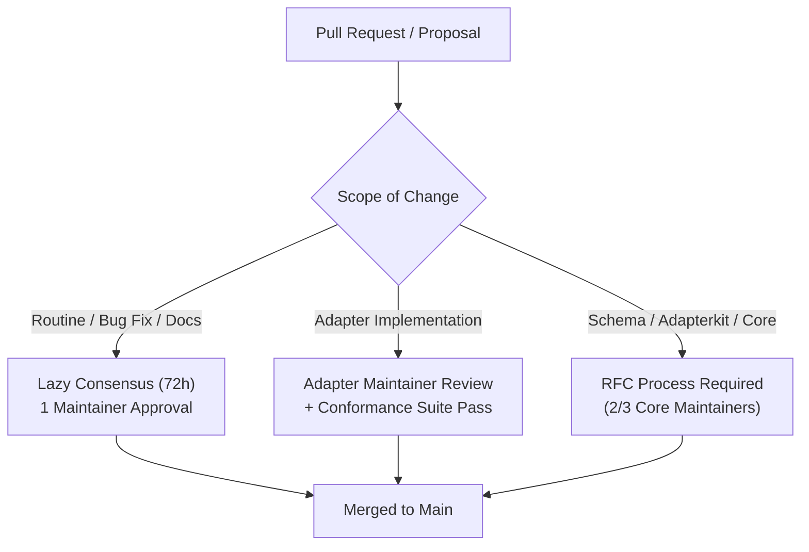

# Project Governance

> Governance model, maintainer responsibilities, decision-making procedures, and certification standards for `go-anything`.

---

## 1. Overview and Principles

`go-anything` is an open-source framework designed to migrate legacy applications to modern Go incrementally—one bounded unit at a time—using the strangler pattern backed by recorded behavioral evidence.

The project operates under four core governance principles:

1. **Evidence Over Assumptions:** Parity claims must be anchored in verified behavioral cases and rigorous quality gates. Parity is asserted only for observed and fuzzed inputs, never as a blanket claim for unobserved execution paths.
2. **Fail-Closed Safety & Security:** Security controls—such as in-memory credential redaction, no-network sandboxing, and local-first execution with zero telemetry—are non-negotiable core invariants that no adapter or configuration may bypass.
3. **Human Authority on Routing & Cutover:** Destructive, promotional, or routing operations (`approve`, `promote`, `lift`, and cutover routing) remain strictly under human control via interactive CLI commands and are never delegated to autonomous MCP tools.
4. **Open and Transparent Collaboration:** Technical discussions, RFC evaluations, architectural decisions, and release planning take place publicly in open repositories, issue trackers, and pull requests.

---

## 2. Maintainer Roles & Responsibilities

The project defines three tiers of contributors and maintainers:

```
┌────────────────────────────────────────────────────────┐
│                   Core Maintainers                     │
│  - Architecture, state machine, sandbox, redactor      │
│  - RFC approvals, schema stability, release signing    │
└──────────────────────────┬─────────────────────────────┘
                           │
┌──────────────────────────▼─────────────────────────────┐
│                  Adapter Maintainers                   │
│  - Language source adapters & application adapters    │
│  - Conformance suite compliance (pkg/adapterkit)       │
└──────────────────────────┬─────────────────────────────┘
                           │
┌──────────────────────────▼─────────────────────────────┐
│                     Contributors                       │
│  - Human engineers & autonomous AI coding agents       │
│  - Bug fixes, features, docs, test coverage            │
└────────────────────────────────────────────────────────┘
```

### 2.1 Core Maintainers

Core Maintainers hold ultimate technical and operational responsibility for `go-anything`.

- **Scope:**
  - Core engine packages (`internal/state`, `internal/redactor`, `internal/sandbox`, `internal/gate`, `internal/replay`, `internal/comparator`, `internal/shadow`).
  - Public adapter API (`pkg/adapterkit`) and official JSON schemas (`schemas/v1/`).
  - Command-line interface (`cmd/go-anything/`) and Model Context Protocol (MCP) server (`internal/mcp/`).
  - Security incident triage, patch deployment, and cryptographic release signing (`cosign`, `goreleaser`).
- **Responsibilities:**
  - Guide architectural direction through Architecture Decision Records (ADRs).
  - Triage and adjudicate RFC proposals affecting frozen schemas or public contracts.
  - Review and approve pull requests touching core boundaries.
  - Safeguard the ten-state unit lifecycle and fail-closed security invariants.
  - Maintain build and continuous integration health across supported platforms.
- **Appointment:** Candidates are proposed by existing Core Maintainers based on sustained high-quality contributions, deep architectural comprehension, and active community participation. Appointment requires unanimous consensus among active Core Maintainers.

### 2.2 Adapter Maintainers

Adapter Maintainers oversee language-specific and application-specific adapters that extend `go-anything`.

- **Scope:**
  - Source language adapters (`adapters/source/golang`, `adapters/source/python`, `adapters/source/typescript`, etc.).
  - Application runtime adapters (`adapters/application/cli`, `adapters/application/http`, foreign library wrappers, worker sidecars).
  - Conformance test suites and integration fixtures for their respective ecosystems.
- **Responsibilities:**
  - Maintain 100% compliance with `pkg/adapterkit/conformance`.
  - Track ecosystem evolution (e.g., Go compiler versions, Python AST changes, Node/TypeScript runtime updates).
  - Identify and document language-specific semantic traps (e.g., JSON nil vs empty slice distinctions, map key ordering, numeric precision, timezone representations).
  - Review contributions affecting their specific adapter domains.
- **Appointment:** Nominated by any contributor or maintainer upon demonstrating domain expertise and maintaining a conformant adapter. Appointment requires approval from at least two Core Maintainers.

### 2.3 Contributors

Contributors encompass all individuals, teams, and autonomous AI agents submitting changes to the repository.

- **Scope:** Bug reports, documentation updates, test fixtures, performance enhancements, and new adapter prototypes.
- **Responsibilities:**
  - Adhere to the coding standards, testing conventions, and verification steps in `CONTRIBUTING.md`.
  - Pass the mandatory Rule 5 verification gate (`gofmt -s -w .`, `go vet ./...`, `go test -race ./...`, `govulncheck ./...`) before marking any task ready for review.
  - Abide by the project Code of Conduct and security guidelines in `SECURITY.md`.
  - For AI agent contributors: respect workspace boundaries, observe local lease mechanics in `.go-anything/local/`, never forge gate evidence, and never attempt to bypass server-enforced state transitions.

### 2.4 Inactivity and Emeritus Status

Maintainers who have been inactive for six consecutive months may be transitioned to Emeritus status by agreement of the Core Maintainers. Emeritus maintainers retain public acknowledgment of their contributions and may request reinstatement through a standard review.

---

## 3. Decision Making & Consensus

`go-anything` uses a consensus-seeking model designed to balance rapid technical progress with thorough architectural rigor.



### 3.1 Lazy Consensus (Routine Changes)

For documentation, bug fixes, performance optimizations, and non-breaking internal changes:
- Any maintainer may approve and merge after a **72-hour review window** if no objections are raised.
- If any maintainer objects, the change pauses until the objection is discussed and resolved.

### 3.2 Formal Consensus (Core & Adapter Changes)

- Pull requests altering `internal/` packages require explicit review and approval from at least **one Core Maintainer**.
- Pull requests modifying adapter implementations require approval from the designated **Adapter Maintainer** and must demonstrate **100% pass on the conformance test suite**.

### 3.3 Escalation and Voting

When consensus cannot be reached through technical discussion:
- The matter is escalated to the Core Maintainers.
- A formal vote is conducted where each Core Maintainer has one vote.
- Approval requires a **two-thirds (2/3) supermajority** of all active Core Maintainers.
- The outcome and rationale are documented publicly in an Architecture Decision Record (ADR) under `Docs/decisions/`.

---

## 4. RFC (Request for Comments) Process

The Request for Comments (RFC) process ensures that breaking changes, schema evolutions, and fundamental architectural shifts receive thorough scrutiny before implementation.

### 4.1 When an RFC is Mandatory

An RFC is strictly required for:

1. **Schema Evolutions:** Any proposed changes to JSON Schemas in `schemas/v1/` (`manifest`, `units`, `rules`, `cases`, `reports`, `evidence`), or the creation of `schemas/v2/`.
2. **Public Contract Changes:** Any modification, addition, or deprecation within `pkg/adapterkit`.
3. **Core Architectural Shifts:** Alterations to the ten-state unit lifecycle, evidence profile definitions, sandbox backend architecture, or state persistence models.
4. **New First-Party Adapters:** Ingestion of a new source language or application runtime into the core repository.

### 4.2 RFC Lifecycle

```
[Proposal Draft] ──► [Public Review (≥14 Days)] ──► [Final Comment Period (7 Days)] ──► [Resolution]
                                                                                              │
                                                          ┌───────────────────────────────────┴───────┐
                                                          ▼                                           ▼
                                                      [Accepted]                                  [Rejected]
                                             (Assigned ADR & Milestone)                    (Archived with Rationale)
```

1. **Proposal Draft:** The author opens an issue or pull request using the RFC template, detailing:
   - Summary and Motivation
   - Proposed Technical Design
   - Backward Compatibility & Migration Strategy (including `go-anything migrate` implications)
   - Fail-Closed Security & Threat Model Impact
   - Alternatives Considered
2. **Public Review Period:** The proposal remains open for community review and prototyping for a minimum of **14 calendar days**.
3. **Final Comment Period (FCP):** A Core Maintainer initiates a 7-day FCP when the design has stabilized and consensus appears near.
4. **Resolution:**
   - **Accepted:** The RFC is formally approved by a 2/3 Core Maintainer supermajority, assigned an ADR number in `Docs/decisions/`, and scheduled for a release milestone.
   - **Rejected:** The rationale is documented and the proposal is closed.
   - **Postponed:** Marked for re-evaluation in a future roadmap cycle.
5. **Implementation & Stability Guarantees:**
   - Changes must provide backwards compatibility or an automated migration via `go-anything migrate`.
   - Deprecations must remain functional across at least one minor release cycle before removal.

---

## 5. Adapter Certification & Conformance Requirements

`go-anything` maintains a strict decoupled boundary between the migration core and language adapters. External and third-party adapters can be plugged in without recompiling the core, but they must meet rigorous certification standards.

### 5.1 The Conformance Test Suite

To be certified as an official or compatible adapter, an implementation must pass **100% of the checks** in the official conformance suite provided by `pkg/adapterkit/conformance`:

```go
import (
    "testing"
    "github.com/mohammedrefat/go-anything/pkg/adapterkit/conformance"
)

func TestMyAdapter_Conformance(t *testing.T) {
    adapter := NewMyCustomAdapter()
    conformance.RunSuite(t, adapter, conformance.Config{
        SampleDir:  "./testdata/sample_project",
        SampleUnit: "unit-auth",
    })
}
```

Alternatively, adapters can invoke programmatic validation returning structured compliance reports:

```go
report := conformance.NewSuite(adapter, cfg).Validate(ctx)
if !report.Passed {
    t.Fatalf("conformance failed: %v", report.Violations)
}
```

### 5.2 The Eight Conformance Dimensions

Certified adapters must satisfy all eight verification checks executed by the conformance runner:

| Check | Description | Enforcement Standard |
| :--- | :--- | :--- |
| **1. Metadata (`CheckMetadata`)** | Adapter identification and protocol compatibility | Valid non-empty `Name`, semantic `Version`, recognized `SourceLanguage`, and at least one transport (`InProcess`, `Subprocess`, `HTTP`, `CShared`). |
| **2. Detection & Environment (`CheckDetectionAndEnv`)** | Workspace detection and runtime verification | Implements `adapterkit.Detector` and `adapterkit.EnvironmentChecker`. Correctly identifies project manifests (e.g. `package.json`, `go.mod`, `pyproject.toml`) and reports missing tools. |
| **3. Capability Guard (`CheckCapabilities`)** | Declaration of privilege boundaries | Declares only necessary capabilities (`read_repo`, `run_original`, `network`). The core's `CapabilityGuard` blocks any undeclared operation with `ErrUndeclaredCapability`. |
| **4. Field Semantics (`CheckFieldSemantics`)** | Behavioral field metadata | Correctly identifies and tags fields with semantics (`secret`, `volatile`, `ordered`). **Must never** bypass or attempt to replace core in-memory redaction. |
| **5. Analysis & Discovery (`CheckAnalysisAndDiscovery`)** | Dependency graphing and wave planning | Implements `DependencyAnalyzer` and `TestDiscoverer`. Parses imports/packages into a directed acyclic graph and plans valid dependency waves without cycles. |
| **6. Case Schema Integrity (`CheckCaseSchema`)** | Fixture schema adherence | Emitted behavioral cases conform strictly to `schemas/v1/cases.schema.json` with mandatory `schema_version`, valid JSON types, and sanitized payloads. |
| **7. Multi-Transport Replay (`CheckReplayAcrossTransports`)** | Deterministic case execution | Validated replay drivers execute cases across all declared transports, producing deterministic execution results sorted by `case_id`. |
| **8. Parity & Coverage Limits (`CheckCoverageLimits`)** | Honest evidence boundaries | Must declare explicit limits of observation. Must not claim blanket parity or make equivalence claims for unobserved execution paths. |

### 5.3 Adapter Security Invariants

- **Isolated Execution:** External adapters execute in a restricted sandbox (`internal/sandbox`) with an environment allowlist, CPU/memory limits, and network isolation by default.
- **Supply Chain Integrity:** External adapter binaries must be explicitly registered with a pinned SHA-256 checksum in `.go-anything/manifest.json`. Unverified or dynamically downloaded adapters are strictly rejected.
- **Core Boundary Isolation:** Adapters must interact exclusively through `pkg/adapterkit` and may **never** import `internal/` packages.

---

## 6. Security Response & Vulnerability Management

The `go-anything` security model prioritizes safe, local-first execution. Security policies, threat models, and vulnerability workflows are maintained in detail in [SECURITY.md](SECURITY.md).

### 6.1 Vulnerability Reporting

If you identify a security issue, vulnerability, or secret redaction bypass:
- **Do not open a public issue.**
- Submit a confidential report via [GitHub Security Advisories](https://github.com/mohammedrefat/go-anything/security/advisories) or email the Core Maintainers directly.
- Include reproduction steps, affected versions, and sample test fixtures where applicable.

### 6.2 Response SLA & Disclosure Workflow

```
[Report Received] ──► [48h SLA: Acknowledgment] ──► [Triage & Patch Development] ──► [Private Verification] ──► [Coordinated Release]
```

1. **Acknowledgment:** Maintainers will acknowledge the report within **48 hours** with an initial triage classification.
2. **Remediation & Patching:** Fixes are prepared in private repositories. All patches must pass the full Rule 5 verification gate and include regression tests.
3. **Coordinated Disclosure:** Security advisories and patched releases are published within **30 to 90 days** depending on vulnerability severity, or sooner with mutual agreement.
4. **CVE Assignment:** Common Vulnerabilities and Exposures (CVE) identifiers are requested and published alongside the GitHub Security Advisory.

---

## 7. Code of Conduct

`go-anything` is dedicated to providing a respectful, harassment-free, and professional environment for all contributors, maintainers, and community members.

### 7.1 Community Standard

We adopt the **Contributor Covenant (version 2.1)** as our standard for community interaction:
- Welcome diverse viewpoints and constructive collaboration.
- Focus on what is best for the project and its users.
- Demonstrate empathy, professional courtesy, and respect toward other contributors.
- Respect the time and focus of human maintainers and autonomous contributors alike.

### 7.2 Enforcement

Instances of abusive, harassing, or unacceptable behavior may be reported to the Core Maintainers. All complaints will be investigated promptly and handled with discretion. Core Maintainers reserve the right and responsibility to remove, edit, or reject comments, commits, issues, and pull requests that do not align with this Code of Conduct.

---

## 8. Amendments to Governance

Amendments to this governance document must be submitted via the **RFC Process** described in Section 4. Approval requires a **unanimous vote** among active Core Maintainers.
