<div align="center">

  

  <h1>go-anything</h1>
  <p><strong>الانتقال من أي لغة برمجية إلى لغة Go الحديثة — وحدة برمجية موثقة ومحققة واحدة تلو الأخرى.</strong></p>
  <p>استبدل عمليات إعادة الكتابة الشاملة وعالية المخاطر بنمط الهجرة التدريجي (Strangler Fig)،<br />المعزز بأدلة سلوكية مسجلة، وبوابات جودة مؤتمتة، مع إشراف وتحكم بشري مباشر.</p>

  <p>
    <a href="https://go.dev/"></a>
    <a href="LICENSE"></a>
    <a href="https://github.com/mohammedrefaat/go-anything/releases"></a>
  </p>

  <p>
    <a href="#التثبيت-والتحقق">التثبيت</a> ·
    <a href="#دليل-البدء-السريع-في-5-دقائق">البدء السريع</a> ·
    <a href="Docs/USER_GUIDE.md">دليل المستخدم الكامل</a> ·
    <a href="#كيف-يعمل">كيف يعمل</a> ·
    <a href="#خارطة-طريق-المراحل-الرئيسية-m0m7">خارطة الطريق</a> ·
    <a href="#القيود-المعروفة">القيود المعروفة</a> ·
    <a href="GOVERNANCE.md">الحوكمة</a> ·
    <a href="SECURITY.md">الأمان</a> ·
    <a href="Docs/go-anything%20Architecture%20%26%20Implementation%20Plan%20(v3)%20(1).md">المعمارية</a>
  </p>

  <p>
    <strong>اللغات:</strong><br />
    <a href="README.md">English</a> ·
    <a href="README.ar.md">العربية</a>
  </p>

</div>

---

## محتويات هذه الصفحة

- [كيف يعمل](#كيف-يعمل)
- [لماذا go-anything؟](#لماذا-go-anything)
- [إخلاء مسؤولية صريح حول التطابق السلوكي (Parity Disclaimer)](#إخلاء-مسؤولية-صريح-حول-التطابق-السلوكي-parity-disclaimer)
- [التثبيت والتحقق](#التثبيت-والتحقق)
- [دليل البدء السريع في 5 دقائق](#دليل-البدء-السريع-في-5-دقائق)
- [خارطة طريق المراحل الرئيسية (M0–M7)](#خارطة-طريق-المراحل-الرئيسية-m0m7)
- [القيود المعروفة](#القيود-المعروفة)
- [سير عمل وكلاء الذكاء الاصطناعي وMCP](#سير-عمل-وكلاء-الذكاء-الاصطناعي-وmcp)
- [معمارية النظام ومبادئ التصميم](#معمارية-النظام-ومبادئ-التصميم)
- [خريطة مستودع المشروع](#خريطة-مستودع-المشروع)
- [الحوكمة والمساهمة](#الحوكمة-والمساهمة)
- [الترخيص](#الترخيص)

---

## كيف يعمل

يقوم `go-anything` بترحيل التطبيقات والخدمات إلى لغة Go **وحدة برمجية واحدة تلو الأخرى**، مع إثبات تطابق سلوك كل وحدة تم ترحيلها مع السلوك المسجل للنظام الأصلي بدقة قبل اعتمادها للإنتاج.

- **ليس مترجم أكواد آلي (AST Transpiler):** يقوم المطور أو وكيل البرمجة الذكي بكتابة كود Go عصري ومثالي. بينما يتولى `go-anything` التنسيق، بيئات العزل (Sandbox)، التقاط السلوك الحقيقي، إعادة التشغيل التفاضلي، وبوابات الجودة الصارمة.
- **نمط شجرة الخناق (Strangler Fig):** يظل التطبيق الأصلي قيد التشغيل في الإنتاج. يتم استبدال الوحدات المحددة تدريجياً عبر خادم وكيل عكسي (Reverse Proxy) أو موجه جانبي (Sidecar Router) قابل للإرجاع الفوري عند الحاجة.
- **التحقق الصارم الآمن عند الإخفاق (Fail-Closed):** يتم التحقق من التطابق من خلال تشغيل المدخلات المسجلة وحالات الاختبار العشوائي (Fuzzing) عبر كلا النظامين ومقارنة المخرجات وفق قواعد حتمية.

```mermaid
flowchart LR
    A["1. تحليل شجرة الاعتماديات<br/>وتخطيط الموجات (Waves)"] --> B["2. التقاط السلوك في عازل<br/>وحجب البيانات الحساسة"]
    B --> C["3. كتابة الوحدة المستهدفة<br/>بلغة Go الحديثة"]
    C --> D["4. إعادة تشغيل تزامنية<br/>وفحص بوابات الجودة"]
    D -->|وجود فروقات أو أخطاء| C
    D -->|تحقق ناجح مع إثبات| E["5. الوضع الخفي (Shadow)<br/>مع حركة البيانات الحية"]
    E --> F["6. موافقة بشرية عبر CLI<br/>وتحويل مسار البيانات"]
    F --> G["7. إزالة الكود القديم (Lift)<br/>وإتمام المهمة"]
```



---

## لماذا go-anything؟

| إعادة الكتابة الشاملة عالية المخاطر | الترحيل التدريجي المتحقق منه (`go-anything`) |
| :--- | :--- |
| استبدال كامل المشروع مرة واحدة في خطوة محفوفة بالمخاطر | الترحيل تدريجياً حسب موجات الاعتماديات المنعزلة |
| اكتشاف الثغرات وحالات الفشل بعد الإطلاق في الإنتاج | المقارنة مع حالات حقيقية مسجلة قبل تحويل أي بيانات |
| ضياع سياق العمل والتقدم داخل محادثات شات مؤقتة | حفظ الحالة في ملفات JSON/JSONL موثقة ومحفوظة في Git |
| افتراض التطابق بناءً على اختبارات تقليدية فقط | أدلة تطابق صريحة مربوطة بمتجهات وبيانات اختبار موثقة |
| منح وكلاء الذكاء الاصطناعي صلاحيات نشر كاملة وغير منضبطة | قرارات الاعتماد والترقية `approve` و`promote` و`lift` بيد الإنسان فقط |

---

## إخلاء مسؤولية صريح حول التطابق السلوكي (Parity Disclaimer)

> [!IMPORTANT]
> **التطابق له حدود واضحة.**
>
> يُزعم التطابق السلوكي **فقط للمدخلات التي تم تسجيلها ورصدها واختبارها عبر Fuzzing**، ولا يمتد ذلك أبداً للسلوكيات أو المسارات البرمجية غير المختبرة. اجتياز اختبارات السلوك يبرهن التكافؤ ضمن مسارات الاختبار المسجلة — وهو **ليس** ضماناً رياضياً مطلقاً لتكافؤ السلوك عبر كافة المسارات غير المفحوصة.
>
> يستخدم `go-anything` نظام التسجيل المزدوج لكشف الحقول المتغيرة تلقائياً (مثل الطوابع الزمنية ومعرفات UUID) وتطبيعها، ولكن يجب على الفريق الهندسي مراجعة تقارير الفروقات وتغطية الحالات قبل التحويل النهائي للبيانات.

---

## التثبيت والتحقق

يتم توزيع `go-anything` كملفات تنفيذية موقعة رقمياً ومستقلة تماماً بدون أي اعتماديات خارجية، وكذلك عبر مديري الحزم الشائعة وسلسلة أدوات Go. تتوفر تفاصيل مصفوفة المنصات والتحقق التشفيري عبر Sigstore Cosign في [Docs/install.md](Docs/install.md) و[Docs/packaging.md](Docs/packaging.md).

### مديرو الحزم (Package Managers)

قم بتثبيت `go-anything` عبر مدير الحزم المفضل لديك:

#### Homebrew (macOS و Linux)
```bash
brew tap mohammedrefaat/tap
brew install go-anything
```

#### Scoop (Windows)
```powershell
scoop bucket add go-anything https://github.com/mohammedrefaat/scoop-bucket.git
scoop install go-anything
```

#### npm (Node.js)
```bash
npm install -g @mohammedrefaat/go-anything
```

### الملفات التنفيذية المترجمة مسبقاً (Prebuilt Binaries)

قم بتنزيل الحزمة المتوافقة مع نظام تشغيلك ومعمارية جهازك من [إصدارات GitHub الرسمية](https://github.com/mohammedrefaat/go-anything/releases):

| نظام التشغيل | المعمارية | اسم الحزمة |
| :--- | :--- | :--- |
| **Linux** | `amd64`, `arm64` | `go-anything_<version>_linux_<arch>.tar.gz` |
| **macOS** | `arm64` (Apple Silicon), `amd64` (Intel) | `go-anything_<version>_darwin_<arch>.tar.gz` |
| **Windows** | `amd64` | `go-anything_<version>_windows_amd64.zip` |

#### أنظمة Linux و macOS (عبر Bash / Zsh)

```bash
VERSION="2.0.0"
OS=$(uname -s | tr '[:upper:]' '[:lower:]')
ARCH=$(uname -m | sed 's/x86_64/amd64/' | sed 's/aarch64/arm64/')
RELEASE_URL="https://github.com/mohammedrefaat/go-anything/releases/download/v${VERSION}"
ARTIFACT="go-anything_${VERSION}_${OS}_${ARCH}.tar.gz"

# تنزيل الملف والأرقام التأكيدية والتوقيع الرقمي
curl -fsSL -O "${RELEASE_URL}/${ARTIFACT}"
curl -fsSL -O "${RELEASE_URL}/checksums.txt"
curl -fsSL -O "${RELEASE_URL}/checksums.txt.sigstore.json"

# التحقق التشفيري من التوقيع عبر Cosign (Keyless Sigstore)
cosign verify-blob \
  --bundle checksums.txt.sigstore.json \
  --certificate-identity-regexp "^https://github\.com/mohammedrefaat/go-anything/\.github/workflows/release\.yml@refs/tags/v.*$" \
  --certificate-oidc-issuer "https://token.actions.githubusercontent.com" \
  checksums.txt

# التحقق من بصمة SHA-256
if command -v sha256sum >/dev/null 2>&1; then
  sha256sum --ignore-missing -c checksums.txt
else
  shasum -a 256 --ignore-missing -c checksums.txt
fi

# فك الضغط والتثبيت في مسار النظام
tar -xzf "${ARTIFACT}" go-anything
sudo install -m 0755 go-anything /usr/local/bin/go-anything
```

#### نظام Windows (عبر PowerShell)

```powershell
$Version = "2.0.0"
$ReleaseUrl = "https://github.com/mohammedrefaat/go-anything/releases/download/v$Version"
$Artifact = "go-anything_${Version}_windows_amd64.zip"

Invoke-WebRequest -Uri "$ReleaseUrl/$Artifact" -OutFile $Artifact
Invoke-WebRequest -Uri "$ReleaseUrl/checksums.txt" -OutFile "checksums.txt"
Invoke-WebRequest -Uri "$ReleaseUrl/checksums.txt.sigstore.json" -OutFile "checksums.txt.sigstore.json"

# التحقق التشفيري عبر Cosign (في حال توفره)
if (Get-Command cosign -ErrorAction SilentlyContinue) {
    cosign verify-blob `
      --bundle checksums.txt.sigstore.json `
      --certificate-identity-regexp "^https://github\.com/mohammedrefaat/go-anything/\.github/workflows/release\.yml@refs/tags/v.*$" `
      --certificate-oidc-issuer "https://token.actions.githubusercontent.com" `
      checksums.txt
}

# التحقق من بصمة SHA-256
$expected = (Get-Content checksums.txt | Select-String $Artifact).Line.Split(" ")[0].ToLower()
$actual = (Get-FileHash -Algorithm SHA256 $Artifact).Hash.ToLower()
if ($expected -ne $actual) { throw "خطأ: بصمة التجزئة غير متطابقة!" }

# فك الضغط ونقل الملف إلى المسار التنفيذي
Expand-Archive -Path $Artifact -DestinationPath .\go-anything-bin -Force
$targetDir = "$HOME\bin"
if (!(Test-Path $targetDir)) { New-Item -ItemType Directory -Path $targetDir }
Move-Item .\go-anything-bin\go-anything.exe "$targetDir\go-anything.exe" -Force
```

### التثبيت عبر سلسلة أدوات Go (`go install`)

في حال تثبيت بيئة Go 1.27+:

```bash
go install github.com/mohammedrefaat/go-anything/cmd/go-anything@latest
```

### التحقق وفحص الجاهزية

تأكد من سلامة التثبيت وفحص جاهزية النظام ومساحة العمل:

```bash
go-anything version
# المخرجات المتوقعة: go-anything v2.0.0 (profile: full, jobs: 8)

go-anything doctor
# المخرجات المتوقعة: [PASS] workspace clean, tools available, no stale leases
```

---

## دليل البدء السريع في 5 دقائق

اتبع هذا الدليل العملي بدءاً من بيئة نظيفة لتهيئة مشروع، تسجيل السلوك، كتابة وحدة بلغة Go، واجتياز بوابات الجودة وإعادة التشغيل بدون مساعدة خارجية:

### المتطلبات الأساسية

- تثبيت [Go 1.27+](https://go.dev/dl/) وإتاحته في مسار النظام `PATH`.
- تثبيت Git.

### الخطوة 1: تثبيت `go-anything`

قم بتثبيت الأداة عبر مديري الحزم، أو التجميع المسبق، أو عبر أدوات Go:

```bash
go install github.com/mohammedrefaat/go-anything/cmd/go-anything@latest

# التأكد من التثبيت
go-anything version
# المخرجات المتوقعة: go-anything v2.0.0 (profile: full, jobs: 8)
```

---

### الخطوة 2: تهيئة أو تحديث مساحة العمل

أنشئ مساحة عمل للترحيل أو قم بتحديث خدمة Go قائمة. لأي مشروع Go قديم، ينشئ أمر `modernize` النسخة المرجعية `legacy/` ومجلد الكود الحديث `modern/`:

```bash
# تهيئة مساحة عمل للخدمة المستهدفة
go-anything init --source=go --name=sample-service /path/to/my-service
cd /path/to/my-service

# فحص سلامة مساحة العمل ومعايير الأمان
go-anything doctor
```

يتحقق أمر `go-anything doctor` من:
- سلامة مستودع الحالات في `.go-anything/units/`
- استثناء `.go-anything/local/` في ملف `.gitignore` (لمنع رفع عقود الإيجار المؤقتة إلى Git)
- قواعد إخفاء وحجب البيانات في `.go-anything/rules.json`
- جاهزية بيئة العزل (Sandbox) في نظام التشغيل

---

### الخطوة 3: استعراض الوحدات وموجات الاعتماديات

استعرض الوحدات المسجلة وترتيب الموجات وعقود الاستئجار النشطة:

```bash
go-anything status
```

مثال على المخرجات:
```text
Workspace: sample-service (schemas: v1)
Dependency Waves:
  Wave 0:
    [Ready] unit-healthcheck (dependencies: none, risk: low)
    [Ready] unit-auth-token  (dependencies: none, risk: medium)
  Wave 1:
    [Planned] unit-user-api   (dependencies: [unit-auth-token], risk: high)
```

---

### الخطوة 4: تسجيل حالات السلوك (في عازل آمن ومحجوبة السرية)

التقط حالات الاختبار السلوكية من التطبيق الأصلي. يشغل `go-anything record` الأوامر داخل بيئة عزل صارمة، ويستبدل البيانات الحساسة في الذاكرة بصيغ وهمية آمنة ويحفظ الحالات في ملفات JSONL:

```bash
go-anything record \
  --unit unit-healthcheck \
  --cmd "./legacy-service --health" \
  --dir .
```

يقوم `go-anything` تلقائياً بما يلي:
- تشغيل التطبيق مرتين لرصد المخرجات المتغيرة دورياً (الوقت، العدادات).
- استبدال كلمات المرور والرموز السرية وCookies ببدائل وهمية تحافظ على التنسيق.
- تخزين الحالات المطهرة في `.go-anything/cases/unit-healthcheck.jsonl`.
- ترقية حالة الوحدة من `Planned` إلى `Recorded`.

---

### الخطوة 5: كتابة الوحدة بلغة Go الحديثة

اكتب كود الوحدة داخل مجلد `modern/` (أو اطلب من وكيل الذكاء الاصطناعي كتابته):

```go
// modern/health/main.go
package main

import (
    "encoding/json"
    "os"
)

type HealthResponse struct {
    Status string `json:"status"`
}

func main() {
    resp := HealthResponse{Status: "ok"}
    _ = json.NewEncoder(os.Stdout).Encode(resp)
}
```

بناء الملف التنفيذي:
```bash
go build -o ./bin/modern-health ./modern/health/main.go
```

---

### الخطوة 6: إعادة التشغيل التزامنية الحتمية

أعد تشغيل كافة الحالات المسجلة ضد الملف التنفيذي الجديد عبر مسارات عمل متوازية:

```bash
go-anything replay \
  --unit unit-healthcheck \
  --target ./bin/modern-health \
  --dir .
```

المخرجات:
```text
[REPLAY] Replaying 10 recorded cases for 'unit-healthcheck' across 8 workers...
  ✓ case-001: MATCH (0.8ms)
  ✓ case-002: MATCH (0.9ms)
  ...
  ✓ case-010: MATCH (0.7ms)
Replay complete: 10/10 passed (0 mismatches, 0 errors).
```

---

### الخطوة 7: التحقق وفحص بوابات الجودة

تحقق من مطابقة الوحدة للمتطلبات واجتياز فحوص الجودة الكاملة (`build`, `vet`, `test -race`, `govulncheck`, `error_paths`, `api_compat`):

```bash
go-anything verify unit-healthcheck \
  --target ./bin/modern-health \
  --profile replay \
  --dir .
```

في خطوط الأتمتة أو جلسات الوكلاء عبر MCP (`run_gate`)، يتم حفظ الأدلة وتوثيقها وربطها برقم الـ Commit في `.go-anything/evidence/` وترقية الوحدة إلى `Verified`.

---

### الخطوة 8: الموافقة البشرية والترقية وإزالة الكود القديم (Lift)

بمجرد التحقق، يمنح المهندس البشري الموافقة، ويفعل توجيه البيانات، ثم يزيل التطبيق القديم بأمان:

```bash
# 1. موافقة بشرية (حصرياً عبر سطر الأوامر، لا يمكن للوكلاء تنفيذها)
go-anything approve unit-healthcheck --skip-shadow

# 2. تحويل مسار البيانات الرئيسي إلى كود Go الحديث
go-anything promote unit-healthcheck

# 3. إزالة الجسر القديم عندما يصل الاعتماد عليه إلى صفر
go-anything lift unit-healthcheck
```

---

## خارطة طريق المراحل الرئيسية (M0–M7)

تم تنفيذ واختبار كافة المراحل الرئيسية للمشروع من التأسيس وصولاً إلى الإصدار المستقر الكامل، وتم إثباتها بالاختبارات المؤتمتة:

| المرحلة | الإصدار | أوامر CLI المحققة | ملفات الاختبار المحققة | النطاق والمخرجات الرئيسية | حالة بوابة الإنجاز |
| :--- | :--- | :--- | :--- | :--- | :--- |
| **M0: الأساس المعماري** | `v0.0.x` | [`init`](cmd/go-anything/init.go), [`doctor`](cmd/go-anything/doctor.go), [`status`](cmd/go-anything/status.go), [`template`](cmd/go-anything/template.go) | [`cmd/go-anything/cli_test.go`](cmd/go-anything/cli_test.go) | آلة الـ 10 حالات، القراءة والكتابة الذرية، أقفال الملفات، عازل التنفيذ، هيكل CLI، ADR-001/002. | ✅ **تم الاجتياز:** اجتياز فحص `init` و`doctor` بنجاح تام. |
| **M1: إعادة التشغيل بالعازل** | `v0.0.x` | [`record`](cmd/go-anything/record.go), [`replay`](cmd/go-anything/replay.go), [`diff`](cmd/go-anything/diff.go) | [`cmd/go-anything/e2e_m1_test.go`](cmd/go-anything/e2e_m1_test.go) | رصد الحقول المتغيرة بالتشغيل المزدوج، مقارن متعدد الأنماط، محرك إعادة التشغيل التزامني. | ✅ **تم الاجتياز:** تطابق تام 100% عبر 3 جولات متطابقة متتالية. |
| **M2: الواجهة والإزالة** | `v0.0.x` | [`verify`](cmd/go-anything/verify.go), [`approve`](cmd/go-anything/approve.go), [`promote`](cmd/go-anything/promote.go), [`cutover`](cmd/go-anything/cutover.go), [`lift`](cmd/go-anything/lift.go) | [`cmd/go-anything/e2e_m2_test.go`](cmd/go-anything/e2e_m2_test.go), [`cmd/go-anything/verify_approve_promote_test.go`](cmd/go-anything/verify_approve_promote_test.go) | البروكسي العكسي، مفتاح الإيقاف الطارئ (`KILL_SWITCH=1`)، مراقبة التراجع، وأمر `lift`. | ✅ **تم الاجتياز:** إتمام الدورة الكاملة على تطبيقات تجريبية بنجاح. |
| **M3: محول لغة Go** | `v0.1.0` | [`modernize`](cmd/go-anything/init.go), [`analyze`](cmd/go-anything/analyze.go) | [`cmd/go-anything/modernize_test.go`](cmd/go-anything/modernize_test.go), [`cmd/go-anything/dogfood_test.go`](cmd/go-anything/dogfood_test.go) | محلل شجرة Go AST، تحديد الأنواع، تخطيط الموجات عبر شجرة الاستدعاء، تدفق `modernize`. | ✅ **تم الاجتياز:** تحديث خدمة Go حقيقية بدون أي فروقات. |
| **M4: بوابات الجودة وMCP** | `v0.1.0` | [`gate`](cmd/go-anything/gate.go), [`mcp`](cmd/go-anything/mcp.go) | [`cmd/go-anything/m4_acceptance_test.go`](cmd/go-anything/m4_acceptance_test.go), [`cmd/go-anything/mcp_test.go`](cmd/go-anything/mcp_test.go) | مصفوفة الفحص السداسية، بطاقات النتائج، خادم MCP stdio (8 أدوات) مع تطهير المدخلات. | ✅ **تم الاجتياز:** نجاح وكيل ذكاء اصطناعي بنقل وحدة برمجية كاملة بشكل مستقل. |
| **M5: الوضع الخفي والالتقاط** | `v0.1.0` | [`shadow`](cmd/go-anything/shadow.go) | [`cmd/go-anything/m5_acceptance_test.go`](cmd/go-anything/m5_acceptance_test.go) | نسخ البيانات الحية في الوقت الحقيقي، أحواض معالجة منضبطة، واقتصار تلقائي على طلبات GET/HEAD. | ✅ **تم الاجتياز:** سجل نظيف للوضع الخفي ودراسة حالة حية. |
| **M6: محول Python** | `v0.2.0` | [`init --source=python`](cmd/go-anything/init.go) | [`cmd/go-anything/m6_acceptance_test.go`](cmd/go-anything/m6_acceptance_test.go) | محول لغة Python (تحليل استيرادات AST، دعم pytest، قنوات Subprocess وHTTP وC-Shared). | ✅ **تم الاجتياز:** ترحيل أداة CLI وخدمة FastAPI بنجاح تام. |
| **M7: محول TypeScript والتجميد** | `v1.0.0` | [`migrate`](cmd/go-anything/migrate.go), [`init --source=typescript`](cmd/go-anything/init.go) | [`cmd/go-anything/m7_acceptance_test.go`](cmd/go-anything/m7_acceptance_test.go), [`cmd/go-anything/migrate_test.go`](cmd/go-anything/migrate_test.go) | محول TypeScript/Node (ESM/CommonJS، Jest/Vitest)، تجميد مخططات `schemas/v1/`، أمر `migrate`، `GOVERNANCE.md`. | ✅ **تم الاجتياز:** ترحيل مشروع مفتوح المصدر متعدد الوحدات بالكامل مع صفر تراجع. |

---

## القيود المعروفة

1. **متطلبات فاحص تسابق البيانات (Race Detector) وCGO:**
   يتطلب فحص الجودة الكامل تشغيل `go test -race`، والذي يستلزم تفعيل CGO ووجود مترجم لغة C في البيئة المضيفة (GCC أو Clang على أنظمة Linux/macOS، و MinGW-w64 على Windows). في البيئات الخالية من CGO (`CGO_ENABLED=0`)، يتم تجاوز فحص التسابق بحالة (`StatusSkipped`). يُنصح في هذه البيئات بتحديد ملف الأدلة المخفف `--profile=replay` أو توفير بيئة CGO مناسبة.
2. **حدود ادعاء التطابق السلوكي (القاعدة R-6):**
   يدعي `go-anything` التكافؤ السلوكي **حصراً وصرامةً على المدخلات المرصودة والمسجلة والمختبرة عبر Fuzzing** (المسارات الإيجابية، الحالات الحافة، الفخاخ الدلالية، وعينات الإنتاج الحية). ولا يمثل ذلك برهاناً رياضياً شاملاً للتكافؤ السلوكي عبر المسارات البرمجية غير المختبرة.
3. **مستويات عزل بيئات التشغيل (Sandbox - ADR-001):**
   يتوفر العزل الشامل على مستوى نواة النظام (عزل الشبكات والملفات والعمليات عبر فضاءات أسماء Linux و cgroups) كـ **مستوى أول (Tier 1)** على أنظمة Linux. بينما يطبق **المستوى الثاني (Tier 2)** على أنظمة macOS و Windows وفق أقصى جهد ممكن: حظر المتغيرات البيئية غير المصرح بها، عزل مسارات العمل المؤقتة، وتطبيق مهلات زمنية صارمة.
4. **حالة محول مكتبات Python المشتركة (C-Shared):**
   يعد استدعاء مكتبات CPython C-Shared المباشر (`adapters/source/python/cshared`) تجريبياً نظراً لقيود قفل المفسر العام (GIL) وتعارض الإشارات بين بيئتي CPython و Go Runtime. يُوصى بالاعتماد على قنوات العمليات الفرعية (Subprocess) أو خوادم HTTP الجانبية للإنتاج.
5. **الحدود البشرية الصارمة للتحكم (قاعدة التنفيذ 4):**
   عمليات تعديل مسار حركة البيانات الحية في الإنتاج، واعتماد الوحدات البرمجية نهائياً، وإزالة كود المصدر الأصلي عبر `lift` هي عمليات حصرية للأوامر اليدوية البشرية عبر CLI (`approve`, `promote`, `lift`, `cutover`, `shadow`). هذه الأوامر محجوبة عمداً عن خادم وكلاء الذكاء الاصطناعي (MCP) ولا يمكن للوكلاء تزويرها أو استدعاؤها.

---

## سير عمل وكلاء الذكاء الاصطناعي وMCP

يتضمن `go-anything` خادماً مدمجاً لبروتوكول سياق النماذج (Model Context Protocol, MCP) يعمل عبر مدخلات ومخرجات النظام القياسية `stdio` بدون فتح منافذ شبكة:

```bash
go-anything mcp
```

### أدوات MCP القياسية والمرافقة

يفرض خادم MCP دورة حياة الـ 10 حالات من جهة الخادم؛ ولا يمكن للوكيل تجاوز أي مرحلة أو تزوير نتائج الجودة:

#### أدوات دورة الحياة الأساسية (8 أدوات قياسية)
1. `status` — استعلام عن حالة التقدم، والوحدة القادمة، وعقود الاستئجار النشطة، والموانع.
2. `claim_unit` — حجز وحدة بحالة `Ready` بعقد استئجار مؤقت في `.go-anything/local/`.
3. `inspect_unit` — الاطلاع على الكود الأصلي، والحالات المطهرة، والفخاخ الدلالية والقيود.
4. `record_cases` — تشغيل الكود الأصلي في بيئة العزل، وحجب البيانات السرية، وحفظ JSONL.
5. `verify_diff` — بناء كود Go المستهدف، وإعادة تشغيل الحالات، وإظهار الفروقات المنقحة.
6. `run_gate` — تشغيل بوابات الجودة الست وحفظ وثائق الإثبات المربوطة بالـ Commit.
7. `mark_verified` — ترقية الوحدة إلى حالة `Verified` (مشروط بوجود إثبات لـ HEAD الحالي).
8. `handoff` — إنشاء ملف `HANDOFF.md` يلخص النتائج والخطوات التالية للجلسة القادمة.

#### أدوات التحليل والمرافقة (v2.0)
- `analyze` — تحليل كود المشروع القديم واستخراج مخطط موجات الاعتماديات.
- `profile` — قياس نقاط الثقل البرمجي وترتيب الدوال المرشحة للترحيل.
- `bridge` — توليد قوالب جسور الربط الجانبية ومخططاتها وأغلفتها البرمجية.
- `hotpath` — تنفيذ تدفق الترحيل الموجه للمسارات الساخنة حتى الحدود البشرية.
- `fuzz_bench` — تشغيل اختبارات Fuzzing التفاضلية أو قياسات الأداء ومعدلات التأخير.
- `shadow_status` — استعراض مقاييس الوضع الخفي وتقارير الفروقات وسجلات الطلبات.

> **الحد البشري الصارم:** لا يوفر خادم MCP **أبداً** أوامر `approve` أو `promote` أو `lift` أو تعديل المسارات الحية، فهذه الصلاحيات للمهندس البشري فقط (قاعدة التنفيذ 4).

---

## معمارية النظام ومبادئ التصميم

1. **خطوات تدريجية قابلة للعكس:** الاستبدال التدريجي بنمط شجرة الخناق. يظل الكود الأصلي متاحاً كخيار تراجع فوري حتى إتمام أمر `lift` النهائي.
2. **حجب الأسرار الحتمي في الذاكرة (Fail-Closed):** استبدال الرموز السرية ومفاتيح التوثيق قبل كتابتها على القرص. وأي بيانات لا يمكن تطهيرها تؤدي لإلغاء التسجيل فوراً.
3. **عزل صارم في بيئة تشغيل (Sandbox):** استخدام فضاءات أسماء Linux (المستوى 1) أو العزل على مستوى العمليات في macOS/Windows (المستوى 2) مع حظر الشبكة تلقائياً.
4. **أدلة حتمية قابلة للإعادة:** ترتيب حالات الاختبار والفروقات بدقة وفق معرف الحالة `case_id` وليس وفق سرعة الإنجاز الزمني.
5. **محلية تامة وبدون أي قياسات عن بُعد:** يتم الاحتفاظ بكافة الحالات والأدلة محلياً في `.go-anything/` دون إرسال أي بيانات عبر الإنترنت.
6. **معمارية محولات منفصلة:** تتصل محولات اللغات عبر العقد البرمجي الثابت `pkg/adapterkit` ويجب أن تجتاز 100% من اختبارات التوافق الرسمية في `pkg/adapterkit/conformance`.

---

## خريطة مستودع المشروع

```text
cmd/go-anything/        نقطة الدخول لسطر الأوامر وخادم MCP stdio
pkg/adapterkit/         عقود المحولات العامة والمجمدة (v1)
  └── conformance/      مجموعة اختبارات الاعتماد والمطابقة الرسمية
internal/               المحرك الأساسي للترحيل والتحقق:
  ├── analyzer/         تحليل شجرة كود المصدر واستنتاج الأنواع وشجرة الاستدعاء
  ├── bench/            اختبارات الأداء وقياسات الذاكرة وسرعة الاستجابة
  ├── comparator/       أداة المقارنة متعددة الأنماط (exact, json, numeric, regex)
  ├── gate/             محرك بوابات الجودة (build, vet, staticcheck, race, vuln)
  ├── mcp/              خادم stdio MCP مع تنقية المدخلات والمخرجات
  ├── migrate/          محرك ترقية مخططات مساحة العمل
  ├── planner/          مخطط موجات الاعتماديات الطوبولوجي
  ├── recorder/         التسجيل في بيئة العزل مع رصد التغيرات التلقائي
  ├── redactor/         أداة حجب وتطهير الأسرار والبيانات الحساسة في الذاكرة
  ├── replay/           محرك إعادة التشغيل التزامني الحتمي
  ├── sandbox/          فضاءات أسماء Linux وعزل العمليات في نظام التشغيل
  ├── shadow/           محرك الوضع الخفي لنسخ حركة البيانات الحية
  └── state/            دورة حياة الـ 10 حالات، القراءة والكتابة الذرية وأقفال الملفات
adapters/               محولات اللغات وبيئات التشغيل:
  ├── source/           محولات الكود المصدري (Go, Python, TypeScript, JavaScript)
  └── application/      محولات التطبيقات (CLI, HTTP, Foreign Library, Worker)
packaging/              أغلفة مديري الحزم الرسمية (npm, Homebrew, Scoop)
demo/                   أمثلة وتجارب قياس حية (Node REST API, Python Worker)
schemas/                مخططات JSON الموثقة:
  ├── v1/               المخططات المستقرة والمجمدة (manifest, units, rules إلخ)
  ├── v2/               مخططات مخرجات الأوامر (analyze, diff, gate, shadow, cutover)
  └── v1alpha1/         المخططات التجريبية السابقة (قابلة للترقية عبر migrate)
Docs/                   المعمارية، والقرارات ودراسات الحالة:
  ├── decisions/        سجلات القرارات المعمارية (ADR-001, ADR-002, ADR-005)
  ├── case-studies/     دراسات حالة واقعية من بيئات الإنتاج (M3, M4, M5, M6, M7)
  ├── USER_GUIDE.md     دليل المستخدم الشامل ومراجع الأوامر
  └── install.md        مصفوفة المنصات والأرقام التأكيدية والتثبيت
GOVERNANCE.md           أدوار المشرفين، التوافق، إجراءات RFC وتوثيق المحولات
SECURITY.md             نموذج التهديدات، مستويات بيئات العزل وسياسة الإبلاغ عن الثغرات
CONTRIBUTING.md         إعداد البيئة التطويرية، معايير الكود، ومتطلبات التحقق
```

---

## الحوكمة والمساهمة

- **نموذج الحوكمة:** راجع [GOVERNANCE.md](GOVERNANCE.md) للاطلاع على أدوار المشرفين، التوافق، آلية RFC، واعتماد المحولات.
- **سياسة الأمان:** راجع [SECURITY.md](SECURITY.md) لمعرفة نموذج التهديدات وآلية الإبلاغ المسؤول عن الثغرات.
- **دليل المستخدم التفصيلي:** اقرأ [دليل المستخدم الكامل](Docs/USER_GUIDE.md) للحصول على دروس عملية مفصلة خطوة بخطوة.
- **المساهمة:** راجع [CONTRIBUTING.md](CONTRIBUTING.md) للبدء في المساهمة وإعداد البيئة المحلية.

لتفعيل خطافات git التلقائية للتحقق قبل الحفظ:

```bash
git config core.hooksPath .githooks
```

---

## الترخيص

مشروع `go-anything` مرخص تحت [رخصة أباتشي الإصدار 2.0 (Apache License, Version 2.0)](LICENSE). للاطلاع على التنويهات والشكر، راجع [NOTICE](NOTICE).
