<div align="center">

  

  <h1>go-anything</h1>
  <p><strong>Migration von jeder Programmiersprache zu modernem Go – eine verifizierte Einheit nach der anderen.</strong></p>
  <p>Ersetzen Sie riskante Big-Bang-Neuentwicklungen durch eine schrittweise Strangler-Migration,<br />abgesichert durch aufgezeichnete Verhaltensnachweise, automatisierte Qualitäts-Gates und menschliche Freigabe.</p>

  <p>
    <a href="https://go.dev/"></a>
    <a href="LICENSE"></a>
    <a href="https://github.com/mohammedrefat/go-anything/releases"></a>
    <a href="#meilenstein-fahrplan-m0m7"></a>
  </p>

  <p>
    <a href="#5-minuten-schnellstart">Schnellstart</a> ·
    <a href="Docs/USER_GUIDE.md">Benutzerhandbuch</a> ·
    <a href="#funktionsweise">Funktionsweise</a> ·
    <a href="#meilenstein-fahrplan-m0m7">Fahrplan</a> ·
    <a href="GOVERNANCE.md">Governance</a> ·
    <a href="SECURITY.md">Sicherheit</a> ·
    <a href="Docs/go-anything%20Architecture%20%26%20Implementation%20Plan%20(v3)%20(1).md">Architektur</a>
  </p>

  <p>
    <strong>Übersetzungen:</strong><br />
    <a href="README.md">English</a> ·
    <a href="README.es.md">Español</a> ·
    <a href="README.zh-CN.md">简体中文</a> ·
    <a href="README.ja.md">日本語</a> ·
    <a href="README.de.md">Deutsch</a> ·
    <a href="README.fr.md">Français</a> ·
    <a href="README.pt-BR.md">Português (Brasil)</a> ·
    <a href="README.ru.md">Русский</a> ·
    <a href="README.ar.md">العربية</a> ·
    <a href="README.hi.md">हिन्दी</a> ·
    <a href="README.ko.md">한국어</a>
  </p>

</div>

---

> [!NOTE]
> Diese lokalisierte Dokumentation entspricht dem Release **v1.0.0** und kann hinter der kanonischen englischen Spezifikation in [README.md](README.md) (v1.0.1+) zurückbleiben.

---

## Auf dieser Seite

- [Funktionsweise](#funktionsweise)
- [Warum go-anything?](#warum-go-anything)
- [Ausdrücklicher Paritäts-Haftungsausschluss](#ausdrücklicher-paritäts-haftungsausschluss)
- [5-Minuten-Schnellstart](#5-minuten-schnellstart)
- [Meilenstein-Fahrplan (M0–M7)](#meilenstein-fahrplan-m0m7)
- [Autonome Agenten & MCP-Workflow](#autonome-agenten--mcp-workflow)
- [Architektur & Designprinzipien](#architektur--designprinzipien)
- [Repository-Übersicht](#repository-übersicht)
- [Governance & Mitwirken](#governance--mitwirken)
- [Lizenz](#lizenz)

---

## Funktionsweise

`go-anything` migriert Anwendungen **Einheit für Einheit** nach Go und belegt für jede Einheit vor dem Produktiveinsatz die exakte Übereinstimmung mit dem aufgezeichneten Verhalten des Originals.

- **Kein mechanischer AST-Codeübersetzer:** Sie oder Ihr KI-Codierungs-Agent schreiben idiomatisches, modernes Go. `go-anything` übernimmt die Orchestrierung, Sandbox-Isolation, Verhaltensaufzeichnung, differentielle Testwiederholung (Replay) und Qualitätsprüfung.
- **Das Strangler-Pattern:** Die bestehende Anwendung bleibt unverändert aktiv und produktiv. Einzelne, abgegrenzte Einheiten werden schrittweise hinter einem reversiblen Reverse-Proxy oder Sidecar-Router ersetzt.
- **Fail-Closed-Verifizierung:** Parität wird nachgewiesen, indem aufgezeichnete und gefuzzte Anfragen durch beide Implementierungen geleitet und die Ausgaben anhand deterministischer Regeln verglichen werden.

```mermaid
flowchart LR
    A["1. Abhängigkeitsgraph<br/>& Wellenplanung"] --> B["2. Sandbox-Aufzeichnung<br/>& Geheimnis-Redaktion"]
    B --> C["3. Einheit in modernem<br/>Go implementieren"]
    C --> D["4. Paralleles Replay<br/>& Qualitäts-Gate"]
    D -->|Abweichungen / Fehler| C
    D -->|Verifiziert mit Nachweis| E["5. Shadow-Modus<br/>(Live-Verkehr)"]
    E --> F["6. Menschliche Freigabe<br/>& Umschaltung"]
    F --> G["7. Strangler-Lift<br/>& Rückbau"]
```



---

## Warum go-anything?

| Riskantes Big-Bang-Rewrite | Verifizierte inkrementelle Migration (`go-anything`) |
| :--- | :--- |
| Die gesamte Codebasis wird auf einmal ersetzt | Schrittweises Vorgehen entlang topologischer Abhängigkeitswellen |
| Randfälle und Regressionen werden erst in der Produktion sichtbar | Verhaltensabgleich gegen echte Testfälle vor der Verkehrsumschaltung |
| Fortschritt und Kontext gehen in temporären Chat-Sitzungen verloren | Dauerhafter Status in versionierbaren, prüfbaren JSON/JSONL-Dateien |
| Pauschale Annahme von Parität („Unit-Tests waren grün“) | Explizite Paritätsgrenzen gebunden an aufgezeichnete Testvektoren |
| Autonome Agenten erhalten uneingeschränkten Deployment-Zugriff | Menschliche Exklusivkontrolle für `approve`, `promote` und `lift` |

---

## Ausdrücklicher Paritäts-Haftungsausschluss

> [!IMPORTANT]
> **Parität hat Grenzen.**
>
> Parität wird **ausschließlich für aufgezeichnete, beobachtete und durch Fuzzing getestete Eingaben** beansprucht, niemals für unbeobachtetes Verhalten. Das Bestehen der Verhaltensprüfungen belegt die Äquivalenz unter den aufgezeichneten Testverteilungen – es ist **keine** mathematische Garantie für semantische Identität über ungetestete Pfade hinweg.
>
> `go-anything` führt Dual-Run-Aufzeichnungen durch, um volatile Felder (Zeitstempel, Zufalls-UUIDs, Zähler) automatisch zu erkennen und zu normalisieren. Migrationsteams müssen Verhaltensdifferenzen und die Testabdeckung vor der Produktivumschaltung prüfen.

---

## 5-Minuten-Schnellstart

Dieser Leitfaden führt Sie von einer sauberen Umgebung über die Initialisierung, Verhaltensaufzeichnung und Go-Implementierung bis hin zum Bestehen des Qualitäts-Gates:

### Voraussetzungen

- [Go 1.26+](https://go.dev/dl/) installiert und im System-`PATH` verfügbar.
- Git.

### Schritt 1: `go-anything` installieren

Repository klonen und CLI-Werkzeug kompilieren:

```bash
git clone https://github.com/mohammedrefat/go-anything.git
cd go-anything

# CLI-Binärdatei in $GOPATH/bin installieren
go install ./cmd/go-anything

# Installation überprüfen
go-anything version
# Ausgabe: go-anything v1.0.0 (profile: full, jobs: 8)
```

---

### Schritt 2: Arbeitsbereich initialisieren oder modernisieren

Erstellen Sie einen Migrations-Arbeitsbereich oder modernisieren Sie einen Go-Dienst. Für bestehende Go-Dienste richtet `modernize` die Referenzkopie `legacy/` und das Zielgerüst `modern/` ein:

```bash
# Arbeitsbereich initialisieren
go-anything init --source=go --name=sample-service /pfad/zu/meinem-dienst
cd /pfad/zu/meinem-dienst

# Zustand und Sicherheitsrichtlinien prüfen
go-anything doctor
```

`go-anything doctor` prüft:
- Status-Speicher in `.go-anything/units/`
- `.gitignore`-Ausschluss für `.go-anything/local/` (Schutz vor versehentlichem Commit von Leases)
- Redaktionsregeln in `.go-anything/rules.json`
- Verfügbarkeit und Funktionsfähigkeit der Sandbox-Isolation

---

### Schritt 3: Einheiten und Abhängigkeitswellen prüfen

Übersicht über registrierte Einheiten, Wellenreihenfolge und aktive Leases:

```bash
go-anything status
```

Ausgabe:
```text
Workspace: sample-service (schemas: v1)
Dependency Waves:
  Wave 0:
    [Ready] unit-healthcheck (dependencies: none, risk: low)
    [Ready] unit-auth-token  (dependencies: none, risk: medium)
  Wave 1:
    [Planned] unit-user-api   (dependencies: [unit-auth-token], risk: high)
```

---

### Schritt 4: Verhaltensfälle aufzeichnen (isoliert & redigiert)

Verhalten der Originalanwendung erfassen. `go-anything record` führt den Befehl in einer isolierten Sandbox aus, redigiert vertrauliche Daten im Arbeitsspeicher und speichert bereinigte JSONL-Testfälle:

```bash
go-anything record \
  --unit unit-healthcheck \
  --cmd "./legacy-service --health" \
  --dir .
```

`go-anything` führt automatisch aus:
- Doppelte Ausführung zur Identifizierung volatiler Felder (Zeitstempel, Sequenzen).
- Formaterhaltende Ersetzung vertraulicher Tokens (Passwörter, Cookies, Secrets).
- Speicherung in `.go-anything/cases/unit-healthcheck.jsonl`.
- Statusübergang der Einheit von `Planned` zu `Recorded`.

---

### Schritt 5: Einheit in modernem Go implementieren

Schreiben Sie die Go-Implementierung in `modern/` (oder lassen Sie diese von einem KI-Agenten erstellen):

```go
// modern/health/main.go
package main

import (
    "encoding/json"
    "os"
)

type HealthResponse struct {
    Status string `json:"status"`
}

func main() {
    resp := HealthResponse{Status: "ok"}
    _ = json.NewEncoder(os.Stdout).Encode(resp)
}
```

Go-Programm kompilieren:
```bash
go build -o ./bin/modern-health ./modern/health/main.go
```

---

### Schritt 6: Paralleles deterministisches Replay

Wiederholen Sie alle Testfälle gegen die neue Go-Binärdatei:

```bash
go-anything replay \
  --unit unit-healthcheck \
  --target ./bin/modern-health \
  --dir .
```

Ausgabe:
```text
[REPLAY] Replaying 10 recorded cases for 'unit-healthcheck' across 8 workers...
  ✓ case-001: MATCH (0.8ms)
  ✓ case-002: MATCH (0.9ms)
  ...
  ✓ case-010: MATCH (0.7ms)
Replay complete: 10/10 passed (0 mismatches, 0 errors).
```

---

### Schritt 7: Verifizierung & Qualitäts-Gate

Führen Sie das vollständige Qualitäts-Gate durch (`build`, `vet`, `test -race`, `govulncheck`, `error_paths`, `api_compat`):

```bash
go-anything verify unit-healthcheck \
  --target ./bin/modern-health \
  --profile replay \
  --dir .
```

In CI-Pipelines oder Agenten-Sitzungen via MCP (`run_gate`) wird der Nachweis mit dem Git-Commit verknüpft unter `.go-anything/evidence/` abgelegt und der Status auf `Verified` gesetzt.

---

### Schritt 8: Menschliche Freigabe, Promotion & Lift

Nach erfolgreicher Prüfung erteilt der Entwickler die Freigabe, schaltet den Verkehr um und entfernt das Altsystem:

```bash
# 1. Menschliche Freigabe (nur über CLI, keine Ausführung durch MCP-Tools)
go-anything approve unit-healthcheck --skip-shadow

# 2. Strangler-Routing auf die Go-Implementierung umschalten
go-anything promote unit-healthcheck

# 3. Altsystem-Brücke entfernen, sobald kein Fallback-Verkehr mehr anfällt
go-anything lift unit-healthcheck
```

---

## Meilenstein-Fahrplan (M0–M7)

Alle Kernmeilensteine von der Architektur bis v1.0.0 wurden vollständig umgesetzt und abgenommen:

| Meilenstein | Release | Umfang & Liefergegenstände | Exit-Gate-Status |
| :--- | :--- | :--- | :--- |
| **M0: Fundament** | `v0.0.x` | 10-Zustands-Maschine, atomare E/A, Datei-Locks, Fail-Closed-Redaktor, Sandbox, CLI-Skelett, ADR-001/002. | ✅ **Bestanden:** `init` und `doctor` fehlerfrei. |
| **M1: Sandbox-Replay** | `v0.0.x` | Dual-Run-Volatilitätserkennung, Multi-Mode-Komparator (exact, json, numeric, regex), parallele Replay-Engine. | ✅ **Bestanden:** 100% Übereinstimmung über 3 identische Testläufe. |
| **M2: Front Door & Lift** | `v0.0.x` | Reverse-Proxy, Notfall-Kill-Switch (`KILL_SWITCH=1`), Fallback-Zähler, `lift`-Befehl. | ✅ **Bestanden:** Vollständiger Strangler-Zyklus für CLI- und HTTP-Apps. |
| **M3: Go-Quelladapter** | `v0.1.0` | Go-AST-Parser, Typauflösung, Aufrufgraph-Wellenplanung, `modernize`-Workflow. | ✅ **Bestanden:** Echter Go-Dienst mit 0 Abweichungen modernisiert. |
| **M4: Qualitäts-Gate & MCP** | `v0.1.0` | 6-stufiges Qualitäts-Gate, Scorecard-Engine, stdio MCP-Server (8 Tools) mit Eingabebereinigung. | ✅ **Bestanden:** Autonomer KI-Agent portiert eine Einheit ohne fremde Hilfe. |
| **M5: Shadow & Capture** | `v0.1.0` | Echtzeit-Verkehrsspiegelung, begrenzter Worker-Pool, standardmäßig nur idempotente GET/HEAD-Anfragen. | ✅ **Bestanden:** Sauberes Shadow-Log im Produktivbetrieb & Fallstudie. |
| **M6: Python-Adapter** | `v0.2.0` | Python-Adapter (AST-Imports, pytest-Erkennung, Subprocess, HTTP, C-Shared-Transports). | ✅ **Bestanden:** Python-CLI und FastAPI-Dienst erfolgreich migriert. |
| **M7: TypeScript & Freeze** | `v1.0.0` | TypeScript/Node-Adapter, Einfrieren von `schemas/v1/`, `migrate`-Befehl, `GOVERNANCE.md`. | ✅ **Bestanden:** Mehrteiliges Open-Source-Projekt vollständig migriert und abgelöst. |

---

## Autonome Agenten & MCP-Workflow

`go-anything` beinhaltet einen integrierten Model Context Protocol (MCP) Server, der über `stdio` kommuniziert:

```bash
go-anything mcp
```

### Die 8 Standard-MCP-Tools

Der MCP-Server erzwingt den 10-Zustands-Lebenszyklus serverseitig. Agenten können keine Prüfungen umgehen:

1. `status` – Fortschritt, nächste Einheit nach Wellenreihenfolge, aktive Leases und Blocker abfragen.
2. `claim_unit` – Bereite Einheit mit zeitlich begrenzter lokaler Lease übernehmen (`.go-anything/local/`).
3. `inspect_unit` – Originalcode, bereinigte Testfälle, semantische Fallen und Richtlinien einsehen.
4. `record_cases` – Originalanwendung in Sandbox ausführen, Geheimnisse redigieren, JSONL speichern.
5. `verify_diff` – Go-Portierung bauen, Testfälle wiederholen und bereinigte Diffs zurückgeben.
6. `run_gate` – Vollständiges Qualitäts-Gate ausführen und Commit-gebundene Nachweise speichern.
7. `mark_verified` – Einheit auf `Verified` setzen (nur gültig mit Nachweis für aktuellen HEAD-Commit).
8. `handoff` – `HANDOFF.md` mit Status und Empfehlungen für nachfolgende Sitzungen verfassen.

> **Menschliche Kontrollgrenze:** Der MCP-Server bietet **niemals** die Befehle `approve`, `promote` oder `lift` an. Diese verbleiben ausschließlich beim menschlichen Entwickler.

---

## Architektur & Designprinzipien

1. **Kleine, reversible Schritte:** Schrittweise Ablösung nach dem Strangler-Pattern. Das Original steht bis zum finalen `lift` jederzeit als Fallback bereit.
2. **Fail-Closed Geheimnis-Redaktion im Speicher:** Tokens, Passwörter und Schlüssel werden vor dem Schreiben auf Festplatte ersetzt. Nicht parsbare Daten brechen die Aufzeichnung ab.
3. **Restriktive Sandbox:** Isolation über Linux-Namespaces (Tier 1) bzw. Prozessisolation unter macOS/Windows (Tier 2). Standardmäßig kein Netzwerkzugriff.
4. **Deterministische Nachweise:** Testfälle, Diffs und Scorecards werden streng nach `case_id` sortiert, niemals nach der Ausführungszeit.
5. **Lokal und ohne Telemetrie:** Sämtliche Daten verbleiben lokal in `.go-anything/`. Es werden keinerlei Telemetriedaten übertragen.
6. **Entkoppelte Adapter:** Sprachadapter kommunizieren über die fixierte Schnittstelle `pkg/adapterkit` und müssen die Testsuite `pkg/adapterkit/conformance` zu 100% bestehen.

---

## Repository-Übersicht

```text
cmd/go-anything/        CLI-Einstiegspunkt und MCP-Server (stdio)
pkg/adapterkit/         Öffentliche, eingefrorene Adapterverträge (v1)
  └── conformance/      Offizielle Konformitäts-Testsuite für Adapter
internal/               Kern-Migrations-Engine:
  ├── analyzer/         AST-Quellcodeanalyse, Typenauflösung & Aufrufgraphen
  ├── bench/            Latenz- und Speicher-Benchmarks
  ├── comparator/       Multi-Mode-Diffing (exact, json, numeric, regex)
  ├── gate/             Qualitäts-Gate (build, vet, staticcheck, race, vuln)
  ├── mcp/              Sicherer stdio MCP-Server mit Payload-Sanitization
  ├── migrate/          Schema-Migrationswerkzeug für Arbeitsbereiche
  ├── planner/          Topologischer Wellenplaner für Abhängigkeiten
  ├── recorder/         Sandbox-Aufzeichnung & Volatilitätserkennung
  ├── redactor/         Fail-Closed-Arbeitsspeicher-Redaktor für Geheimnisse
  ├── replay/           Parallele deterministische Replay-Engine
  ├── sandbox/          Linux-Namespaces & Betriebssystem-Prozessisolation
  ├── shadow/           Live-Shadow-Engine mit begrenzten Worker-Pools
  └── state/            10-Zustands-Lebenszyklus, atomare E/A & Datei-Locks
adapters/               Sprach- und Laufzeitadapter:
  ├── source/           Quellcode-Adapter (Go, Python, TypeScript)
  └── application/      Anwendungs-Adapter (CLI, HTTP, Foreign Library, Worker)
schemas/                Versionierte JSON-Schemas:
  ├── v1/               Stabile, eingefrorene Schemas (manifest, units, rules etc.)
  └── v1alpha1/         Legacy-Schemas (über go-anything migrate aktualisierbar)
Docs/                   Architektur, Entscheidungen und Praxisfallstudien:
  ├── USER_GUIDE.md     Vollständiges Benutzerhandbuch & Befehlsübersicht
  ├── decisions/        Architekturentscheidungen (ADR-001, ADR-002)
  └── case-studies/     Praxisberichte (M3, M4, M5, M6, M7)
GOVERNANCE.md           Maintainer-Rollen, Konsensfindung, RFCs und Zertifizierung
SECURITY.md             Bedrohungsmodell, Sandbox-Tiers und Sicherheitsrichtlinien
CONTRIBUTING.md         Entwicklungsumgebung, Richtlinien und Tests
```

---

## Governance & Mitwirken

- **Governance-Modell:** Siehe [GOVERNANCE.md](GOVERNANCE.md) für Rollen, RFC-Verfahren und Adapterzertifizierung.
- **Sicherheitsrichtlinie:** Siehe [SECURITY.md](SECURITY.md) für Bedrohungsmodell und Schwachstellenmeldung.
- **Benutzerhandbuch:** Im [Detaillierten Benutzerhandbuch](Docs/USER_GUIDE.md) finden Sie Schritt-für-Schritt-Anleitungen.
- **Mitwirken:** Konsultieren Sie [CONTRIBUTING.md](CONTRIBUTING.md) vor dem Einreichen von Beiträgen.

Aktivierung der Git-Hooks:

```bash
git config core.hooksPath .githooks
```

---

## Lizenz

`go-anything` steht unter der [Apache-Lizenz, Version 2.0](LICENSE). Danksagungen finden sich in [NOTICE](NOTICE).
