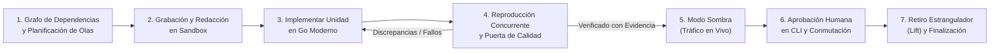

<div align="center">

  

  <h1>go-anything</h1>
  <p><strong>Migra desde cualquier lenguaje a Go moderno: una unidad verificada a la vez.</strong></p>
  <p>Reemplaza las reescrituras completas de alto riesgo con una migración estranguladora incremental,<br />respaldada por evidencia de comportamiento registrada, puertas de calidad automatizadas y control humano en el ciclo.</p>

  <p>
    <a href="https://go.dev/"></a>
    <a href="LICENSE"></a>
    <a href="https://github.com/mohammedrefat/go-anything/releases"></a>
    <a href="#hoja-de-ruta-de-hitos-m0m7"></a>
  </p>

  <p>
    <a href="#inicio-rápido-en-5-minutos">Inicio Rápido</a> ·
    <a href="Docs/USER_GUIDE.md">Guía de Usuario</a> ·
    <a href="#cómo-funciona">Cómo funciona</a> ·
    <a href="#hoja-de-ruta-de-hitos-m0m7">Hoja de Ruta</a> ·
    <a href="GOVERNANCE.md">Gobernanza</a> ·
    <a href="SECURITY.md">Seguridad</a> ·
    <a href="Docs/go-anything%20Architecture%20%26%20Implementation%20Plan%20(v3)%20(1).md">Arquitectura</a>
  </p>

  <p>
    <strong>Idiomas:</strong><br />
    <a href="README.md">English</a> ·
    <a href="README.es.md">Español</a> ·
    <a href="README.zh-CN.md">简体中文</a> ·
    <a href="README.ja.md">日本語</a> ·
    <a href="README.de.md">Deutsch</a> ·
    <a href="README.fr.md">Français</a> ·
    <a href="README.pt-BR.md">Português (Brasil)</a> ·
    <a href="README.ru.md">Русский</a> ·
    <a href="README.ar.md">العربية</a> ·
    <a href="README.hi.md">हिन्दी</a> ·
    <a href="README.ko.md">한국어</a>
  </p>

</div>

---

## En esta página

- [Cómo funciona](#cómo-funciona)
- [¿Por qué go-anything?](#por-qué-go-anything)
- [Aviso Explícito sobre la Paridad](#aviso-explícito-sobre-la-paridad)
- [Inicio Rápido en 5 Minutos](#inicio-rápido-en-5-minutos)
- [Hoja de Ruta de Hitos (M0–M7)](#hoja-de-ruta-de-hitos-m0m7)
- [Flujo de Trabajo para Agentes Autónomos y MCP](#flujo-de-trabajo-para-agentes-autónomos-y-mcp)
- [Arquitectura y Principios de Diseño](#arquitectura-y-principios-de-diseño)
- [Mapa del Repositorio](#mapa-del-repositorio)
- [Gobernanza y Contribución](#gobernanza-y-contribución)
- [Licencia](#licencia)

---

## Cómo funciona

`go-anything` migra aplicaciones hacia Go **una unidad a la vez** y comprueba que cada unidad coincida con el comportamiento registrado del original antes del despliegue.

- **No es un traductor sintáctico de código:** Tú o tu agente de IA escriben código Go idiomático. `go-anything` provee el orquestador, el sandbox de aislamiento, la captura de comportamiento, la reproducción diferencial y las puertas de calidad.
- **El Patrón Estrangulador (Strangler Fig):** La aplicación original permanece activa y funcional. Las unidades delimitadas se reemplazan gradualmente detrás de un proxy inverso o enrutador reversible.
- **Verificación a prueba de fallos (Fail-Closed):** La paridad se comprueba reproduciendo tráfico capturado y sintetizado a través de ambas implementaciones y comparando las respuestas bajo reglas deterministas.



---

## ¿Por qué go-anything?

| Reescritura Completa Arriesgada | Migración Incremental Verificada (`go-anything`) |
| :--- | :--- |
| Reemplaza toda la base de código de golpe | Avanza una ola de dependencias aislada a la vez |
| Descubre errores y regresiones en producción | Compara contra casos grabados antes de desviar el tráfico |
| El progreso se pierde en sesiones de chat efímeras | Estado duradero persistido en archivos JSON/JSONL auditables |
| Suposición ciega de paridad ("pasaron las pruebas") | Límites de paridad explícitos vinculados a vectores registrados |
| Agentes autónomos con acceso de despliegue sin control | Control exclusivo humano para `approve`, `promote` y `lift` |

---

## Aviso Explícito sobre la Paridad

> [!IMPORTANT]
> **La paridad tiene límites.**
>
> La paridad se garantiza **únicamente para las entradas observadas, registradas y generadas por pruebas difusas (fuzzing)**, nunca para comportamientos no observados. Superar las pruebas de comportamiento demuestra equivalencia bajo las distribuciones de prueba registradas; **no** es una garantía matemática de equivalencia semántica en rutas no probadas.
>
> `go-anything` aplica grabaciones duales para detectar campos volátiles (fechas, UUIDs, identificadores aleatorios) y los normaliza con reglas automáticas, pero el equipo de ingeniería debe auditar la cobertura y revisar las diferencias antes de la conmutación final.

---

## Inicio Rápido en 5 Minutos

Sigue esta guía paso a paso desde una máquina limpia para inicializar un proyecto, registrar comportamiento, implementar una unidad en Go, superar la puerta de calidad y reproducir los casos.

### Prerrequisitos

- [Go 1.26+](https://go.dev/dl/) instalado y configurado en tu `PATH`.
- Git.

### Paso 1: Instalar `go-anything`

Clona el repositorio e instala la herramienta CLI:

```bash
git clone https://github.com/mohammedrefat/go-anything.git
cd go-anything

# Instalar el binario CLI en $GOPATH/bin
go install ./cmd/go-anything

# Verificar la instalación
go-anything version
# Salida: go-anything v1.0.0 (profile: full, jobs: 8)
```

---

### Paso 2: Inicializar o Modernizar un Espacio de Trabajo

Crea un espacio de trabajo de migración o moderniza un proyecto existente. Para un servicio Go heredado, `modernize` crea la copia de referencia `legacy/` y el andamiaje objetivo `modern/`:

```bash
# Inicializar el espacio de trabajo para un servicio
go-anything init --source=go --name=sample-service /ruta/a/mi-servicio
cd /ruta/a/mi-servicio

# Inspeccionar la salud del espacio de trabajo y la seguridad
go-anything doctor
```

`go-anything doctor` comprueba:
- Almacén de estado en `.go-anything/units/`
- Protección en `.gitignore` para `.go-anything/local/` (evitando subir bloqueos y préstamos temporales)
- Reglas de redacción en `.go-anything/rules.json`
- Disponibilidad del entorno de aislamiento sandbox

---

### Paso 3: Inspeccionar Unidades y Olas de Dependencia

Visualiza las unidades registradas, sus olas de dependencia y los bloqueos activos:

```bash
go-anything status
```

Salida esperada:
```text
Workspace: sample-service (schemas: v1)
Dependency Waves:
  Wave 0:
    [Ready] unit-healthcheck (dependencies: none, risk: low)
    [Ready] unit-auth-token  (dependencies: none, risk: medium)
  Wave 1:
    [Planned] unit-user-api   (dependencies: [unit-auth-token], risk: high)
```

---

### Paso 4: Grabar Casos de Comportamiento (Aislados y Censurados)

Captura casos de prueba de comportamiento desde la aplicación original. `go-anything record` ejecuta la orden dentro de un sandbox restringido, redacta credenciales confidenciales en memoria y guarda los fixtures en formato JSONL:

```bash
go-anything record \
  --unit unit-healthcheck \
  --cmd "./legacy-service --health" \
  --dir .
```

`go-anything` realiza automáticamente:
- Ejecución doble para detectar salidas volátiles (marcas de tiempo, contadores).
- Sustitución sintética de credenciales preservando el formato (contraseñas, tokens, cookies).
- Almacenamiento seguro en `.go-anything/cases/unit-healthcheck.jsonl`.
- Transición de estado de `Planned` a `Recorded`.

---

### Paso 5: Implementar la Unidad en Go Moderno

Escribe la implementación en `modern/` (o deja que un agente de IA la genere):

```go
// modern/health/main.go
package main

import (
    "encoding/json"
    "os"
)

type HealthResponse struct {
    Status string `json:"status"`
}

func main() {
    resp := HealthResponse{Status: "ok"}
    _ = json.NewEncoder(os.Stdout).Encode(resp)
}
```

Compila el binario en Go:
```bash
go build -o ./bin/modern-health ./modern/health/main.go
```

---

### Paso 6: Reproducción Concurrente Determinista

Reproduce todos los casos registrados contra el binario en Go a través de trabajadores concurrentes:

```bash
go-anything replay \
  --unit unit-healthcheck \
  --target ./bin/modern-health \
  --dir .
```

Salida:
```text
[REPLAY] Replaying 10 recorded cases for 'unit-healthcheck' across 8 workers...
  ✓ case-001: MATCH (0.8ms)
  ✓ case-002: MATCH (0.9ms)
  ...
  ✓ case-010: MATCH (0.7ms)
Replay complete: 10/10 passed (0 mismatches, 0 errors).
```

---

### Paso 7: Verificación y Puerta de Calidad

Verifica la unidad contra la puerta de calidad completa (`build`, `vet`, `test -race`, `govulncheck`, `error_paths`, `api_compat`):

```bash
go-anything verify unit-healthcheck \
  --target ./bin/modern-health \
  --profile replay \
  --dir .
```

En pipelines automatizados o sesiones de agentes vía MCP (`run_gate`), se genera evidencia vinculada al commit en `.go-anything/evidence/`, avanzando el estado a `Verified`.

---

### Paso 8: Aprobación Humana, Promoción y Retiro (Lift)

Una vez verificada, el operador humano otorga la firma final, habilita el tráfico en sombra, promueve la ruta y retira el puente heredado:

```bash
# 1. Aprobación humana (exclusiva de CLI, no ejecutable por herramientas MCP)
go-anything approve unit-healthcheck --skip-shadow

# 2. Conmutar el enrutador hacia la implementación en Go
go-anything promote unit-healthcheck

# 3. Retirar el puente heredado cuando el tráfico de reserva sea cero
go-anything lift unit-healthcheck
```

---

## Hoja de Ruta de Hitos (M0–M7)

Todos los hitos principales, desde la arquitectura inicial hasta la versión v1.0.0, han sido implementados y validados:

| Hito | Versión | Alcance y Entregables | Estado de la Puerta de Salida |
| :--- | :--- | :--- | :--- |
| **M0: Cimientos** | `v0.0.x` | Máquina de 10 estados, E/S atómica, bloqueos de archivo, redactor en memoria, sandbox, CLI base, ADR-001/002. | ✅ **Superado:** `init` y `doctor` validan con éxito. |
| **M1: Reproducción en Sandbox** | `v0.0.x` | Detección de volatilidad en doble ejecución, comparador multimodo (exact, json, numeric, regex), motor de reproducción concurrente. | ✅ **Superado:** 100% de éxito en 3 ejecuciones consecutivas idénticas. |
| **M2: Front Door y Lift** | `v0.0.x` | Proxy inverso frontal, interruptor de apagado de emergencia (`KILL_SWITCH=1`), métricas de fallback y comando `lift`. | ✅ **Superado:** Ciclo estrangulador completo en apps demo CLI y HTTP. |
| **M3: Adaptador de Go** | `v0.1.0` | Analizador AST de Go, resolución de tipos, grafo de llamadas para planificar olas, flujo `modernize`. | ✅ **Superado:** Servicio real en Go migrado con 0 discrepancias. |
| **M4: Puerta de Calidad y MCP** | `v0.1.0` | Puerta de 6 comprobaciones, motor de tarjetas de puntuación, servidor MCP por stdio (8 herramientas) con saneamiento. | ✅ **Superado:** Agente de IA migra una unidad completa de forma autónoma. |
| **M5: Modo Sombra y Captura** | `v0.1.0` | Espejado de tráfico en tiempo real, grupo de trabajadores acotado con contadores de desbordamiento, tráfico idempotente GET/HEAD por defecto. | ✅ **Superado:** Registro de sombra limpio en producción y caso de estudio real. |
| **M6: Adaptador de Python** | `v0.2.0` | Adaptador para Python (análisis de imports AST, detección pytest, transportes Subprocess, HTTP, C-Shared). | ✅ **Superado:** CLI y servicio FastAPI en Python migrados con éxito. |
| **M7: TypeScript y Congelación** | `v1.0.0` | Adaptador TypeScript/Node (ESM/CommonJS, Jest/Vitest), congelación de `schemas/v1/`, comando `migrate`, `GOVERNANCE.md`. | ✅ **Superado:** Proyecto de código abierto multiunidad retirado sin tráfico de fallback. |

---

## Flujo de Trabajo para Agentes Autónomos y MCP

`go-anything` incluye un servidor MCP (Model Context Protocol) nativo que se comunica mediante `stdio`:

```bash
go-anything mcp
```

### Las 8 Herramientas MCP Estándar

El servidor MCP aplica el ciclo de vida de 10 estados en el servidor; los agentes no pueden falsificar resultados ni omitir pasos:

1. `status` — Muestra el progreso, la siguiente unidad en orden de dependencias, préstamos activos y bloqueos.
2. `claim_unit` — Reclama una unidad lista con un préstamo temporal en `.go-anything/local/`.
3. `inspect_unit` — Inspecciona el código original, casos sanitizados, trampas semánticas y restricciones.
4. `record_cases` — Ejecuta la aplicación original en el sandbox, aplica censura y guarda JSONL.
5. `verify_diff` — Compila el código en Go, reproduce los casos y devuelve éxito o diferencias sanitizadas.
6. `run_gate` — Ejecuta las 6 etapas de la puerta de calidad y genera evidencia vinculada al commit.
7. `mark_verified` — Avanza la unidad a `Verified` (requiere evidencia vinculada al HEAD actual).
8. `handoff` — Genera `HANDOFF.md` resumiendo el estado y las siguientes tareas para la próxima sesión.

> **Límite Humano Obligatorio:** El servidor MCP **jamás** expone las operaciones `approve`, `promote`, `lift` ni alteraciones de enrutamiento.

---

## Arquitectura y Principios de Diseño

1. **Pasos Pequeños y Reversibles:** Reemplaza el software gradualmente con el patrón estrangulador. El original siempre está disponible como respaldo inmediato.
2. **Redacción Confidencial en Memoria (Fail-Closed):** Las credenciales sensibles se reemplazan antes de tocar el disco. Si una carga confidencial no puede interpretarse, la grabación se cancela.
3. **Sandbox Restringido:** El aislamiento se ejecuta en Linux mediante namespaces (Nivel 1) y aislamiento de procesos en macOS/Windows (Nivel 2), sin acceso a la red por defecto.
4. **Evidencia Determinista:** Los casos de prueba, diferencias y reportes se ordenan estrictamente por `case_id`, nunca por tiempo de ejecución.
5. **Local y Sin Telemetría:** Toda la información reside en `.go-anything/`. No se transmiten datos a servidores externos.
6. **Arquitectura Desacoplada de Adaptadores:** Los adaptadores interactúan mediante el contrato congelado `pkg/adapterkit` y deben cumplir el 100% de las pruebas en `pkg/adapterkit/conformance`.

---

## Mapa del Repositorio

```text
cmd/go-anything/        Punto de entrada CLI y servidor MCP por stdio
pkg/adapterkit/         Contratos públicos y congelados de adaptadores (v1)
  └── conformance/      Suite oficial de certificación de adaptadores
internal/               Motor central de migración:
  ├── analyzer/         AST de código fuente, análisis de tipos y grafos de llamada
  ├── bench/            Benchmarks de latencia y asignación de memoria
  ├── comparator/       Comparación multimodo (exact, json, numeric, regex)
  ├── gate/             Puerta de calidad (build, vet, staticcheck, race, vuln)
  ├── mcp/              Servidor MCP stdio con saneamiento de payloads
  ├── migrate/          Motor de migración de esquemas de espacio de trabajo
  ├── planner/          Planificador topológico de olas de dependencias
  ├── recorder/         Grabación en sandbox con detección de volatilidad
  ├── redactor/         Redactor en memoria fail-closed para credenciales
  ├── replay/           Motor de reproducción concurrente determinista
  ├── sandbox/          Namespaces de Linux y aislamiento de procesos del SO
  ├── shadow/           Motor de modo sombra con grupos de trabajo acotados
  └── state/            Ciclo de vida de 10 estados, E/S atómica y bloqueos
adapters/               Adaptadores de lenguaje y tiempo de ejecución:
  ├── source/           Adaptadores de código fuente (Go, Python, TypeScript)
  └── application/      Adaptadores de aplicación (CLI, HTTP, Librería Externa, Worker)
schemas/                Esquemas JSON versionados:
  ├── v1/               Esquemas congelados estables (manifest, units, rules, etc.)
  └── v1alpha1/         Esquemas originales (soportados vía go-anything migrate)
Docs/                   Arquitectura, decisiones y casos de estudio:
  ├── USER_GUIDE.md     Guía detallada de usuario y referencia de comandos
  ├── decisions/        Registros de Decisiones de Arquitectura (ADR-001, ADR-002)
  └── case-studies/     Casos de estudio reales (M3, M4, M5, M6, M7)
GOVERNANCE.md           Roles de mantenedores, consenso, RFCs y certificación
SECURITY.md             Modelo de amenazas, sandbox y política de divulgación
CONTRIBUTING.md         Requisitos del entorno, estándares de código y pruebas
```

---

## Gobernanza y Contribución

- **Modelo de Gobernanza:** Consulta [GOVERNANCE.md](GOVERNANCE.md) para detalles sobre mantenedores, RFCs y certificación de adaptadores.
- **Política de Seguridad:** Consulta [SECURITY.md](SECURITY.md) para conocer el modelo de amenazas y reporte de vulnerabilidades.
- **Guía de Usuario:** Lee la [Guía de Usuario Detallada](Docs/USER_GUIDE.md) para tutoriales completos y ejemplos paso a paso.
- **Contribución:** Consulta [CONTRIBUTING.md](CONTRIBUTING.md) para preparar el entorno de desarrollo y pruebas.

Para habilitar los hooks automatizados de git:

```bash
git config core.hooksPath .githooks
```

---

## Licencia

`go-anything` se distribuye bajo la [Licencia Apache 2.0](LICENSE). Consulta [NOTICE](NOTICE) para ver las atribuciones correspondientes.
