<div align="center">

  

  <h1>go-anything</h1>
  <p><strong>Migrez depuis n'importe quel langage vers du Go moderne — une unité vérifiée à la fois.</strong></p>
  <p>Remplacez les réécritures complètes à haut risque par une migration progressive basée sur le patron de l'étrangleur (Strangler),<br />adossée à des preuves comportementales enregistrées, des portes de qualité automatisées et une validation humaine.</p>

  <p>
    <a href="https://go.dev/"></a>
    <a href="LICENSE"></a>
    <a href="https://github.com/mohammedrefat/go-anything/releases"></a>
    <a href="#feuille-de-route-des-jalons-m0m7"></a>
  </p>

  <p>
    <a href="#démarrage-rapide-en-5-minutes">Démarrage rapide</a> ·
    <a href="Docs/USER_GUIDE.md">Guide d'utilisation</a> ·
    <a href="#comment-ça-fonctionne">Fonctionnement</a> ·
    <a href="#feuille-de-route-des-jalons-m0m7">Feuille de route</a> ·
    <a href="GOVERNANCE.md">Gouvernance</a> ·
    <a href="SECURITY.md">Sécurité</a> ·
    <a href="Docs/go-anything%20Architecture%20%26%20Implementation%20Plan%20(v3)%20(1).md">Architecture</a>
  </p>

  <p>
    <strong>Traductions :</strong><br />
    <a href="README.md">English</a> ·
    <a href="README.es.md">Español</a> ·
    <a href="README.zh-CN.md">简体中文</a> ·
    <a href="README.ja.md">日本語</a> ·
    <a href="README.de.md">Deutsch</a> ·
    <a href="README.fr.md">Français</a> ·
    <a href="README.pt-BR.md">Português (Brasil)</a> ·
    <a href="README.ru.md">Русский</a> ·
    <a href="README.ar.md">العربية</a> ·
    <a href="README.hi.md">हिन्दी</a> ·
    <a href="README.ko.md">한국어</a>
  </p>

</div>

---

> [!NOTE]
> Cette documentation localisée correspond à la version **v1.0.0** et peut accuser un retard par rapport à la spécification canonique en anglais disponible dans [README.md](README.md) (v1.0.1+).

---

## Sur cette page

- [Comment ça fonctionne](#comment-ça-fonctionne)
- [Pourquoi choisir go-anything ?](#pourquoi-choisir-go-anything-)
- [Avertissement explicite sur la parité](#avertissement-explicite-sur-la-parité)
- [Démarrage rapide en 5 minutes](#démarrage-rapide-en-5-minutes)
- [Feuille de route des jalons (M0–M7)](#feuille-de-route-des-jalons-m0m7)
- [Flux de travail pour agents IA autonomes et MCP](#flux-de-travail-pour-agents-ia-autonomes-et-mcp)
- [Architecture et principes de conception](#architecture-et-principes-de-conception)
- [Plan du dépôt](#plan-du-dépôt)
- [Gouvernance et contribution](#gouvernance-et-contribution)
- [Licence](#licence)

---

## Comment ça fonctionne

`go-anything` migre des applications vers Go **une unité à la fois** et prouve que chaque unité reproduit fidèlement le comportement enregistré de l'original avant tout déploiement en production.

- **Ce n'est pas un traducteur de code automatique :** Vous ou votre agent d'assistance écrivez du code Go idiomatique et moderne. `go-anything` fournit l'orchestrateur, le bac à sable d'isolation (sandbox), la capture comportementale, le rejeu différentiel et les portes de qualité.
- **Le patron de l'étrangleur (Strangler Fig) :** L'application d'origine demeure en production. Les unités délimitées sont remplacées progressivement derrière un reverse-proxy réversible.
- **Vérification stricte (Fail-Closed) :** La parité est validée en rejouant des flux enregistrés et des cas de fuzzing à travers les deux versions, en comparant les sorties selon des règles déterministes.

```mermaid
flowchart LR
    A["1. Graphe de dépendances<br/>et planification par vagues"] --> B["2. Enregistrement en sandbox<br/>et caviardage de données"]
    B --> C["3. Implémentation de l'unité<br/>en Go moderne"]
    C --> D["4. Rejeu concurrent<br/>et porte de qualité"]
    D -->|Divergences / Erreurs| C
    D -->|Validé avec preuves| E["5. Mode miroir (Shadow)<br/>sur trafic réel"]
    E --> F["6. Validation humaine en CLI<br/>et bascule de routage"]
    F --> G["7. Retrait final (Lift)<br/>de l'ancien code"]
```



---

## Pourquoi choisir go-anything ?

| Réécriture complète risquée (Big-Bang) | Migration incrémentale vérifiée (`go-anything`) |
| :--- | :--- |
| Remplace tout le code d'un seul coup | Déplace une vague de dépendances isolée à la fois |
| Découvre les régressions et cas limites en production | Compare avec les scénarios capturés avant le transfert de trafic |
| Progrès perdu dans l'historique éphémère de sessions de chat | État durable persisté dans des fichiers JSON/JSONL auditables |
| Supposition aveugle d'équivalence (« les tests sont passés ») | Limites de parité explicites liées à des vecteurs de test réels |
| Agents autonomes disposant d'un droit de déploiement direct | Contrôle exclusif humain pour `approve`, `promote` et `lift` |

---

## Avertissement explicite sur la parité

> [!IMPORTANT]
> **La parité a des limites.**
>
> La parité n'est revendiquée **que pour les entrées enregistrées, observées et soumises au fuzzing**, jamais pour des comportements non observés. Valider les tests comportementaux prouve l'équivalence sous les distributions de tests enregistrées ; ce n'est **pas** une garantie mathématique universelle sur des chemins d'exécution non testés.
>
> `go-anything` effectue une double exécution pour identifier les champs volatils (horodatages, UUIDs, jetons aléatoires) et les normalise avec des règles automatiques. Les équipes de migration doivent auditer les rapports d'écarts avant toute bascule définitive.

---

## Démarrage rapide en 5 minutes

Suivez cette procédure complète depuis un environnement propre pour initialiser un projet, enregistrer le comportement, implémenter une unité en Go, passer la porte de qualité et rejouer les cas :

### Prérequis

- [Go 1.26+](https://go.dev/dl/) installé et disponible dans votre variable `PATH`.
- Git.

### Étape 1 : Installer `go-anything`

Clonez le dépôt et installez l'outil CLI :

```bash
git clone https://github.com/mohammedrefat/go-anything.git
cd go-anything

# Installer le binaire dans $GOPATH/bin
go install ./cmd/go-anything

# Vérifier l'installation
go-anything version
# Sortie : go-anything v1.0.0 (profile: full, jobs: 8)
```

---

### Étape 2 : Initialiser ou moderniser un espace de travail

Créez un espace de migration ou modernisez un service Go existant. Pour un service Go ancien, `modernize` crée la copie de référence `legacy/` et la structure cible `modern/` :

```bash
# Initialiser l'espace pour un service existant
go-anything init --source=go --name=sample-service /chemin/vers/mon-service
cd /chemin/vers/mon-service

# Vérifier l'état de santé et la conformité sécurité
go-anything doctor
```

`go-anything doctor` valide :
- L'espace d'état dans `.go-anything/units/`
- La configuration `.gitignore` protégeant `.go-anything/local/` (évitant le commit accidentel de baux et verrous)
- Les règles de caviardage de données dans `.go-anything/rules.json`
- L'état de préparation de l'isolation sandbox

---

### Étape 3 : Inspecter les unités et les vagues de dépendance

Visualisez les unités enregistrées, leurs vagues topologiques et les baux actifs :

```bash
go-anything status
```

Exemple de sortie :
```text
Workspace: sample-service (schemas: v1)
Dependency Waves:
  Wave 0:
    [Ready] unit-healthcheck (dependencies: none, risk: low)
    [Ready] unit-auth-token  (dependencies: none, risk: medium)
  Wave 1:
    [Planned] unit-user-api   (dependencies: [unit-auth-token], risk: high)
```

---

### Étape 4 : Enregistrer les cas comportementaux (Sandbox et caviardage)

Capturez des cas réels à partir de l'application d'origine. `go-anything record` exécute la commande dans un bac à sable restreint, caviarde en mémoire les données confidentielles et enregistre des fixtures JSONL assainies :

```bash
go-anything record \
  --unit unit-healthcheck \
  --cmd "./legacy-service --health" \
  --dir .
```

`go-anything` réalise automatiquement :
- Deux exécutions successives pour repérer les sorties dynamiques volatiles (horodatages, compteurs).
- La substitution synthétique des secrets préservant le format (mots de passe, tokens, cookies).
- L'enregistrement dans `.go-anything/cases/unit-healthcheck.jsonl`.
- La transition de l'état de l'unité de `Planned` à `Recorded`.

---

### Étape 5 : Implémenter l'unité en Go moderne

Rédigez l'implémentation dans `modern/` (ou laissez un agent IA la produire) :

```go
// modern/health/main.go
package main

import (
    "encoding/json"
    "os"
)

type HealthResponse struct {
    Status string `json:"status"`
}

func main() {
    resp := HealthResponse{Status: "ok"}
    _ = json.NewEncoder(os.Stdout).Encode(resp)
}
```

Compilez le binaire Go :
```bash
go build -o ./bin/modern-health ./modern/health/main.go
```

---

### Étape 6 : Rejeu concurrent et déterministe

Rejouez l'ensemble des scénarios enregistrés contre le nouveau binaire Go :

```bash
go-anything replay \
  --unit unit-healthcheck \
  --target ./bin/modern-health \
  --dir .
```

Sortie :
```text
[REPLAY] Replaying 10 recorded cases for 'unit-healthcheck' across 8 workers...
  ✓ case-001: MATCH (0.8ms)
  ✓ case-002: MATCH (0.9ms)
  ...
  ✓ case-010: MATCH (0.7ms)
Replay complete: 10/10 passed (0 mismatches, 0 errors).
```

---

### Étape 7 : Vérification et passage de la porte de qualité

Vérifiez l'unité face à la porte de qualité complète (`build`, `vet`, `test -race`, `govulncheck`, `error_paths`, `api_compat`) :

```bash
go-anything verify unit-healthcheck \
  --target ./bin/modern-health \
  --profile replay \
  --dir .
```

Dans un pipeline CI ou une session d'agent via MCP (`run_gate`), une preuve liée au commit Git est archivée dans `.go-anything/evidence/`, faisant passer l'unité à l'état `Verified`.

---

### Étape 8 : Approbation humaine, promotion et retrait (Lift)

Après validation, l'ingénieur procède à la signature, teste la bascule et retire l'ancien système :

```bash
# 1. Signature humaine (exclusivement en CLI, inaccessible aux outils MCP)
go-anything approve unit-healthcheck --skip-shadow

# 2. Bascule du routage vers l'implémentation en Go
go-anything promote unit-healthcheck

# 3. Retrait définitif du pont legacy lorsque le trafic de repli est nul
go-anything lift unit-healthcheck
```

---

## Feuille de route des jalons (M0–M7)

Tous les jalons prévus, de l'architecture fondamentale à la version v1.0.0, ont été entièrement implémentés et validés :

| Jalon | Version | Périmètre et livrables | Statut du portail de sortie |
| :--- | :--- | :--- | :--- |
| **M0 : Fondations** | `v0.0.x` | Machine à 10 états, E/S atomiques, verrous de fichiers, caviardage fail-closed, sandbox, squelette CLI, ADR-001/002. | ✅ **Validé :** `init` et `doctor` réussis sans erreur. |
| **M1 : Rejeu en sandbox** | `v0.0.x` | Détection de volatilité, comparateur multi-modes (exact, json, numeric, regex), moteur de rejeu concurrent. | ✅ **Validé :** 100% de concordance sur 3 runs consécutifs identiques. |
| **M2 : Front Door et Lift** | `v0.0.x` | Reverse-proxy, coupe-circuit d'urgence (`KILL_SWITCH=1`), métriques de repli, commande `lift`. | ✅ **Validé :** Cycle complet validé sur applications CLI et HTTP démo. |
| **M3 : Adaptateur Go** | `v0.1.0` | Analyseur AST Go, inférence de types, graphe d'appels pour planifier les vagues, flux `modernize`. | ✅ **Validé :** Véritable service Go modernisé avec 0 divergence. |
| **M4 : Porte de qualité & MCP** | `v0.1.0` | Chaîne de 6 vérifications de qualité, moteur de scorecard, serveur MCP stdio (8 outils) avec assainissement. | ✅ **Validé :** Migration d'une unité complète par un agent IA de façon autonome. |
| **M5 : Mode miroir & Capture** | `v0.1.0` | Réplication de trafic temps réel, pool limité avec compteurs de débordement, requêtes idempotentes par défaut. | ✅ **Validé :** Journal miroir intègre en conditions réelles et retour d'expérience. |
| **M6 : Adaptateur Python** | `v0.2.0` | Adaptateur source Python (imports AST, détection pytest, canaux Subprocess, HTTP, C-Shared). | ✅ **Validé :** Outil CLI et API FastAPI Python migrés avec succès. |
| **M7 : TypeScript & Gel** | `v1.0.0` | Adaptateur TypeScript/Node (ESM/CommonJS, Jest/Vitest), gel des schémas `schemas/v1/`, commande `migrate`, `GOVERNANCE.md`. | ✅ **Validé :** Projet open source complexe entièrement libéré de son code d'origine. |

---

## Flux de travail pour agents IA autonomes et MCP

`go-anything` intègre un serveur Model Context Protocol (MCP) natif opérant via `stdio` :

```bash
go-anything mcp
```

### Les 8 outils MCP standard

Le serveur MCP gère strictement le cycle de vie des 10 états. Les agents ne peuvent ni contourner les étapes ni forger des preuves :

1. `status` — Obtenir la progression, la prochaine unité selon les vagues, les baux actifs et les blocages.
2. `claim_unit` — Réserver une unité prête avec un bail local temporaire (`.go-anything/local/`).
3. `inspect_unit` — Examiner le code original, les cas assainis, les pièges sémantiques et contraintes.
4. `record_cases` — Exécuter l'application originale en sandbox, caviarder les données et sauvegarder en JSONL.
5. `verify_diff` — Compiler la version Go, rejouer les cas et renvoyer les écarts assainis.
6. `run_gate` — Exécuter les 6 étapes de la porte de qualité et générer une preuve liée au commit.
7. `mark_verified` — Faire passer l'unité à `Verified` (requiert une preuve liée au commit HEAD).
8. `handoff` — Générer `HANDOFF.md` résumant l'avancement et les étapes à suivre pour la prochaine session.

> **Périmètre exclusivement humain :** Le serveur MCP ne propose **jamais** les commandes `approve`, `promote`, `lift`, ni aucune modification directe du routage en production.

---

## Architecture et principes de conception

1. **Étapes courtes et réversibles :** Remplacement progressif suivant le patron de l'étrangleur. L'original reste un recours immédiat en cas d'imprévu.
2. **Caviardage strict en mémoire (Fail-Closed) :** Les secrets sont substitués avant tout enregistrement sur disque. Si un élément confidentiel ne peut être traité en toute sécurité, la capture s'interrompt.
3. **Sandbox étanche :** Isolation par namespaces Linux (Niveau 1) ou isolation de processus sur macOS/Windows (Niveau 2), sans accès réseau par défaut.
4. **Preuves déterministes :** Tous les cas de test, écarts et rapports sont triés par `case_id`, indépendamment de la durée d'exécution.
5. **Local et sans télémétrie :** Toutes les données restent localisées dans `.go-anything/`. Aucune télémétrie n'est envoyée vers l'extérieur.
6. **Architecture d'adaptateurs découplée :** Les adaptateurs s'interfacent via le contrat gelé `pkg/adapterkit` et doivent satisfaire à 100% de la suite de certification `pkg/adapterkit/conformance`.

---

## Plan du dépôt

```text
cmd/go-anything/        Point d'entrée CLI et serveur MCP stdio
pkg/adapterkit/         Contrats d'adaptateurs publics et figés (v1)
  └── conformance/      Suite officielle de certification des adaptateurs
internal/               Moteur central de migration :
  ├── analyzer/         Analyse AST de code source, inférence de types et graphes d'appels
  ├── bench/            Benchmarks de latence et d'allocations mémoire
  ├── comparator/       Comparateur multi-modes (exact, json, numeric, regex)
  ├── gate/             Exécuteur de portes de qualité (build, vet, staticcheck, race, vuln)
  ├── mcp/              Serveur MCP stdio avec assainissement des charges utiles
  ├── migrate/          Outil de migration de métadonnées d'espace de travail
  ├── planner/          Planificateur topologique de vagues de dépendances
  ├── recorder/         Enregistrement en sandbox et détection de volatilité
  ├── redactor/         Caviardage de secrets en mémoire (fail-closed)
  ├── replay/           Moteur de rejeu concurrent déterministe
  ├── sandbox/          Namespaces Linux et isolation de processus système
  ├── shadow/           Moteur de réplication de trafic en miroir (shadow mode)
  └── state/            Cycle de vie à 10 états, E/S atomiques et verrous de fichiers
adapters/               Adaptateurs de langages et d'exécutions :
  ├── source/           Adaptateurs de code source (Go, Python, TypeScript)
  └── application/      Adaptateurs d'applications (CLI, HTTP, Bibliothèques, Workers)
schemas/                Schémas JSON versionnés :
  ├── v1/               Schémas stables et figés (manifest, units, rules, etc.)
  └── v1alpha1/         Schémas de développement (convertibles via go-anything migrate)
Docs/                   Architecture, décisions et retours d'expérience :
  ├── USER_GUIDE.md     Guide d'utilisation complet et référence des commandes
  ├── decisions/        Comptes-rendus de décisions d'architecture (ADR-001, ADR-002)
  └── case-studies/     Études de cas réelles (M3, M4, M5, M6, M7)
GOVERNANCE.md           Rôles, consensus, processus de RFC et certification
SECURITY.md             Modèle de menaces, niveaux de sandbox et politique de divulgation
CONTRIBUTING.md         Configuration de l'environnement, normes et validation
```

---

## Gouvernance et contribution

- **Modèle de gouvernance :** Consultez [GOVERNANCE.md](GOVERNANCE.md) pour les rôles des mainteneurs, le consensus, les RFCs et la certification.
- **Politique de sécurité :** Consultez [SECURITY.md](SECURITY.md) pour le modèle de menaces et le signalement de vulnérabilités.
- **Guide détaillé :** Consultez le [Guide d'utilisation complet](Docs/USER_GUIDE.md) pour des tutoriels exhaustifs et des exemples pratiques.
- **Contribution :** Consultez [CONTRIBUTING.md](CONTRIBUTING.md) pour les instructions relatives à l'environnement de développement.

Activez les hooks git automatisés :

```bash
git config core.hooksPath .githooks
```

---

## Licence

`go-anything` est distribué sous la [Licence Apache 2.0](LICENSE). Voir [NOTICE](NOTICE) pour les mentions légales et attributions.
