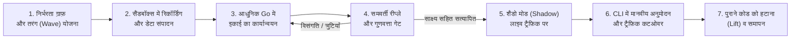

<div align="center">

  

  <h1>go-anything</h1>
  <p><strong>किसी भी भाषा से आधुनिक Go में माइग्रेट करें — एक समय में एक सत्यापित इकाई (Unit)।</strong></p>
  <p>जोखिम भरे बड़े रीराइट (Big-Bang Rewrite) के बजाय वृद्धिशील स्ट्रैंगलर माइग्रेशन (Strangler Migration) अपनाएं,<br />जिसे रिकॉर्ड किए गए व्यावहारिक साक्ष्य, स्वचालित गुणवत्ता गेट्स (Quality Gates) और मानवीय नियंत्रण का समर्थन प्राप्त है।</p>

  <p>
    <a href="https://go.dev/"></a>
    <a href="LICENSE"></a>
    <a href="https://github.com/mohammedrefat/go-anything/releases"></a>
    <a href="#मील-के-पत्थर-रोडमैप-m0m7"></a>
  </p>

  <p>
    <a href="#5-मिनट-में-त्वरित-शुरुआत">त्वरित शुरुआत</a> ·
    <a href="Docs/USER_GUIDE.md">उपयोगकर्ता गाइड</a> ·
    <a href="#यह-कैसे-काम-करता-है">कार्यप्रणाली</a> ·
    <a href="#मील-के-पत्थर-रोडमैप-m0m7">रोडमैप</a> ·
    <a href="GOVERNANCE.md">शासन</a> ·
    <a href="SECURITY.md">सुरक्षा</a> ·
    <a href="Docs/go-anything%20Architecture%20%26%20Implementation%20Plan%20(v3)%20(1).md">आर्किटेक्चर</a>
  </p>

  <p>
    <strong>अन्य भाषाएँ:</strong><br />
    <a href="README.md">English</a> ·
    <a href="README.es.md">Español</a> ·
    <a href="README.zh-CN.md">简体中文</a> ·
    <a href="README.ja.md">日本語</a> ·
    <a href="README.de.md">Deutsch</a> ·
    <a href="README.fr.md">Français</a> ·
    <a href="README.pt-BR.md">Português (Brasil)</a> ·
    <a href="README.ru.md">Русский</a> ·
    <a href="README.ar.md">العربية</a> ·
    <a href="README.hi.md">हिन्दी</a> ·
    <a href="README.ko.md">한국어</a>
  </p>

</div>

---

> [!NOTE]
> यह स्थानीयकृत दस्तावेज़ रिलीज़ **v1.0.0** से मेल खाता है और [README.md](README.md) में नवीनतम अंग्रेज़ी विनिर्देश (v1.0.1+) से पीछे हो सकता है।

---

## इस पृष्ठ पर

- [यह कैसे काम करता है](#यह-कैसे-काम-करता-है)
- [go-anything क्यों चुनें?](#go-anything-क्यों-चुनें)
- [समानता (Parity) पर स्पष्ट अस्वीकरण](#समानता-parity-पर-स्पष्ट-अस्वीकरण)
- [5 मिनट में त्वरित शुरुआत](#5-मिनट-में-त्वरित-शुरुआत)
- [मील के पत्थर रोडमैप (M0–M7)](#मील-के-पत्थर-रोडमैप-m0m7)
- [स्वायत्त AI एजेंट और MCP वर्कफ़्लो](#स्वायत्त-ai-एजेंट-और-mcp-वर्कफ़्लो)
- [सिस्टम आर्किटेक्चर और डिज़ाइन सिद्धांत](#सिस्टम-आर्किटेक्चर-और-डिज़ाइन-सिद्धांत)
- [रिपॉजिटरी संरचना](#रिपॉजिटरी-संरचना)
- [शासन और योगदान](#शासन-और-योगदान)
- [लाइसेंस](#लाइसेंस)

---

## यह कैसे काम करता है

`go-anything` एप्लिकेशनों को **एक समय में एक इकाई (Unit)** के रूप में Go में माइग्रेट करता है और उत्पादन में भेजने से पहले यह सिद्ध करता है कि प्रत्येक इकाई मूल सिस्टम के रिकॉर्ड किए गए व्यवहार से पूरी तरह मेल खाती है।

- **यह कोई AST कोड अनुवादक नहीं है:** आप या आपका AI कोडिंग एजेंट प्रामाणिक और आधुनिक Go कोड लिखते हैं। `go-anything` ऑर्केस्ट्रेशन, सुरक्षित सैंडबॉक्स (Sandbox), व्यवहार रिकॉर्डिंग, विभेदक रीप्ले (Differential Replay) और गुणवत्ता गेट्स प्रदान करता है।
- **स्ट्रैंगलर पैटर्न (Strangler Fig):** मूल एप्लिकेशन लाइव और सक्रिय रहता है। सीमित सीमाओं वाली इकाइयों को रिवर्स प्रॉक्सी के पीछे धीरे-धीरे बदला जाता है, जिसे कभी भी तुरंत वापस किया जा सकता है।
- **सुरक्षित सत्यापन (Fail-Closed):** दोनों संस्करणों में रिकॉर्ड किए गए और फ़ज़ (Fuzz) किए गए ट्रैफ़िक को चलाकर और परिणामों की तुलना करके समानता सिद्ध की जाती है।



---

## go-anything क्यों चुनें?

| जोखिम भरा पूर्ण पुनर्लेखन (Big-Bang) | सत्यापित वृद्धिशील माइग्रेशन (`go-anything`) |
| :--- | :--- |
| एक ही बार में पूरे कोडबेस को बदलना | टोपोलॉजिकल निर्भरता तरंगों के अनुसार एक-एक इकाई बदलना |
| उत्पादन में जाने के बाद त्रुटियों का पता चलना | ट्रैफ़िक स्थानांतरित करने से पहले रिकॉर्ड किए गए मामलों से तुलना |
| अस्थायी चैट सत्रों में संदर्भ और प्रगति का खो जाना | JSON/JSONL फ़ाइलों में स्थायी, समीक्षा योग्य स्थिति संचित होना |
| समानता की अंधी धारणा ("सभी टेस्ट पास हो गए") | वास्तविक परीक्षण मामलों से जुड़ी स्पष्ट समानता सीमाएँ |
| स्वायत्त एजेंटों को बिना रोक-टोक सीधे परिनियोजन की अनुमति | `approve`, `promote` और `lift` के लिए केवल मानवीय नियंत्रण |

---

## समानता (Parity) पर स्पष्ट अस्वीकरण

> [!IMPORTANT]
> **समानता की सीमाएं हैं।**
>
> समानता का दावा **केवल रिकॉर्ड किए गए, देखे गए और फ़ज़ किए गए इनपुट्स के लिए किया जाता है**, अनदेखे व्यवहार के लिए कभी नहीं। व्यावहारिक परीक्षणों को पास करना यह सिद्ध करता है कि रिकॉर्ड किए गए परीक्षणों के तहत सिस्टम समतुल्य है — यह किसी भी अप्रयुक्त पथ पर गणितीय समानता की पूर्ण गारंटी **नहीं** है।
>
> `go-anything` परिवर्तनशील फ़ील्ड्स (टाइमस्टैम्प, रैंडम टोकन, UUIDs) को स्वचालित रूप से पहचानने के लिए दोहरे निष्पादन (Dual-run) का उपयोग करता है, लेकिन टीमों को ट्रैफ़िक स्थानांतरित करने से पहले अंतर रिपोर्टों की समीक्षा अवश्य करनी चाहिए।

---

## 5 मिनट में त्वरित शुरुआत

परियोजना आरंभ करने, व्यवहार रिकॉर्ड करने, Go इकाई लिखने और परीक्षण पास करने के लिए यह चरण-दर-चरण मार्गदर्शिका देखें:

### पूर्वापेक्षाएँ

- [Go 1.26+](https://go.dev/dl/) स्थापित हो और आपके `PATH` में उपलब्ध हो।
- Git स्थापित हो।

### चरण 1: `go-anything` स्थापित करें

रिपॉजिटरी क्लोन करें और CLI टूल स्थापित करें:

```bash
git clone https://github.com/mohammedrefat/go-anything.git
cd go-anything

# CLI बाइनरी को $GOPATH/bin में इंस्टॉल करें
go install ./cmd/go-anything

# स्थापना की पुष्टि करें
go-anything version
# आउटपुट उदाहरण: go-anything v1.0.0 (profile: full, jobs: 8)
```

---

### चरण 2: कार्यक्षेत्र आरंभ या आधुनिकीकरण करें

एक माइग्रेशन कार्यक्षेत्र बनाएं या किसी मौजूदा Go सेवा का आधुनिकीकरण करें। पुरानी Go सेवा के लिए, `modernize` मूल संदर्भ `legacy/` और आधुनिक लक्ष्य `modern/` तैयार करता है:

```bash
# कार्यक्षेत्र आरंभ करें
go-anything init --source=go --name=sample-service /path/to/my-service
cd /path/to/my-service

# कार्यक्षेत्र की सुरक्षा और स्थिति जांचें
go-anything doctor
```

`go-anything doctor` निम्नलिखित की जांच करता है:
- `.go-anything/units/` में स्थिति भंडारण
- `.gitignore` में `.go-anything/local/` का सुरक्षित बहिष्करण (ताकि अस्थायी लीज़ ग़लती से कमिट न हों)
- `.go-anything/rules.json` में संपादन नियम
- ऑपरेटिंग सिस्टम सैंडबॉक्स की तत्परता

---

### चरण 3: इकाइयों और निर्भरता तरंगों का निरीक्षण करें

पंजीकृत इकाइयों, निर्भरता क्रम और सक्रिय लीज़ की सूची देखें:

```bash
go-anything status
```

आउटपुट उदाहरण:
```text
Workspace: sample-service (schemas: v1)
Dependency Waves:
  Wave 0:
    [Ready] unit-healthcheck (dependencies: none, risk: low)
    [Ready] unit-auth-token  (dependencies: none, risk: medium)
  Wave 1:
    [Planned] unit-user-api   (dependencies: [unit-auth-token], risk: high)
```

---

### चरण 4: व्यावहारिक परीक्षण रिकॉर्ड करें (सुरक्षित सैंडबॉक्स और संपादन)

मूल एप्लिकेशन से व्यवहार रिकॉर्ड करें। `go-anything record` सैंडबॉक्स में कमांड चलाता है, मेमोरी में संवेदनशील जानकारी को संपादित करता है, और शुद्ध JSONL फ़ाइलें सहेजता है:

```bash
go-anything record \
  --unit unit-healthcheck \
  --cmd "./legacy-service --health" \
  --dir .
```

`go-anything` स्वचालित रूप से:
- गतिशील डेटा (टाइमस्टैम्प) का पता लगाने के लिए दो बार कोड चलाता है।
- पासवर्ड, टोकन और कुकीज़ को सुरक्षित प्रारूप-संरक्षक डमी डेटा से बदलता है।
- परीक्षण मामलों को `.go-anything/cases/unit-healthcheck.jsonl` में सहेजता है।
- इकाई की स्थिति को `Planned` से `Recorded` में अपडेट करता है।

---

### चरण 5: आधुनिक Go में इकाई का कार्यान्वयन करें

`modern/` फ़ोल्डर में Go कोड लिखें (या AI एजेंट से लिखवाएं):

```go
// modern/health/main.go
package main

import (
    "encoding/json"
    "os"
)

type HealthResponse struct {
    Status string `json:"status"`
}

func main() {
    resp := HealthResponse{Status: "ok"}
    _ = json.NewEncoder(os.Stdout).Encode(resp)
}
```

Go बाइनरी कंपाइल करें:
```bash
go build -o ./bin/modern-health ./modern/health/main.go
```

---

### चरण 6: समवर्ती और नियतात्मक रीप्ले

नए Go प्रोग्राम के विरुद्ध सभी रिकॉर्ड किए गए मामलों को समानांतर में चलाएं:

```bash
go-anything replay \
  --unit unit-healthcheck \
  --target ./bin/modern-health \
  --dir .
```

आउटपुट:
```text
[REPLAY] Replaying 10 recorded cases for 'unit-healthcheck' across 8 workers...
  ✓ case-001: MATCH (0.8ms)
  ✓ case-002: MATCH (0.9ms)
  ...
  ✓ case-010: MATCH (0.7ms)
Replay complete: 10/10 passed (0 mismatches, 0 errors).
```

---

### चरण 7: सत्यापन और गुणवत्ता गेट पास करना

पूर्ण गुणवत्ता गेट चलाएं (`build`, `vet`, `test -race`, `govulncheck`, `error_paths`, `api_compat`):

```bash
go-anything verify unit-healthcheck \
  --target ./bin/modern-health \
  --profile replay \
  --dir .
```

स्वचालित पाइपलाइन या MCP सत्र (`run_gate`) में, Git कमिट से बंधा हुआ प्रमाण `.go-anything/evidence/` में संग्रहीत होता है और इकाई `Verified` स्थिति में पहुंच जाती है।

---

### चरण 8: मानवीय स्वीकृति, प्रचार और पुराने कोड को हटाना (Lift)

सत्यापन के बाद, इंजीनियर CLI से अंतिम अनुमोदन देता है, शैडो ट्रैफ़िक चलाता है, और पुराने कोड को पूरी तरह हटा देता है:

```bash
# 1. मानवीय स्वीकृति (केवल CLI द्वारा, MCP से संभव नहीं)
go-anything approve unit-healthcheck --skip-shadow

# 2. रूटिंग को नए Go कोड पर स्विच करें
go-anything promote unit-healthcheck

# 3. पुराने कोड को पूरी तरह हटाएं
go-anything lift unit-healthcheck
```

---

## मील के पत्थर रोडमैप (M0–M7)

मूल आर्किटेक्चर से लेकर v1.0.0 तक के सभी प्रमुख चरण पूर्ण और सत्यापित हो चुके हैं:

| मील का पत्थर | रिलीज़ | कार्यक्षेत्र और परिणाम | निकास द्वार स्थिति |
| :--- | :--- | :--- | :--- |
| **M0: आधारभूत ढांचा** | `v0.0.x` | 10-स्थिति मशीन, एटॉमिक I/O, फ़ाइल लॉक, मेमोरी रेडैक्टर, सैंडबॉक्स, CLI ढांचा, ADR-001/002। | ✅ **उत्तीर्ण:** `init` और `doctor` सफल। |
| **M1: सैंडबॉक्स रीप्ले** | `v0.0.x` | दोहरे निष्पादन से परिवर्तनशीलता पहचान, मल्टी-मोड तुलना इंजन, समवर्ती रीप्ले। | ✅ **उत्तीर्ण:** लगातार 3 समान परीक्षणों में 100% समानता। |
| **M2: फ्रंट डोर और लिफ्ट** | `v0.0.x` | रिवर्स प्रॉक्सी, आपातकालीन किल-स्विच (`KILL_SWITCH=1`), फ़ॉलबैक ट्रैकिंग और `lift` कमांड। | ✅ **उत्तीर्ण:** CLI और HTTP ऐप्स पर संपूर्ण जीवनचक्र सफल। |
| **M3: Go स्रोत एडेप्टर** | `v0.1.0` | Go AST पार्सर, प्रकार समाधान, कॉल ग्राफ़ तरंग योजना, `modernize` वर्कफ़्लो। | ✅ **उत्तीर्ण:** वास्तविक Go सेवा बिना किसी अंतर के आधुनिक बनी। |
| **M4: गुणवत्ता गेट और MCP** | `v0.1.0` | 6-चरणीय गुणवत्ता परीक्षण, स्कोरकार्ड इंजन, stdio MCP सर्वर (8 टूल्स) सुरक्षा सैनिटाइजेशन के साथ। | ✅ **उत्तीर्ण:** AI एजेंट ने बिना मानवीय मदद पूरी इकाई माइग्रेट की। |
| **M5: शैडो और कैप्चर** | `v0.1.0` | वास्तविक समय ट्रैफ़िक मिररिंग, सीमित वर्कर पूल, डिफ़ॉल्ट रूप से केवल idempotent अनुरोध। | ✅ **उत्तीर्ण:** लाइव ट्रैफ़िक पर स्वच्छ शैडो लॉग और केस स्टडी। |
| **M6: Python एडेप्टर** | `v0.2.0` | Python एडेप्टर (AST इम्पोर्ट विश्लेषण, pytest पहचान, Subprocess, HTTP, C-Shared ट्रांसपोर्ट्स)। | ✅ **उत्तीर्ण:** Python CLI और FastAPI सेवा सफलतापूर्वक माइग्रेट। |
| **M7: TypeScript और फ्रीज** | `v1.0.0` | TypeScript/Node एडेप्टर (ESM/CommonJS, Jest/Vitest), `schemas/v1/` फ्रीज, `GOVERNANCE.md`। | ✅ **उत्तीर्ण:** ओपन-सोर्स प्रोजेक्ट को पुराने कोड से पूरी तरह मुक्त किया गया। |

---

## स्वायत्त AI एजेंट और MCP वर्कफ़्लो

`go-anything` में मानक `stdio` पर चलने वाला मॉडल संदर्भ प्रोटोकॉल (MCP) सर्वर अंतर्निहित है:

```bash
go-anything mcp
```

### 8 मानक MCP टूल्स

MCP सर्वर 10-स्थिति जीवनचक्र का प्रबंधन सर्वर-साइड करता है; एजेंट किसी भी चरण को छोड़ नहीं सकते:

1. `status` — प्रगति, अगली उपलब्ध इकाई, सक्रिय लीज़ और अवरोधों की जानकारी।
2. `claim_unit` — `.go-anything/local/` में अस्थायी लीज़ के साथ इकाई लेना।
3. `inspect_unit` — मूल कोड, शुद्ध किए गए मामले और ज्ञात समस्याओं का निरीक्षण।
4. `record_cases` — सैंडबॉक्स में मूल कोड चलाकर सुरक्षित JSONL मामले बनाना।
5. `verify_diff` — Go कोड बनाकर मामलों का रीप्ले करना और अंतर दिखाना।
6. `run_gate` — 6 गुणवत्ता परीक्षण चलाकर कमिट-आधारित साक्ष्य सहेजना।
7. `mark_verified` — इकाई को `Verified` घोषित करना (वर्तमान HEAD के साक्ष्य आवश्यक)।
8. `handoff` — अगले सत्र के लिए प्रगति सारांश `HANDOFF.md` तैयार करना।

> **मानवीय नियंत्रण की सीमा:** MCP सर्वर में `approve`, `promote`, `lift` या लाइव ट्रैफ़िक परिवर्तन के टूल्स **कभी उपलब्ध नहीं होते**।

---

## सिस्टम आर्किटेक्चर और डिज़ाइन सिद्धांत

1. **छोटे और प्रतिवर्ती चरण:** स्ट्रैंगलर पैटर्न का पालन। अंतिम `lift` तक मूल सिस्टम तुरंत फ़ॉलबैक के रूप में उपलब्ध रहता है।
2. **मेमोरी में सुरक्षित संपादन (Fail-Closed):** पासवर्ड और टोकन डिस्क पर लिखने से पहले ही बदल दिए जाते हैं।
3. **सख्त सैंडबॉक्स:** Linux नेमस्पेस (टियर 1) या OS प्रोसेस आइसोलेशन (टियर 2)। डिफ़ॉल्ट रूप से कोई नेटवर्क एक्सेस नहीं।
4. **नियतात्मक साक्ष्य:** सभी परीक्षण और अंतर `case_id` द्वारा क्रमबद्ध होते हैं, निष्पादन समय द्वारा नहीं।
5. **स्थानीय और शून्य टेलीमेट्री:** सभी डेटा केवल `.go-anything/` में रहता है। कोई भी डेटा बाहर नहीं भेजा जाता।
6. **अलग किए गए एडेप्टर:** भाषा एडेप्टर स्थिर `pkg/adapterkit` इंटरफ़ेस द्वारा जुड़ते हैं और आधिकारिक टेस्ट `pkg/adapterkit/conformance` पास करना अनिवार्य है।

---

## रिपॉजिटरी संरचना

```text
cmd/go-anything/        CLI प्रवेश बिंदु और stdio MCP सर्वर
pkg/adapterkit/         सार्वजनिक व स्थिर एडेप्टर इंटरफ़ेस (v1)
  └── conformance/      आधिकारिक एडेप्टर प्रमाणन परीक्षण सुइट
internal/               कोर माइग्रेशन इंजन:
  ├── analyzer/         स्रोत कोड AST, प्रकार विश्लेषण और कॉल ग्राफ़
  ├── bench/            लेटेंसी और मेमोरी आवंटन बेंचमार्क
  ├── comparator/       मल्टी-मोड तुलना इंजन (exact, json, numeric, regex)
  ├── gate/             गुणवत्ता गेट इंजन (build, vet, staticcheck, race, vuln)
  ├── mcp/              सुरक्षित stdio MCP सर्वर
  ├── migrate/          कार्यक्षेत्र स्कीमा अपग्रेड टूल
  ├── planner/          टोपोलॉजिकल तरंग योजनाकार
  ├── recorder/         सैंडबॉक्स रिकॉर्डर और परिवर्तनशीलता पहचान
  ├── redactor/         मेमोरी में संवेदनशील डेटा संपादन
  ├── replay/           समवर्ती नियतात्मक रीप्ले इंजन
  ├── sandbox/          Linux नेमस्पेस और प्रोसेस आइसोलेशन
  ├── shadow/           लाइव ट्रैफ़िक शैडो इंजन
  └── state/            10-स्थिति चक्र, एटॉमिक I/O और फ़ाइल लॉक्स
adapters/               भाषा और रनटाइम एडेप्टर:
  ├── source/           स्रोत एडेप्टर (Go, Python, TypeScript)
  └── application/      अनुप्रयोग एडेप्टर (CLI, HTTP, Foreign Library, Worker)
schemas/                संस्करणयुक्त JSON स्कीमा:
  ├── v1/               स्थिर व अंतिम स्कीमा (manifest, units, rules आदि)
  └── v1alpha1/         शुरुआती स्कीमा (migrate द्वारा अपग्रेड संभव)
Docs/                   आर्किटेक्चर, निर्णय और केस स्टडीज़:
  ├── USER_GUIDE.md     विस्तृत उपयोगकर्ता गाइड और कमांड निर्देशिका
  ├── decisions/        आर्किटेक्चर निर्णय रिकॉर्ड (ADR-001, ADR-002)
  └── case-studies/     वास्तविक माइग्रेशन अध्ययन (M3, M4, M5, M6, M7)
GOVERNANCE.md           रखरखाव भूमिकाएं, सहमति, RFC प्रक्रिया और प्रमाणन
SECURITY.md             खतरे का मॉडल, सैंडबॉक्स और भेद्यता रिपोर्टिंग
CONTRIBUTING.md         पर्यावरण सेटअप, कोडिंग मानक और परीक्षण नियम
```

---

## शासन और योगदान

- **शासन मॉडल:** अधिक जानकारी के लिए [GOVERNANCE.md](GOVERNANCE.md) देखें।
- **सुरक्षा नीति:** सुरक्षा मॉडल और बग रिपोर्टिंग के लिए [SECURITY.md](SECURITY.md) देखें।
- **विस्तृत निर्देश:** चरण-दर-चरण ट्यूटोरियल के लिए [उपयोगकर्ता गाइड](Docs/USER_GUIDE.md) पढ़ें।
- **योगदान:** योगदान देने से पहले [CONTRIBUTING.md](CONTRIBUTING.md) अवश्य पढ़ें।

स्वचालित Git कमिट हुक सक्षम करने के लिए:

```bash
git config core.hooksPath .githooks
```

---

## लाइसेंस

`go-anything` [Apache License, Version 2.0](LICENSE) के तहत वितरित किया गया है। आभार और विवरण के लिए [NOTICE](NOTICE) देखें।
