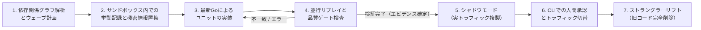

<div align="center">

  

  <h1>go-anything</h1>
  <p><strong>あらゆる言語から最新のGoへ—検証済みの単一ユニット単位で安全に移行。</strong></p>
  <p>リスクの高い一括書き換え（ビッグバン）を段階的なストラングラー移行に置き換え、<br />記録された振る舞いエビデンス、自動化された品質ゲート、そして人間の承認統制によって安全性を担保します。</p>

  <p>
    <a href="https://go.dev/"></a>
    <a href="LICENSE"></a>
    <a href="https://github.com/mohammedrefat/go-anything/releases"></a>
    <a href="#マイルストーンロードマップ-m0m7"></a>
  </p>

  <p>
    <a href="#5分でわかるクイックスタート">クイックスタート</a> ·
    <a href="Docs/USER_GUIDE.md">ユーザーガイド</a> ·
    <a href="#仕組み">仕組み</a> ·
    <a href="#マイルストーンロードマップ-m0m7">ロードマップ</a> ·
    <a href="GOVERNANCE.md">ガバナンス</a> ·
    <a href="SECURITY.md">セキュリティ</a> ·
    <a href="Docs/go-anything%20Architecture%20%26%20Implementation%20Plan%20(v3)%20(1).md">アーキテクチャ</a>
  </p>

  <p>
    <strong>他言語版：</strong><br />
    <a href="README.md">English</a> ·
    <a href="README.es.md">Español</a> ·
    <a href="README.zh-CN.md">简体中文</a> ·
    <a href="README.ja.md">日本語</a> ·
    <a href="README.de.md">Deutsch</a> ·
    <a href="README.fr.md">Français</a> ·
    <a href="README.pt-BR.md">Português (Brasil)</a> ·
    <a href="README.ru.md">Русский</a> ·
    <a href="README.ar.md">العربية</a> ·
    <a href="README.hi.md">हिन्दी</a> ·
    <a href="README.ko.md">한국어</a>
  </p>

</div>

---

> [!NOTE]
> この翻訳ドキュメントはリリース **v1.0.0** に準拠しており、[README.md](README.md) の最新の英語仕様（v1.0.1+）より更新が遅れている場合があります。

---

## 目次

- [仕組み](#仕組み)
- [なぜ go-anything なのか？](#なぜ-go-anything-なのか)
- [パリティ（等価性）に関する明確な免責事項](#パリティ等価性に関する明確な免責事項)
- [5分でわかるクイックスタート](#5分でわかるクイックスタート)
- [マイルストーンロードマップ (M0–M7)](#マイルストーンロードマップ-m0m7)
- [自律型AIエージェントとMCPワークフロー](#自律型aiエージェントとmcpワークフロー)
- [アーキテクチャと設計原則](#アーキテクチャと設計原則)
- [リポジトリ構成マップ](#リポジトリ構成マップ)
- [ガバナンスと貢献方法](#ガバナンスと貢献方法)
- [ライセンス](#ライセンス)

---

## 仕組み

`go-anything` はアプリケーションを**1ユニットずつ** Go へと移行し、本番投入前に記録された元の挙動と完全に一致することを自動検証します。

- **ASTの機械的コード翻訳器ではありません：** 開発者またはAIコーディングエージェントが、自然でイディオマティックなGoコードを記述します。`go-anything` はオーケストレーション、サンドボックス分離、挙動キャプチャ、差分リプレイ、品質ゲートの役割を担います。
- **ストラングラーパターン（Strangler Fig）：** 既存のアプリケーションは稼働し続けます。リバースプロキシやサイドカー経由で、限定された境界のユニットを1つずつ安全に置き換えます。
- **フェイルクローズ（Fail-Closed）な検証：** 記録されたリクエストやファジングテストのトラフィックを双方の実装に流し込み、決定論的なルールに基づいて出力を厳密に比較します。



---

## なぜ go-anything なのか？

| リスクの高い一括リライト | 検証駆動型の段階的移行 (`go-anything`) |
| :--- | :--- |
| コードベース全体を一度に置き換える | 依存関係ウェーブに沿って1ユニットずつ安全に進める |
| 本番運用開始後に潜在的バグやデグレードが発覚する | トラフィックを切り替える前に記録済みテストケースと突き合わせる |
| 移行の進捗やコンテキストがチャット履歴の中に埋もれる | Git管理可能で監査可能なJSON/JSONLファイルとして状態を永続化 |
| 「テストが通ったから安心」という盲目的な等価性の過信 | 記録されたテストベクトルに基づいた明示的なパリティ境界を定義 |
| 自律エージェントに無制限の本番デプロイ権限を与えてしまう | `approve`、`promote`、`lift` などの重要操作は人間のみ実行可能 |

---

## パリティ（等価性）に関する明確な免責事項

> [!IMPORTANT]
> **等価性の保証には明確な境界が存在します。**
>
> パリティは**記録され、観測され、ファジングテストが行われた入力に対してのみ**主張されます。未観測の挙動について等価性を保証するものではありません。挙動チェックの通過は、記録されたテストデータセット下における動作の一致を証明するものであり、未テストの実行パスすべてに対する数学的な完全同等性を保証するものではありません。
>
> `go-anything` は二重実行（Dual-run）によって動的フィールド（タイムスタンプ、ランダムトークン、UUID）を自動検出し正規化しますが、移行チームは本番切替前に必ず挙動差分レポートとカバレッジを精査してください。

---

## 5分でわかるクイックスタート

クリーンなマシン環境からプロジェクトの初期化、挙動の記録、Goユニットの実装、品質ゲートの通過、リプレイ検証までの流れを体験できます：

### 前提条件

- [Go 1.26以上](https://go.dev/dl/) がインストールされ、`PATH` に通っていること。
- Git がインストールされていること。

### ステップ 1: `go-anything` のインストール

リポジトリをクローンしてCLIをインストールします：

```bash
git clone https://github.com/mohammedrefat/go-anything.git
cd go-anything

# CLIバイナリを $GOPATH/bin にインストール
go install ./cmd/go-anything

# インストールの確認
go-anything version
# 出力例: go-anything v1.0.0 (profile: full, jobs: 8)
```

---

### ステップ 2: ワークスペースの初期化 / モダン化

移行対象プロジェクトを初期化します。レガシーなGoサービスを移行する場合、`modernize` は `legacy/`（旧コードの凍結コピー）と `modern/`（新しいGoコード用）を自動構築します：

```bash
# 対象サービス用ワークスペースの初期化
go-anything init --source=go --name=sample-service /path/to/my-service
cd /path/to/my-service

# ワークスペースの健全性とセキュリティの検査
go-anything doctor
```

`go-anything doctor` は以下を自動チェックします：
- `.go-anything/units/` の状態保存領域
- `.gitignore` による `.go-anything/local/` の除外設定（一時リースの誤コミット防止）
- `.go-anything/rules.json` の機密情報置換ルール
- サンドボックス隔離環境の稼働準備状況

---

### ステップ 3: 移行ユニットと依存ウェーブの確認

登録されたユニット、依存関係のウェーブ順序、アクティブなリースを確認します：

```bash
go-anything status
```

出力例：
```text
Workspace: sample-service (schemas: v1)
Dependency Waves:
  Wave 0:
    [Ready] unit-healthcheck (dependencies: none, risk: low)
    [Ready] unit-auth-token  (dependencies: none, risk: medium)
  Wave 1:
    [Planned] unit-user-api   (dependencies: [unit-auth-token], risk: high)
```

---

### ステップ 4: 挙動テストケースの記録（サンドボックス＆機密置換）

既存アプリケーションから実際の挙動をキャプチャします。`go-anything record` は制限付きサンドボックス内でコマンドを実行し、機密情報をメモリ上で安全に置換した上でJSONL形式として保存します：

```bash
go-anything record \
  --unit unit-healthcheck \
  --cmd "./legacy-service --health" \
  --dir .
```

`go-anything` は以下を自動処理します：
- 2回実行による出力の比較（タイムスタンプなどの揮発性フィールドの検出）。
- 機密情報（パスワード、トークン、Cookie）のフォーマット保持型ダミー置換。
- 置換済みフィクスチャを `.go-anything/cases/unit-healthcheck.jsonl` に保存。
- ユニット状態を `Planned` から `Recorded` へ自動更新。

---

### ステップ 5: モダンなGoでユニットを実装

`modern/` ディレクトリ配下に移植コードを実装します（AIエージェントによる自動生成も可能です）：

```go
// modern/health/main.go
package main

import (
    "encoding/json"
    "os"
)

type HealthResponse struct {
    Status string `json:"status"`
}

func main() {
    resp := HealthResponse{Status: "ok"}
    _ = json.NewEncoder(os.Stdout).Encode(resp)
}
```

Goコードをコンパイルします：
```bash
go build -o ./bin/modern-health ./modern/health/main.go
```

---

### ステップ 6: 並行・決定論的リプレイの実行

記録したテストケースをGoバイナリに対して並行実行します：

```bash
go-anything replay \
  --unit unit-healthcheck \
  --target ./bin/modern-health \
  --dir .
```

出力結果：
```text
[REPLAY] Replaying 10 recorded cases for 'unit-healthcheck' across 8 workers...
  ✓ case-001: MATCH (0.8ms)
  ✓ case-002: MATCH (0.9ms)
  ...
  ✓ case-010: MATCH (0.7ms)
Replay complete: 10/10 passed (0 mismatches, 0 errors).
```

---

### ステップ 7: 品質ゲートによる検証

完全な品質ゲート検査（`build`、`vet`、`test -race`、`govulncheck`、`error_paths`、`api_compat`）を実行します：

```bash
go-anything verify unit-healthcheck \
  --target ./bin/modern-health \
  --profile replay \
  --dir .
```

自動化CIやMCP経由のエージェントセッション（`run_gate`）では、GitのコミットSHAと結びついた検証エビデンスが `.go-anything/evidence/` に記録され、ユニットの状態が `Verified` に昇格します。

---

### ステップ 8: 人間による承認・プロモート・リフト（Lift）

検証完了後、エンジニアがCLIから最終承認を行い、シャドウトラフィックを経て本番ルーティングを切り替え、レガシーコードを退役させます：

```bash
# 1. 人間による承認（CLI専用・MCPからの呼び出し不可）
go-anything approve unit-healthcheck --skip-shadow

# 2. フロントドアのルーティングをGo実装へ切り替え
go-anything promote unit-healthcheck

# 3. フォールバックトラフィックが0になった後、旧コードを完全削除
go-anything lift unit-healthcheck
```

---

## マイルストーンロードマップ (M0–M7)

初期設計から v1.0.0 リリースに至るすべてのマイルストーンが実装され、検証を通過しています：

| マイルストーン | リリース | 対象範囲と主な成果物 | 出口ゲート状態 |
| :--- | :--- | :--- | :--- |
| **M0: 基盤設計** | `v0.0.x` | 10状態マシン、アトミックI/O、ファイルロック、フェイルクローズ機密置換、サンドボックス、CLI骨格、ADR-001/002。 | ✅ **通過：** `init` および `doctor` の完全通過。 |
| **M1: サンドボックスリプレイ** | `v0.0.x` | 二重実行による揮発性フィールド検出、マルチモード比較器（exact, json, numeric, regex）、決定論的並行リプレイエンジン。 | ✅ **通過：** 3回の同一リプレイ実行で100%完全一致。 |
| **M2: フロントドア＆リフト** | `v0.0.x` | リバースプロキシ、緊急キルスイッチ（`KILL_SWITCH=1`）、フォールバック監視、`lift` コマンド。 | ✅ **通過：** CLI・HTTPデモアプリによるライフサイクル完結。 |
| **M3: Go言語アダプター** | `v0.1.0` | Go AST解析、型解決、コールグラフによるウェーブ自動計算、`modernize` コマンド。 | ✅ **通過：** 実運用Goサービスの不一致0件モダン化。 |
| **M4: 品質ゲート＆MCP** | `v0.1.0` | 6種の品質ゲート検査、スコアカード、stdio MCPサーバー（8ツール）および安全サニタイズ。 | ✅ **通過：** AIエージェント単独でのユニット移植完了。 |
| **M5: シャドウ＆キャプチャ** | `v0.1.0` | リアルタイムトラフィック複製、有界ワーカープール、デフォルト冪等（GET/HEAD）限定、実トラフィック検証。 | ✅ **通過：** 本番シャドウログの正常確認および事例作成。 |
| **M6: Pythonアダプター** | `v0.2.0` | Python AST依存関係解析、pytest対応、Subprocess/HTTPトランスポート、C-Sharedサポート。 | ✅ **通過：** Python CLIおよびFastAPIサービスの完全移植。 |
| **M7: TypeScript＆安定化** | `v1.0.0` | TypeScript/Nodeアダプター、`schemas/v1/` 正式固定、`migrate` コマンド、`GOVERNANCE.md`。 | ✅ **通過：** 複数ユニットOSSのリフト完了とフォールバックゼロ達成。 |

---

## 自律型AIエージェントとMCPワークフロー

`go-anything` には、`stdio` 経由で動作するModel Context Protocol（MCP）サーバーが標準搭載されています：

```bash
go-anything mcp
```

### 8つの標準MCPツール

MCPサーバーはサーバー側で10状態ライフサイクルを厳密に管理します。AIエージェントがステップをスキップしたり結果を偽装することはできません：

1. `status` — 全体進捗、依存ウェーブ順の次ユニット、有効リース、ブロッカーの照会。
2. `claim_unit` — `Ready` なユニットの期間限定ローカルリースを取得（`.go-anything/local/`）。
3. `inspect_unit` — 元コード、サニタイズ済みケース、既知の罠、制約条件の閲覧。
4. `record_cases` — サンドボックス内で元アプリを実行し、機密置換を行ってJSONLに保存。
5. `verify_diff` — Goバイナリをビルドし、全ケースをリプレイして差分を出力。
6. `run_gate` — 6項目の品質ゲートを実行し、コミット連携エビデンスを生成。
7. `mark_verified` — ユニットを `Verified` に昇格（HEADコミットのエビデンスが必須）。
8. `handoff` — セッションの進捗と次のタスクをまとめた `HANDOFF.md` を生成。

> **人間専用の権限制限：** MCPツールには `approve`、`promote`、`lift` および本番ルーティング変更機能は**意図的に含まれていません**。これらはCLIで人間が直接実行する必要があります。

---

## アーキテクチャと設計原則

1. **小さく、可逆的なステップ：** ストラングラーパターンに基づき段階的に移行。最終的な `lift` まで、元コードは即座にフォールバックとして機能します。
2. **メモリ上でのフェイルクローズ機密置換：** トークンや秘密鍵はディスクに書き込まれる前に置換されます。解析できない機密データが含まれる場合、安全のため記録は即座に中断されます。
3. **サンドボックス分離：** Linux名前空間（Tier 1）やmacOS/Windowsのプロセス隔離（Tier 2）により、外部通信を遮断したクリーンな環境でテストを実行します。
4. **決定論的エビデンス：** テストケースや差分はすべて `case_id` 順でソートされ、実行順序による差異を排除します。
5. **ローカルファースト・テレメトリ完全ゼロ：** すべての状態は `.go-anything/` 内にのみ保持され、外部ネットワークへの通信は行いません。
6. **分離されたアダプター構成：** 各言語アダプターは固定された `pkg/adapterkit` インターフェースを通じて協調し、公式テストスイート `pkg/adapterkit/conformance` に100%合格する必要があります。

---

## リポジトリ構成マップ

```text
cmd/go-anything/        CLIエントリーポイントおよびMCP stdioサーバー
pkg/adapterkit/         公開固定アダプター契約インターフェース (v1)
  └── conformance/      アダプター公式適合性認定テストスイート
internal/               コア移行エンジン：
  ├── analyzer/         ソースコードAST・型推論・コールグラフ解析
  ├── bench/            レイテンシおよびメモリ割り当てベンチマーク
  ├── comparator/       マルチモード差分比較器 (exact, json, numeric, regex)
  ├── gate/             品質ゲート実行器 (build, vet, staticcheck, race, vuln)
  ├── mcp/              安全サニタイズ付きstdio MCPサーバー
  ├── migrate/          ワークスペースメタデータ移行ツール
  ├── planner/          トポロジカル依存関係解析・ウェーブ計画
  ├── recorder/         サンドボックス内記録・揮発性フィールド検出
  ├── redactor/         メモリ上フェイルクローズ機密置換エンジン
  ├── replay/           決定論的並行リプレイエンジン
  ├── sandbox/          Linux名前空間＆OSプロセス隔離
  ├── shadow/           本番トラフィックミラーリングエンジン
  └── state/            10状態ライフサイクル、アトミックI/O、ファイルロック
adapters/               言語およびランタイムアダプター：
  ├── source/           ソースコード解析 (Go, Python, TypeScript)
  └── application/      アプリケーション実行 (CLI, HTTP, Foreign Library, Worker)
schemas/                バージョン管理されたJSONスキーマ：
  ├── v1/               正式固定スキーマ (manifest, units, rules など)
  └── v1alpha1/         旧世代スキーマ (migrate コマンドで移行可能)
Docs/                   アーキテクチャ・決定記録・導入事例：
  ├── USER_GUIDE.md     詳細なユーザーガイドおよびコマンド逆引き
  ├── decisions/        アーキテクチャ決定記録 (ADR-001, ADR-002)
  └── case-studies/     公式実践事例レポート (M3, M4, M5, M6, M7)
GOVERNANCE.md           メンテナー体制、合意形成、RFC、アダプター認定
SECURITY.md             脅威モデル、サンドボックス仕様、脆弱性報告手順
CONTRIBUTING.md         開発環境の構築、コーディング規約、テスト要件
```

---

## ガバナンスと貢献方法

- **ガバナンス体制：** [GOVERNANCE.md](GOVERNANCE.md) を参照してください。メンテナー階層、RFCプロセス、アダプター認証基準について記載されています。
- **セキュリティ方針：** [SECURITY.md](SECURITY.md) を参照してください。サンドボックスの仕様や脆弱性報告窓口について説明しています。
- **詳細操作マニュアル：** [ユーザーガイド](Docs/USER_GUIDE.md) にてチュートリアルや実践的なコマンド例を確認できます。
- **コントリビューション：** [CONTRIBUTING.md](CONTRIBUTING.md) を確認の上、開発にご参加ください。

自動Gitコミットフックを有効化するには：

```bash
git config core.hooksPath .githooks
```

---

## ライセンス

`go-anything` は [Apache License, Version 2.0](LICENSE) のもとで公開されています。謝辞については [NOTICE](NOTICE) をご覧ください。
