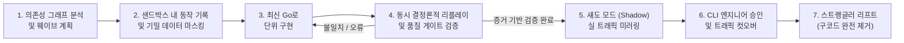

<div align="center">

  

  <h1>go-anything</h1>
  <p><strong>어떤 언어에서든 모던 Go로 안전하게 점진적 전환 — 한 번에 검증된 한 단위(Unit)씩.</strong></p>
  <p>위험 부담이 큰 빅뱅 방식의 전면 재작성을 점진적인 스트랭글러(Strangler Fig) 마이그레이션으로 대체하세요.<br />기록된 동작 증거, 자동화된 품질 게이트, 엔지니어의 명시적 승인을 통해 완벽한 안전성을 보장합니다.</p>

  <p>
    <a href="https://go.dev/"></a>
    <a href="LICENSE"></a>
    <a href="https://github.com/mohammedrefat/go-anything/releases"></a>
    <a href="#마일스톤-로드맵-m0m7"></a>
  </p>

  <p>
    <a href="#5분-퀵스타트">퀵스타트</a> ·
    <a href="Docs/USER_GUIDE.md">사용자 가이드</a> ·
    <a href="#동작-원리">동작 원리</a> ·
    <a href="#마일스톤-로드맵-m0m7">로드맵</a> ·
    <a href="GOVERNANCE.md">거버넌스</a> ·
    <a href="SECURITY.md">보안</a> ·
    <a href="Docs/go-anything%20Architecture%20%26%20Implementation%20Plan%20(v3)%20(1).md">아키텍처</a>
  </p>

  <p>
    <strong>다국어 지원:</strong><br />
    <a href="README.md">English</a> ·
    <a href="README.es.md">Español</a> ·
    <a href="README.zh-CN.md">简体中文</a> ·
    <a href="README.ja.md">日本語</a> ·
    <a href="README.de.md">Deutsch</a> ·
    <a href="README.fr.md">Français</a> ·
    <a href="README.pt-BR.md">Português (Brasil)</a> ·
    <a href="README.ru.md">Русский</a> ·
    <a href="README.ar.md">العربية</a> ·
    <a href="README.hi.md">हिन्दी</a> ·
    <a href="README.ko.md">한국어</a>
  </p>

</div>

---

> [!NOTE]
> 이 번역 문서는 **v1.0.0** 릴리스 기준이며, [README.md](README.md)의 최신 영어 사양(v1.0.1+)과 차이가 있거나 지연될 수 있습니다.

---

## 목차

- [동작 원리](#동작-원리)
- [왜 go-anything인가?](#왜-go-anything인가)
- [동작 동등성(Parity)에 대한 명시적 면책 조항](#동작-동등성parity에-대한-명시적-면책-조항)
- [5분 퀵스타트](#5분-퀵스타트)
- [마일스톤 로드맵 (M0–M7)](#마일스톤-로드맵-m0m7)
- [자율 AI 에이전트와 MCP 워크플로](#자율-ai-에이전트와-mcp-워크플로)
- [아키텍처 및 설계 원칙](#아키텍처-및-설계-원칙)
- [저장소 구조도](#저장소-구조도)
- [거버넌스 및 기여 안내](#거버넌스-및-기여-안내)
- [라이선스](#라이선스)

---

## 동작 원리

`go-anything`은 애플리케이션을 **한 번에 한 단위(Unit)씩** Go로 이전하며, 실제 트래픽을 전환하기 전에 원본 시스템의 기록된 동작과 정확히 일치함을 자동으로 증명합니다.

- **기계적 AST 코드 번역기가 아닙니다:** 개발자 또는 AI 코딩 에이전트가 관용적이고 모던한 Go 코드를 직접 작성합니다. `go-anything`은 오케스트레이션, 샌드박스 격리, 동작 캡처, 차분 리플레이, 엄격한 품질 게이트를 담당합니다.
- **스트랭글러 패턴 (Strangler Fig):** 기존 애플리케이션은 지속적으로 가동됩니다. 경계가 정의된 단위를 역방향 프록시나 사이드카 라우터 뒤에서 하나씩 교체하며, 문제 발생 시 즉각 롤백할 수 있습니다.
- **Fail-Closed 방식의 무결성 검증:** 기록된 트래픽과 퍼징(Fuzzing) 입력을 양쪽 구현체에 동시에 주입하고, 결정론적 규칙에 따라 출력을 엄격히 비교하여 동등성을 입증합니다.



---

## 왜 go-anything인가?

| 위험천만한 전면 재작성 (Big-Bang) | 검증 기반의 점진적 마이그레이션 (`go-anything`) |
| :--- | :--- |
| 전체 코드베이스를 한 번에 교체 | 위상 의존성 웨이브에 따라 고립된 한 단위씩 안전하게 전환 |
| 운영 배포 후에야 엣지 케이스와 장애 발견 | 트래픽을 전환하기 전에 기록된 실제 테스트 벡터와 대조 |
| 일회성 대화창 세션에 작업 맥락과 진행 상황 유실 | 감사 및 버전 관리가 가능한 JSON/JSONL 파일에 영구 보관 |
| "테스트 통과했으니 괜찮겠지"라는 맹목적 동등성 신뢰 | 실제 캡처된 테스트 벡터에 기반한 명시적 동등성 보장 한계 |
| 자율 에이전트에게 무제한적인 배포 권한 부여 | `approve`, `promote`, `lift`는 오직 인간 엔지니어만 실행 가능 |

---

## 동작 동등성(Parity)에 대한 명시적 면책 조항

> [!IMPORTANT]
> **동등성 보장에는 명확한 한계가 존재합니다.**
>
> 동등성은 **오직 기록되고 관측되었으며 퍼징 테스트를 거친 입력에 대해서만** 보장되며, 관측되지 않은 동작 경로까지 보장하지 않습니다. 동작 검증 통과는 기록된 테스트 데이터셋 하에서의 동작 일치를 증명하는 것이며, 테스트되지 않은 모든 경로에 대한 수학적 동등성을 의미하지는 않습니다.
>
> `go-anything`은 이중 실행(Dual-run)을 통해 휘발성 필드(타임스탬프, 랜덤 토큰, UUID)를 자동으로 감지하고 정규화하지만, 마이그레이션 팀은 트래픽 전환 전에 반드시 차분 리포트와 테스트 커버리지를 검토해야 합니다.

---

## 5분 퀵스타트

깨끗한 환경에서 프로젝트 초기화, 동작 기록, Go 단위 구현, 품질 게이트 통과, 리플레이 검증까지 직접 실습해 보세요:

### 사전 요구 사항

- [Go 1.26+](https://go.dev/dl/)가 설치되어 있고 시스템 `PATH`에 등록되어 있어야 합니다.
- Git이 설치되어 있어야 합니다.

### 1단계: `go-anything` 설치

저장소를 복제하고 CLI 도구를 설치합니다:

```bash
git clone https://github.com/mohammedrefat/go-anything.git
cd go-anything

# $GOPATH/bin에 CLI 바이너리 설치
go install ./cmd/go-anything

# 설치 확인
go-anything version
# 출력 예시: go-anything v1.0.0 (profile: full, jobs: 8)
```

---

### 2단계: 워크스페이스 초기화 및 모더나이즈

마이그레이션 전용 워크스페이스를 생성하거나 기존 프로젝트를 현대화합니다. 기존 Go 서비스의 경우 `modernize` 명령이 `legacy/`(기존 코드 보존)와 `modern/`(새로운 Go 코드)을 자동 구성합니다:

```bash
# 대상 서비스를 위한 워크스페이스 초기화
go-anything init --source=go --name=sample-service /path/to/my-service
cd /path/to/my-service

# 워크스페이스 상태 및 보안 설정 검사
go-anything doctor
```

`go-anything doctor`는 다음을 검사합니다:
- `.go-anything/units/`의 상태 저장소 무결성
- `.gitignore`에 `.go-anything/local/` 포함 여부 (임시 임대 및 잠금 파일의 커밋 방지)
- `.go-anything/rules.json`의 기밀 정보 마스킹 규칙
- 운영체제 샌드박스 격리 기능 준비 상태

---

### 3단계: 단위 및 의존성 웨이브 확인

등록된 단위 목록과 실행 웨이브 순서, 활성 임대 상태를 확인합니다:

```bash
go-anything status
```

출력 예시:
```text
Workspace: sample-service (schemas: v1)
Dependency Waves:
  Wave 0:
    [Ready] unit-healthcheck (dependencies: none, risk: low)
    [Ready] unit-auth-token  (dependencies: none, risk: medium)
  Wave 1:
    [Planned] unit-user-api   (dependencies: [unit-auth-token], risk: high)
```

---

### 4단계: 동작 테스트 케이스 기록 (샌드박스 격리 및 마스킹)

기존 애플리케이션에서 실제 동작을 캡처합니다. `go-anything record`는 제한된 샌드박스 내에서 명령을 실행하고, 메모리 상에서 기밀 정보를 마스킹한 후 안전한 JSONL 형식으로 저장합니다:

```bash
go-anything record \
  --unit unit-healthcheck \
  --cmd "./legacy-service --health" \
  --dir .
```

`go-anything`이 자동으로 수행하는 작업:
- 동적 변경 필드(타임스탬프 등)를 감지하기 위한 이중 실행 비교.
- 비밀번호, 토큰, 쿠키 등을 형식을 유지하는 가상 데이터로 치환.
- `.go-anything/cases/unit-healthcheck.jsonl`에 케이스 저장.
- 단위 상태를 `Planned`에서 `Recorded`로 전환.

---

### 5단계: 모던 Go로 단위 구현

`modern/` 디렉터리에 Go 코드를 작성합니다 (AI 코딩 에이전트가 작성할 수도 있습니다):

```go
// modern/health/main.go
package main

import (
    "encoding/json"
    "os"
)

type HealthResponse struct {
    Status string `json:"status"`
}

func main() {
    resp := HealthResponse{Status: "ok"}
    _ = json.NewEncoder(os.Stdout).Encode(resp)
}
```

Go 바이너리 빌드:
```bash
go build -o ./bin/modern-health ./modern/health/main.go
```

---

### 6단계: 동시 결정론적 리플레이 실행

새로 빌드된 Go 바이너리에 대해 기록된 모든 케이스를 병렬로 재생합니다:

```bash
go-anything replay \
  --unit unit-healthcheck \
  --target ./bin/modern-health \
  --dir .
```

출력:
```text
[REPLAY] Replaying 10 recorded cases for 'unit-healthcheck' across 8 workers...
  ✓ case-001: MATCH (0.8ms)
  ✓ case-002: MATCH (0.9ms)
  ...
  ✓ case-010: MATCH (0.7ms)
Replay complete: 10/10 passed (0 mismatches, 0 errors).
```

---

### 7단계: 품질 게이트 검증

전체 품질 게이트 검사(`build`, `vet`, `test -race`, `govulncheck`, `error_paths`, `api_compat`)를 실행합니다:

```bash
go-anything verify unit-healthcheck \
  --target ./bin/modern-health \
  --profile replay \
  --dir .
```

자동화 CI 또는 MCP 에이전트 세션(`run_gate`)에서는 현재 Git 커밋과 연결된 검증 증거가 `.go-anything/evidence/`에 저장되며 단위 상태가 `Verified`로 승격됩니다.

---

### 8단계: 엔지니어 최종 승인, 프로모트 및 레거시 제거 (Lift)

검증 완료 후, 담당 엔지니어가 CLI를 통해 승인하고 실 트래픽을 전환한 뒤 레거시 코드를 안전하게 제거합니다:

```bash
# 1. 엔지니어 승인 (CLI 전용, MCP 도구로 호출 불가)
go-anything approve unit-healthcheck --skip-shadow

# 2. 라우팅을 모던 Go 구현체로 전환
go-anything promote unit-healthcheck

# 3. 폴백 트래픽이 0으로 유지되면 구버전 브리지 완전 제거
go-anything lift unit-healthcheck
```

---

## 마일스톤 로드맵 (M0–M7)

기초 아키텍처부터 v1.0.0 정식 릴리스까지 모든 마일스톤이 성공적으로 구현되고 검증되었습니다:

| 마일스톤 | 릴리스 | 주요 범위 및 산출물 | 종료 게이트 상태 |
| :--- | :--- | :--- | :--- |
| **M0: 기반 구축** | `v0.0.x` | 10상태 머신, 원자적 I/O, 파일 잠금, Fail-Closed 마스킹, 샌드박스, CLI 골격, ADR-001/002. | ✅ **통과:** `init` 및 `doctor` 정상 통과. |
| **M1: 샌드박스 리플레이** | `v0.0.x` | 이중 실행 휘발성 감지, 멀티모드 비교기(exact, json, numeric, regex), 동시 리플레이 엔진. | ✅ **통과:** 3회 연속 동일 리플레이 100% 일치. |
| **M2: 프론트도어 및 리프트** | `v0.0.x` | 리버스 프록시, 비상 킬스위치(`KILL_SWITCH=1`), 폴백 모니터링 및 `lift` 명령. | ✅ **통과:** CLI 및 HTTP 데모 앱 전체 라이프사이클 통과. |
| **M3: Go 소스 어댑터** | `v0.1.0` | Go AST 분석기, 타입 추론, 호출 그래프 기반 웨이브 계획, `modernize` 워크플로. | ✅ **통과:** 실제 Go 서비스 0 불일치 모더나이즈 달성. |
| **M4: 품질 게이트 & MCP** | `v0.1.0` | 6단계 품질 게이트 러너, 스코어카드, stdio MCP 서버 (8개 도구) 및 페이로드 새니타이징. | ✅ **통과:** AI 에이전트가 단독으로 단위 전체 포팅 완료. |
| **M5: 섀도 모드 & 캡처** | `v0.1.0` | 실시간 트래픽 미러링, 유계 워커 풀, 기본 멱등(GET/HEAD) 요청 한정, 실 트래픽 검증. | ✅ **통과:** 무장애 섀도 로그 확보 및 사례 연구 완료. |
| **M6: Python 어댑터** | `v0.2.0` | Python 소스 어댑터 (AST 임포트 분석, pytest 지원, Subprocess/HTTP/C-Shared 채널). | ✅ **통과:** Python CLI 및 FastAPI 서비스 포팅 완료. |
| **M7: TypeScript & 스키마 동결** | `v1.0.0` | TypeScript/Node 어댑터 (ESM/CommonJS, Jest/Vitest), `schemas/v1/` 정식 동결, `GOVERNANCE.md`. | ✅ **통과:** 다중 단위 오픈소스 프로젝트의 완전한 리프트 완료. |

---

## 자율 AI 에이전트와 MCP 워크플로

`go-anything`은 `stdio`를 통해 동작하는 표준 모델 컨텍스트 프로토콜(Model Context Protocol, MCP) 서버를 내장하고 있습니다:

```bash
go-anything mcp
```

### 8가지 표준 MCP 도구

MCP 서버는 서버 측에서 10상태 라이프사이클을 엄격하게 강제합니다. 에이전트가 단계를 건너뛰거나 검증 결과를 조작할 수 없습니다:

1. `status` — 진행 상황, 웨이브 순서상 다음 단위, 활성 임대 및 차단 요소 조회.
2. `claim_unit` — `Ready` 상태의 단위를 기간 한정 로컬 임대로 획득 (`.go-anything/local/`).
3. `inspect_unit` — 원본 코드, 정제된 케이스, 언어별 함정 및 제약 조건 확인.
4. `record_cases` — 샌드박스에서 원본 앱을 실행하여 기밀 마스킹 후 JSONL로 저장.
5. `verify_diff` — Go 코드를 빌드하고 케이스를 리플레이하여 정제된 차분 출력.
6. `run_gate` — 6단계 품질 게이트를 실행하고 커밋 연결 증거 파일 생성.
7. `mark_verified` — 단위를 `Verified` 상태로 전이 (현재 HEAD 커밋 증거 필수).
8. `handoff` — 진행 내역과 다음 단계를 정리한 `HANDOFF.md` 작성.

> **엄격한 인간 전용 권한 제한:** MCP 도구에는 `approve`, `promote`, `lift` 및 실서버 라우팅 변경 기능이 **절대 포함되지 않습니다**.

---

## 아키텍처 및 설계 원칙

1. **작고 되돌릴 수 있는 단계:** 스트랭글러 패턴을 준수하여 점진적 교체. 최종 `lift` 전까지는 원본 시스템이 즉각적인 폴백 수단으로 기능합니다.
2. **메모리 내 Fail-Closed 기밀 마스킹:** 토큰과 비밀키는 디스크에 기록되기 전에 치환됩니다. 해석 불가능한 기밀 데이터가 감지되면 기록이 즉시 중단됩니다.
3. **엄격한 샌드박스 격리:** Linux 네임스페이스(Tier 1) 및 macOS/Windows 프로세스 격리(Tier 2)를 적용하며 기본적으로 외부 네트워크가 차단됩니다.
4. **결정론적 증거 보존:** 모든 테스트 케이스와 차분 보고서는 실행 시간이 아닌 `case_id` 기준으로 일관되게 정렬됩니다.
5. **로컬 우선 및 원격 텔레메트리 제로:** 모든 상태는 오직 로컬 `.go-anything/` 내에만 저장되며 외부로 어떠한 데이터도 전송되지 않습니다.
6. **어댑터 분리 구조:** 언어 어댑터는 동결된 `pkg/adapterkit` 인터페이스를 통해서만 통신하며 공식 인증 테스트 `pkg/adapterkit/conformance`를 100% 통과해야 합니다.

---

## 저장소 구조도

```text
cmd/go-anything/        CLI 진입점 및 stdio MCP 서버
pkg/adapterkit/         공개 및 동결된 어댑터 표준 규약 (v1)
  └── conformance/      공식 어댑터 적합성 인증 테스트 스위트
internal/               핵심 마이그레이션 엔진:
  ├── analyzer/         소스코드 AST 분석, 타입 추론 및 호출 그래프
  ├── bench/            지연 시간 및 메모리 할당 벤치마크
  ├── comparator/       멀티모드 차분 비교기 (exact, json, numeric, regex)
  ├── gate/             품질 게이트 실행기 (build, vet, staticcheck, race, vuln)
  ├── mcp/              페이로드 새니타이징이 적용된 stdio MCP 서버
  ├── migrate/          워크스페이스 메타데이터 스키마 업그레이드 엔진
  ├── planner/          위상 정렬 기반 의존성 웨이브 플래너
  ├── recorder/         샌드박스 케이스 기록 및 휘발성 필드 감지기
  ├── redactor/         메모리 내 Fail-Closed 기밀 데이터 치환기
  ├── replay/           동시 결정론적 테스트 리플레이 엔진
  ├── sandbox/          Linux 네임스페이스 및 OS 프로세스 격리
  ├── shadow/           실 트래픽 섀도 미러링 엔진
  └── state/            10상태 라이프사이클, 원자적 I/O 및 파일 잠금
adapters/               언어 및 런타임 어댑터:
  ├── source/           소스코드 분석 어댑터 (Go, Python, TypeScript)
  └── application/      애플리케이션 실행 어댑터 (CLI, HTTP, Foreign Library, Worker)
schemas/                버전 관리되는 JSON 스키마:
  ├── v1/               안정화 및 동결된 정식 스키마 (manifest, units, rules 등)
  └── v1alpha1/         초기 알파 스키마 (migrate 명령을 통해 업그레이드 가능)
Docs/                   아키텍처, 결정 기록 및 실제 적용 사례:
  ├── USER_GUIDE.md     상세 사용자 매뉴얼 및 명령어 레퍼런스
  ├── decisions/        아키텍처 결정 기록 (ADR-001, ADR-002)
  └── case-studies/     실전 적용 도그푸딩 사례 연구 (M3, M4, M5, M6, M7)
GOVERNANCE.md           메인테이너 역할, 합의 모델, RFC 프로세스 및 어댑터 인증
SECURITY.md             위협 모델, 샌드박스 등급 및 보안 취약점 보고 절차
CONTRIBUTING.md         개발 환경 설정, 코딩 표준 및 필수 검증 절차
```

---

## 거버넌스 및 기여 안내

- **거버넌스 모델:** [GOVERNANCE.md](GOVERNANCE.md)에서 메인테이너 역할, RFC 절차, 어댑터 인증 기준을 확인하세요.
- **보안 정책:** [SECURITY.md](SECURITY.md)에서 위협 모델 및 취약점 제보 채널을 확인하세요.
- **상세 사용자 매뉴얼:** [사용자 가이드](Docs/USER_GUIDE.md)에서 단계별 실습 예제와 세부 지침을 확인하세요.
- **기여 가이드:** [CONTRIBUTING.md](CONTRIBUTING.md)를 검토하신 후 기여해 주시기 바랍니다.

자동 Git 커밋 검증 훅을 활성화하려면:

```bash
git config core.hooksPath .githooks
```

---

## 라이선스

`go-anything`은 [Apache License, Version 2.0](LICENSE)에 따라 배포됩니다. 외부 저작권 고지는 [NOTICE](NOTICE)를 참조하세요.
