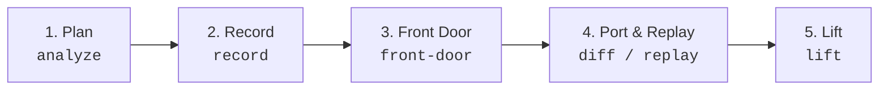

# go-anything

**Rewrite your app in Go, one piece at a time, with behavior proven against recorded cases.**

[](https://goreportcard.com/report/github.com/mohammedrefat/go-anything)
[](LICENSE)
[](https://golang.org)
[](#ai-agent-integration-mcp)
[](#security-and-data-safety)

---

### ⚠️ Parity Disclaimer

> [!IMPORTANT]
> **Parity is claimed only for recorded and fuzzed inputs, never for unobserved behavior.**  
> `go-anything` is **not** a black-box code translator or transpiler. The AI coding agent (or human engineer) writes the Go implementation; `go-anything` orders the work into dependency waves, captures behavioral fixtures, replays and compares diffs, enforces quality gates, manages the strangler front door, and tracks migration state outside ephemeral chat sessions. Parity is claimed only for recorded and fuzzed inputs. The developer and the test suite remain the final authority.

---

## Quick Start

### 1. Install `go-anything`

```bash
go install github.com/mohammedrefat/go-anything/cmd/go-anything@latest
```

### 2. Register with your AI Coding Assistant

`go-anything setup` automatically configures the Model Context Protocol (MCP) server and installs workflow skills for detected tools (**Claude Code**, **Cursor**, **Gemini CLI**, **Codex**, and **OpenCode**):

```bash
go-anything setup
```

### 3. Prompt your Agent

Point your coding assistant at any CLI, HTTP service, library, or worker:

> *"Rewrite this application in Go with go-anything, end to end. Follow the strangler pattern, run `go-anything status` to plan waves, record behavioral cases before touching code, verify diffs on every unit, and report when ready for cutover."*

*(Or run it yourself manually using the CLI steps below).*

---

## The Problem: Why Big Rewrites Fail

Every engineering team has considered rewriting a legacy Python, TypeScript, Ruby, or older Go application in Go for speed, concurrency, and lower cloud bills. Almost all "big bang" rewrites fail for the same reasons:

- **The All-or-Nothing Trap:** A full-app rewrite takes months during which no new features ship and the branch cannot be deployed.
- **Unobserved Edge Cases & Semantic Traps:** Real apps depend on undocumented behaviors—empty slice JSON representations (`null` vs `[]`), string byte vs rune slicing, timestamp sub-second truncation, HTML escaping in JSON, and error return types.
- **Agent Drift:** When LLMs rewrite entire codebases in chat sessions, they hallucinate dependencies, skip edge cases, and lose track of progress across sessions.

`go-anything` fixes this by implementing the **Strangler Fig pattern** with **empirical behavioral verification**.

---

## How It Works: The 5-Step Strangler Workflow



### 1. Plan (`go-anything analyze`)
`go-anything` analyzes your legacy application (CLI, HTTP server, library, or worker), maps the dependency graph, identifies semantic trap risks, and generates an ordered execution plan divided into topological migration waves.

### 2. Record (`go-anything record`)
Before writing any Go code, `go-anything` runs the original application against:
- Documented examples (`curl` commands, CLI flags, usage docs)
- Existing test suites
- Generated boundary inputs and differential fuzzing
- Real captured production payloads

Each case is run **twice** through fail-closed in-memory redaction and format-preserving substitution. Volatile dynamic fields (timestamps, UUIDs, request IDs) are automatically isolated into `.go-anything/rules.json`.

### 3. The Front Door (`go-anything front-door`)
On day one, `go-anything` scaffolds a Go entrypoint in front of your system:
- **CLI:** Go binary intercepts `argv`. Ported subcommands run natively; unported commands fall back to `os/exec` of the original binary with `stdin`/`stdout`/`stderr` pass-through.
- **HTTP Server:** Go `net/http` server with `httputil.ReverseProxy`. Ported routes run natively; unported routes transparently proxy to the legacy process on a local port.
- **Libraries:** Idiomatic Go package facade calling the original runtime via subprocess or IPC bridge until ported.
- **Workers:** Go worker process consuming ported job topics, while legacy workers handle unported queues.

**The app stays 100% functional and deployable from day one.**

### 4. Port & Replay (`go-anything diff` / `replay`)
You or your AI coding agent implement one unit in Go. 

The tool replays all recorded behavioral cases against the new Go code. Every mismatch is output as an actionable structural diff:
```bash
# Replay all cases for a unit
go-anything replay --unit=checkout_cart

# Or debug a single failing edge case
go-anything replay --unit=checkout_cart --case=trap_empty_items
```

Every unit must clear the **Quality Gate**:
- `gofmt -s` and clean builds
- Static analysis (`go vet`, `staticcheck`, `golangci-lint`)
- `go test -race ./...` (mandatory race detector)
- `govulncheck` (zero known CVEs)
- **Zero mismatches on recorded cases**

#### Per-Unit Instant Kill Switch
If an unexpected issue arises in production, flip the kill switch without redeploying:
```bash
export GO_ANYTHING_UNIT_checkout_cart=original
```

### 5. The Lift (`go-anything lift`)
Once every unit in the wave has passed verification, survived shadow evaluation, and fallback traffic drops to zero:
```bash
go-anything lift --unit=checkout_cart
```
`lift` permanently removes the fallback shim, eliminates legacy wrappers, and re-runs the quality gate, leaving behind pure, idiomatic, high-performance Go code.

---

## Go Modernize Mode (`go-anything modernize`)

Need to upgrade an existing, aging Go codebase (Go 1.14–1.21) to modern Go 1.22+ idioms?

Run `go-anything modernize` (an alias for `go-anything init --source=go`). It partitions the modernization into three distinct tiers:

1. **Mechanical:** Automatic tooling (`go fix`, modernize analyzers, `golangci-lint --fix`) run first on an isolated branch.
2. **Idiomatic:** AI agent introduces modern standard library features:
   - Structured logging (`log/slog`) replacing `logrus` or raw `log`
   - Modern `net/http` routing with method and wildcard matching (Go 1.22+)
   - Standard error wrapping (`%w`, `errors.Is`, `errors.As`)
   - `context.Context` plumbing and generics (`any`, generic collections)
   - Eliminating global variables and unconstrained `init()` routines
3. **Architectural:** Decoupling monoliths into clean package boundaries, tested via generated parity drivers and differential fuzzing (`go test -fuzz`).

---

## Semantic Traps Handled

Go handles serialization, concurrency, and types differently than Python, TypeScript, Ruby, or older Go runtimes. `go-anything` automatically generates trap cases for these common discrepancies:

| Semantic Trap | What Goes Wrong | How `go-anything` Solves It |
| :--- | :--- | :--- |
| **Empty Slices vs Nil** | `nil` slice serializes to JSON `null`; empty slice `[]T{}` serializes to `[]`. | Flags collection fields; verifies exact JSON output shape. |
| **HTML Escaping in JSON** | Go's `encoding/json` escapes `<`, `>`, and `&` to unicode escapes by default. | Detects unescaped legacy payloads; configures custom encoder or normalizer. |
| **Map Key Ordering** | Go serializes map keys alphabetically; other runtimes preserve insertion order. | Replay comparator distinguishes unordered map equivalence from array ordering. |
| **Number Precision** | Untyped JSON decodes to `float64` in Go; integer overflow on `int64`, `-0`, `NaN`. | Catches float formatting differences, integer boundary overflows, and sign loss. |
| **String Offsets** | UTF-16 code units (JS/Python) vs UTF-8 byte offsets vs Go `rune` indexing. | Generates multi-byte emoji and Unicode test vectors (`🚀`, `ñ`, zero-width joiners). |
| **Time Formats** | Millisecond vs nanosecond precision; timezone formatting (`Z` vs `+00:00`). | Normalizes volatile time fields while asserting strict schema structure. |
| **Error Contracts** | Error messages, exit codes, and HTTP status codes. | Replays error paths; verifies non-zero exit codes match legacy behavior. |

---

## The Workspace Layout (`.go-anything/`)

All migration state, rules, and behavioral evidence live in `.go-anything/` in your repository root, ensuring multi-session agent persistence and clean git pull requests:

```text
.go-anything/
  manifest.json       # Index of units, dependency waves, schema_version
  rules.json          # Detected wildcards (timestamps, UUIDs) and field normalizers
  units/              # Durable state file per unit (JSON)
    auth.json
    checkout.json
  cases/              # Redacted test cases (versioned JSONL per unit)
    auth.jsonl
    checkout.jsonl
  reports/            # Structural diffs, benchmarks, shadow logs, scorecard.md
  evidence/           # Gate check reports cryptographically tied to git commits
  local/              # Gitignored: Active agent leases and OS file locks
```

> [!NOTE]
> Transient claims and leases live strictly in `.go-anything/local/`. Pull requests never suffer merge conflicts from agent locks.

---

## AI Agent Integration (MCP)

`go-anything mcp` communicates over `stdio` using the standard Model Context Protocol. It allows any coding assistant to autonomously claim units, inspect code, port units, and run gates while strictly enforcing safety guardrails:

```mermaid
sequenceDiagram
    participant Agent as AI Coding Agent
    participant MCP as go-anything MCP
    participant Core as Core Verification Engine
    participant Human as Developer (CLI)

    Agent->>MCP: status
    MCP-->>Agent: Next available unit (Wave 1: "auth")
    Agent->>MCP: claim_unit("auth")
    MCP-->>Agent: Lease granted (stored in local/)
    Agent->>MCP: inspect_unit("auth")
    MCP-->>Agent: Legacy source, detected traps, sanitized sample cases
    Note over Agent: Agent writes Go port in workspace
    Agent->>MCP: verify_diff("auth")
    MCP->>Core: Run sandboxed replay
    Core-->>MCP: Results: 42/42 cases passed (0 mismatches)
    MCP-->>Agent: PASS
    Agent->>MCP: run_gate("auth")
    MCP->>Core: Run gofmt, vet, staticcheck, race, govulncheck
    Core-->>MCP: All checks clean; evidence saved
    Agent->>MCP: mark_verified("auth")
    MCP-->>Agent: Unit status advanced to Verified
    Note over Human: Human reviews scorecard.md in PR
    Human->>Core: go-anything cutover --unit=auth
```

### Safe Guardrails: Human-Only Gates
AI agents are **forbidden** from executing destructive or administrative operations. The following actions are CLI-only and require an explicit human developer:
- `go-anything approve` (human sign-off)
- `go-anything cutover` (traffic routing change)
- `go-anything lift` (permanent legacy code deletion)

---

## Security & Data Safety

Migrating code with AI agents often involves sensitive payloads. `go-anything` enforces fail-closed safety by default:

1. **In-Memory Fail-Closed Redaction:** Detects Authorization headers, bearer tokens, cookies, API keys, PEM private keys, and credit card numbers before payloads hit disk. Unparseable payloads cause recording to fail closed.
2. **Format-Preserving Substitution:** Redacted values are replaced with synthetically valid equivalents of identical shape (e.g., Luhn-valid test card numbers, valid JWT structures), allowing the legacy app to execute successfully.
3. **Restricted Sandbox Execution:** Original applications execute with network access disabled (`--allow-network` to opt-in), strict environment variable allowlists, isolated temporary working directories, and CPU/memory limits.
4. **Local Only & Zero Telemetry:** `go-anything` sends zero telemetry, makes no external network calls, and speaks purely through `stdio`.
5. **Prompt-Injection Defense:** Payloads surfaced through `inspect_unit` or `verify_diff` are truncated, stripped of terminal escape sequences, and enclosed in strict data delimiters.

---

## Parity Scorecard

When a unit or milestone passes, `go-anything` generates an auditable `scorecard.md`:

```markdown
### go-anything Parity Scorecard
- **Units Verified:** 8 / 8
- **Cases Evaluated:** 3,420 (Happy: 1,850 · Edge: 920 · Traps: 450 · Fuzz: 200)
- **Mismatches:** 0
- **Original Code Coverage:** 78.4%
- **Data Races:** 0 (`go test -race ./...` clean)
- **Vulnerabilities:** 0 (`govulncheck` clean)
```

> [!TIP]
> `go-anything` **never** outputs a bare `Mismatches: 0`. Without displaying case counts, category breakdowns, and original code coverage, a bare zero gives a false sense of security.

---

## CLI Commands Reference

| Command | Description |
| :--- | :--- |
| `go-anything setup` | Configures MCP servers and installs skills for Claude Code, Cursor, Gemini CLI, etc. |
| `go-anything init` | Initializes `.go-anything/` in a project with target runtime and front door scaffolding. |
| `go-anything modernize` | Initializes a Go-to-Go modernization project (`--source=go`). |
| `go-anything analyze` | Analyzes project dependencies, identifies traps, and generates wave plan. |
| `go-anything record` | Records baseline behavioral cases from tests, docs, and fuzzing in a sandboxed runner. |
| `go-anything diff` | Replays cases against the Go port and outputs structural difference reports. |
| `go-anything gate` | Executes the complete Quality Gate (`gofmt`, linters, race detector, `govulncheck`). |
| `go-anything shadow` | Starts the Go front door in shadow mode on real traffic; logs diffs to `shadow_mismatches.jsonl`. |
| `go-anything cutover` | Switches primary production traffic to the verified Go unit (enables kill switch). |
| `go-anything lift` | Strips out legacy fallback shims and wrapper scaffolding once fallback traffic hits zero. |
| `go-anything doctor` | Verifies repository health, checks for committed secrets, and validates `.gitignore` coverage. |
| `go-anything mcp` | Starts the Model Context Protocol server over `stdio` for agent workflows. |

---

## Roadmap

| Release | Milestones | Scope & Capabilities |
| :--- | :--- | :--- |
| **v0.0.x** | **M0 – M2** | Architecture foundation, state machine, fail-closed redactor, sandbox runner, record/replay engine, Go front door, kill switch, and `lift` command for CLI and HTTP. |
| **v0.1.0** | **M3 – M5** | Modernize Go source adapter (`go/packages`, `go/types`), full MCP server, Quality Gate, scorecard generator, shadow mode, and first public dogfooding case study. |
| **v0.2.0** | **M6** | Python language adapter (subprocess and HTTP bridges), differential fuzzing, Python CLI & FastAPI case study. |
| **v1.0.0** | **M7** | Frozen `pkg/adapterkit` contract and `v1` schemas, TypeScript/Node.js adapter, community governance (`GOVERNANCE.md`). |

---

## Extensibility: `pkg/adapterkit`

Want to support a new source language or application runtime? `pkg/adapterkit` provides a transport-agnostic interface:

- **Transport Agnostic:** Supports `InProcess`, `Subprocess`, `HTTP`, and `CShared` adapters.
- **Capabilities Contract:** External adapters declare explicit privileges (`read_repo`, `run_original`, `network`). Core rejects any undeclared action.
- **Clear Ownership Split:** Adapters describe data semantics (identifying secret, volatile, or ordered fields); Core owns redaction, sandbox boundaries, and shadow routing.

---

## License & Acknowledgments

- Licensed under the **Apache License, Version 2.0**. See [LICENSE](LICENSE) for details.
- Architecture, strangler fig design, and behavioral record/replay workflow directly inspired by [rust-anything](https://github.com/erkamyaman/rust-anything) (MIT, Copyright (c) 2026 Erkam Yaman). See [NOTICE](NOTICE).
