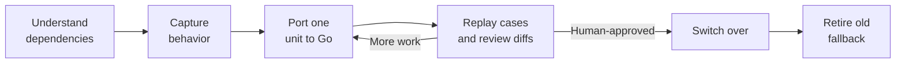

<div align="center">

  

  <h1>go-anything</h1>
  <p><strong>Move from any language to modern Go—one piece at a time.</strong></p>
  <p>Replace the risky big-bang rewrite with a gradual migration, backed by<br />recorded behavior and human-reviewed changes.</p>

  <p>
    <a href="https://go.dev/"></a>
    <a href="LICENSE"></a>
    
  </p>

  <p>
    <a href="#quickstart">Quickstart</a> ·
    <a href="#the-idea">How it works</a> ·
    <a href="#project-status">Project status</a> ·
    <a href="Docs/go-anything%20Architecture%20%26%20Implementation%20Plan%20(v3)%20(1).md">Architecture</a>
  </p>

</div>

> [!WARNING]
> **Early development:** workspace setup, status and health checks, and parts of the record/replay/verification workflow are available. Automatic source analysis and some later-stage workflow commands are not wired up yet. Check command help and the guide below before relying on a command; APIs and schemas may change.

---

## On this page

- [The idea](#the-idea)
- [Why go-anything?](#why-go-anything)
- [Project status](#project-status)
- [Quickstart](#quickstart)
- [How to use go-anything](#how-to-use-go-anything)
- [Design principles](#design-principles)
- [Repository map](#repository-map)
- [Roadmap](#roadmap)
- [Contributing](#contributing)
- [License](#license)

## The idea

Migrate an application without putting the whole rewrite on the critical path. Keep the existing app running, replace a small unit at a time, and compare the new Go implementation against behavior you have actually captured.



This is the **strangler pattern** with behavioral checks in the loop. The coding agent or engineer writes the Go implementation; `go-anything` aims to organize and verify the migration—not translate a codebase automatically.

## Why go-anything?

| Big-bang rewrite | Incremental migration |
| --- | --- |
| Replace the application all at once | Move one bounded unit at a time |
| Discover edge cases after cutover | Compare against recorded examples before switching |
| Lose progress between agent sessions | Keep plans and evidence with the project |
| Treat passing tests as a blanket guarantee | State exactly which observed cases were checked |

> **Parity has limits.** Passing recorded cases provides evidence for those cases; it does not prove equivalence for behavior you never observed.

## Project status

| Today | Direction |
| --- | --- |
| CLI help, version, workspace setup, status, and doctor | Automatic dependency analysis and migration planning |
| Early record, replay, and verification commands | Complete behavior capture and quality-gate workflow |
| Human approval and promotion commands | Fully integrated shadowing and gradual cutover |

**This is an early, incomplete workflow.** In particular, automatic source analysis is not wired up. For Go-to-Go migrations, `modernize` can prepare the workspace; for other source languages, `init` currently creates an empty workspace.

## Quickstart

Requires [Go 1.22+](https://go.dev/dl/).

```sh
git clone https://github.com/mohammedrefat/go-anything.git
cd go-anything

# See the current CLI help
go run ./cmd/go-anything help

# Print the development version
go run ./cmd/go-anything version

# Run the tests
go test ./...
```

The CLI currently reports `go-anything dev`. To install the CLI from the repository, run `go install ./cmd/go-anything`; then use `go-anything help` to see the available commands.

## How to use go-anything

Start by preparing a workspace for the application you want to migrate. For a Go application:

```sh
go run ./cmd/go-anything modernize /path/to/your-go-app
go run ./cmd/go-anything status /path/to/your-go-app
go run ./cmd/go-anything doctor /path/to/your-go-app
```

`modernize` sets up the `legacy/` original and `modern/` working copy and registers the units it can identify. For a different source language, initialize an empty workspace instead:

```sh
go run ./cmd/go-anything init --source=python --name=my-app /path/to/your-app
```

Once a unit is registered, the available early workflow is to record examples from the original, implement the unit in Go, then replay and verify those examples against your Go program:

```sh
go run ./cmd/go-anything record --unit <unit-id> --cmd "<original command>" --dir /path/to/your-app
go run ./cmd/go-anything replay --unit <unit-id> --target /path/to/ported-program --dir /path/to/your-app
go run ./cmd/go-anything verify <unit-id> --target /path/to/ported-program --dir /path/to/your-app
```

Recording runs the original command, so only use it with code you trust. Verification checks the recorded cases; it does not prove parity for behavior that was not observed. Commands for automatic analysis and some later migration stages are not yet fully connected. Run `go run ./cmd/go-anything help` for current command help, and see the [security policy](SECURITY.md) before running project code.

## Design principles

- **Small, reversible steps.** Keep the original application available while units are being replaced.
- **Evidence, not absolutes.** Compare known behavior and make the limits of parity explicit.
- **Human-owned decisions.** Review and release remain with the people responsible for the application.
- **Local, reviewable state.** Keep migration artifacts alongside the project, not inside a chat session.
- **Treat target code as code.** Tests and commands from a legacy repository can execute arbitrary project code. Only work with repositories you trust; read the [security policy](SECURITY.md).

These are design goals; they are not a claim that the current CLI enforces a complete migration workflow.

## Repository map

```text
cmd/go-anything/   CLI entry point
internal/          Core packages
pkg/adapterkit/    Experimental adapter contracts
schemas/           Schema package and v1alpha1 JSON Schemas
skills/            Agent workflow skill definitions
templates/         Project templates
Docs/              Architecture plans and decision records
.githooks/         Git hooks (pre-commit, commit-msg, pre-push)
```

For design details, see [DECISIONS.md](DECISIONS.md) and the [architecture and implementation plan](<Docs/go-anything Architecture & Implementation Plan (v3) (1).md>).

## Roadmap

- [ ] Connect the existing foundations to a usable CLI workflow.
- [ ] Build a complete record-and-replay path for a migration unit.
- [ ] Add reviewable verification gates before any cutover workflow.
- [ ] Grow language and application adapters behind the experimental adapter contract.

Roadmap items are goals; timelines and interfaces are subject to change.

## Contributing

Contributions and thoughtful feedback are welcome. Start with [CONTRIBUTING.md](CONTRIBUTING.md), and check the status above before building on commands or APIs that are not implemented or stable.

To enable the quality and security hooks after cloning, run:

```sh
git config core.hooksPath .githooks
```

## License

`go-anything` is available under the [Apache License, Version 2.0](LICENSE). See [NOTICE](NOTICE) for attribution.
