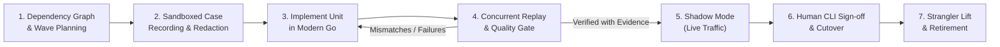

<div align="center">

  

  <h1>go-anything</h1>
  <p><strong>Move from any language to modern Go—one verified unit at a time.</strong></p>
  <p>Replace high-risk big-bang rewrites with an incremental strangler migration,<br />backed by recorded behavioral evidence, automated quality gates, and human-in-the-loop control.</p>

  <p>
    <a href="https://go.dev/"></a>
    <a href="LICENSE"></a>
    <a href="https://github.com/mohammedrefat/go-anything/releases"></a>
    <a href="#milestone-roadmap-m0m7"></a>
  </p>

  <p>
    <a href="#5-minute-vertical-slice-quickstart">Quickstart</a> ·
    <a href="Docs/USER_GUIDE.md">User Guide</a> ·
    <a href="#how-it-works">How it works</a> ·
    <a href="#milestone-roadmap-m0m7">Milestone Roadmap</a> ·
    <a href="GOVERNANCE.md">Governance</a> ·
    <a href="SECURITY.md">Security</a> ·
    <a href="Docs/go-anything%20Architecture%20%26%20Implementation%20Plan%20(v3)%20(1).md">Architecture</a>
  </p>

  <p>
    <strong>Translations:</strong><br />
    <a href="README.md">English</a> ·
    <a href="README.es.md">Español</a> ·
    <a href="README.zh-CN.md">简体中文</a> ·
    <a href="README.ja.md">日本語</a> ·
    <a href="README.de.md">Deutsch</a> ·
    <a href="README.fr.md">Français</a> ·
    <a href="README.pt-BR.md">Português (Brasil)</a> ·
    <a href="README.ru.md">Русский</a> ·
    <a href="README.ar.md">العربية</a> ·
    <a href="README.hi.md">हिन्दी</a> ·
    <a href="README.ko.md">한국어</a>
  </p>

</div>

---

## On this page

- [How it works](#how-it-works)
- [Why go-anything?](#why-go-anything)
- [Explicit Parity Disclaimer](#explicit-parity-disclaimer)
- [5-Minute Vertical-Slice Quickstart](#5-minute-vertical-slice-quickstart)
- [Milestone Roadmap (M0–M7)](#milestone-roadmap-m0m7)
- [Autonomous Agent & MCP Workflow](#autonomous-agent--mcp-workflow)
- [Architecture & Design Principles](#architecture--design-principles)
- [Repository Map](#repository-map)
- [Governance & Contributing](#governance--contributing)
- [License](#license)

---

## How it works

`go-anything` migrates applications to Go **one unit at a time** and proves each unit matches the original's recorded behavior before it ships.

- **Not an AST code translator:** You or your AI coding agent write idiomatic Go. `go-anything` provides the orchestrator, sandbox, behavioral capture, differential replay, and quality gates.
- **The Strangler Pattern:** The original application remains live and functional. Bounded units are replaced incrementally, running behind a reversible reverse proxy or sidecar router.
- **Fail-Closed Verification:** Parity is verified by replaying recorded and fuzzed traffic through both implementations and comparing outputs under deterministic rules.



---

## Why go-anything?

| Risky Big-Bang Rewrite | Verified Incremental Migration (`go-anything`) |
| :--- | :--- |
| Replace the entire codebase all at once | Move one isolated dependency wave at a time |
| Discover edge cases and regressions in production | Compare against recorded fixtures before traffic moves |
| Progress trapped inside ephemeral chat sessions | Durable state persisted in reviewable JSON/JSONL files |
| Blanket assumptions of parity ("tests passed") | Explicit parity boundaries tied to recorded test vectors |
| Autonomous agents given unconstrained deployment access | Human-only controls for `approve`, `promote`, and `lift` |

---

## Explicit Parity Disclaimer

> [!IMPORTANT]
> **Parity has limits.**
>
> Parity is claimed **only for recorded, observed, and fuzzed inputs**, never for unobserved behavior. Passing behavioral checks proves equivalence under the recorded test vectors and distributions—it is **not** a mathematical guarantee of semantic equivalence across arbitrary, untested execution paths.
>
> `go-anything` enforces dual-run recording to identify volatile fields (timestamps, random tokens, UUIDs) and normalizes them with auto-detected rules, but migration teams must review behavioral diffs and audit coverage before traffic cutover.

---

## 5-Minute Vertical-Slice Quickstart

Follow this self-contained walkthrough from a clean machine to initializing a project, recording behavior, implementing a Go unit, passing the quality gate, and replaying cases **without human assistance**.

### Prerequisites

- [Go 1.26+](https://go.dev/dl/) installed and available on your `PATH`.
- Git.

### Step 1: Install `go-anything`

Clone the repository and build or install the CLI:

```bash
git clone https://github.com/mohammedrefat/go-anything.git
cd go-anything

# Install CLI binary into $GOPATH/bin
go install ./cmd/go-anything

# Verify installation
go-anything version
# Output: go-anything v1.0.0 (profile: full, jobs: 8)
```

*(Alternatively, run commands directly via `go run ./cmd/go-anything <subcommand>`.)*

---

### Step 2: Initialize or Modernize a Workspace

Create a dedicated migration workspace or modernize an existing project. For a legacy Go microservice, `modernize` creates the `legacy/` reference copy and `modern/` target scaffold:

```bash
# Initialize a workspace for an existing service
go-anything init --source=go --name=sample-service /path/to/my-service
cd /path/to/my-service

# Inspect workspace health and security baseline
go-anything doctor
```

`go-anything doctor` validates:
- Unit state store in `.go-anything/units/`
- `.gitignore` protection for `.go-anything/local/` (preventing accidental lease commits)
- Redaction rules in `.go-anything/rules.json`
- Sandbox isolation readiness

---

### Step 3: Inspect Units and Dependency Waves

View registered units, their dependency waves, and active leases:

```bash
go-anything status
```

Output:
```text
Workspace: sample-service (schemas: v1)
Dependency Waves:
  Wave 0:
    [Ready] unit-healthcheck (dependencies: none, risk: low)
    [Ready] unit-auth-token  (dependencies: none, risk: medium)
  Wave 1:
    [Planned] unit-user-api   (dependencies: [unit-auth-token], risk: high)
```

---

### Step 4: Record Behavioral Cases (Sandboxed & Redacted)

Capture behavioral test cases from the original application. `go-anything record` executes the command inside a restricted sandbox, performs in-memory fail-closed redaction of sensitive credentials, and saves sanitized JSONL fixtures:

```bash
# Record behavioral cases from the original CLI or service
go-anything record \
  --unit unit-healthcheck \
  --cmd "./legacy-service --health" \
  --dir .
```

`go-anything` automatically:
- Executes the original binary twice to detect volatile outputs (timestamps, monotonic counters).
- Applies format-preserving substitution to secrets (passwords, tokens, cookies).
- Stores sanitized fixtures in `.go-anything/cases/unit-healthcheck.jsonl`.
- Transitions unit state from `Planned` to `Recorded`.

---

### Step 5: Implement the Ported Unit in Modern Go

Write the ported unit implementation in `modern/` (or let an autonomous coding agent write it):

```go
// modern/health/main.go
package main

import (
    "encoding/json"
    "os"
)

type HealthResponse struct {
    Status string `json:"status"`
}

func main() {
    resp := HealthResponse{Status: "ok"}
    _ = json.NewEncoder(os.Stdout).Encode(resp)
}
```

Build the ported target:
```bash
go build -o ./bin/modern-health ./modern/health/main.go
```

---

### Step 6: Concurrent Deterministic Replay

Replay all recorded cases against the ported Go binary across worker pools:

```bash
go-anything replay \
  --unit unit-healthcheck \
  --target ./bin/modern-health \
  --dir .
```

Output:
```text
[REPLAY] Replaying 10 recorded cases for 'unit-healthcheck' across 8 workers...
  ✓ case-001: MATCH (0.8ms)
  ✓ case-002: MATCH (0.9ms)
  ...
  ✓ case-010: MATCH (0.7ms)
Replay complete: 10/10 passed (0 mismatches, 0 errors).
```

---

### Step 7: Verification & Quality Gate

Verify the unit against the full quality gate (`build`, `vet`, `test -race`, `govulncheck`, `error_paths`, `api_compat`):

```bash
# Verify behavioral equivalence against recorded cases
go-anything verify unit-healthcheck \
  --target ./bin/modern-health \
  --profile replay \
  --dir .
```

When running in an automated pipeline or agent session via MCP (`run_gate`), commit-tied evidence is recorded under `.go-anything/evidence/`, advancing the unit state to `Verified`.

---

### Step 8: Human-in-the-Loop Approval, Promotion & Lift

In this walkthrough, `go-anything approve unit-healthcheck --skip-shadow` skips shadow validation and moves the unit directly from Verified to Approved. The operator can then promote the route and retire the legacy original once fallback traffic reaches zero:

```bash
# 1. Human sign-off (CLI-only, cannot be executed by MCP tools)
go-anything approve unit-healthcheck --skip-shadow

# 2. Switch strangler routing to modern Go implementation
go-anything promote unit-healthcheck

# 3. Retire the legacy bridge once fallback traffic reaches zero
go-anything lift unit-healthcheck
```

---

## Milestone Roadmap (M0–M7)

All core milestones from initial architecture through v1.0.0 have been fully implemented and verified:

| Milestone | Release | Scope & Deliverables | Exit Gate Status |
| :--- | :--- | :--- | :--- |
| **M0: Foundation** | `v0.0.x` | State machine (10 states), atomic I/O, file locks, fail-closed redactor, sandbox, CLI skeleton, ADR-001/002. | ✅ **Passed:** `go-anything init` + `doctor` pass with clean validation. |
| **M1: Sandboxed Replay** | `v0.0.x` | Dual-run volatility detection, multi-mode comparator (exact, json, numeric, regex), concurrent replay engine. | ✅ **Passed:** 100% replay across 3 identical consecutive runs. |
| **M2: Front Door & Lift** | `v0.0.x` | Reverse proxy front door, emergency kill-switch (`KILL_SWITCH=1`), fallback monitoring, and `lift` command. | ✅ **Passed:** Full strangler lifecycle on demo CLI & HTTP applications. |
| **M3: Go Source Adapter** | `v0.1.0` | Go AST analyzer, type resolution, call graph dependency wave planner, `go-anything modernize` workflow. | ✅ **Passed:** Real Go service ported with 0 mismatches. |
| **M4: Quality Gate & MCP** | `v0.1.0` | 6-check toolchain quality gate runner, scorecard engine, stdio MCP server (8 tools) with payload sanitization. | ✅ **Passed:** Autonomous AI agent ports a complete unit unaided. |
| **M5: Shadow & Capture** | `v0.1.0` | Real-time traffic shadowing, bounded pool with overflow counters, idempotent-only GET/HEAD default, capture ingestion. | ✅ **Passed:** Clean shadow log on live traffic + dogfood case study. |
| **M6: Python Adapter** | `v0.2.0` | Python source adapter (AST import analysis, pytest discovery, Subprocess, HTTP, C-Shared transports, foreign library wrappers). | ✅ **Passed:** Python CLI and FastAPI HTTP service ported + conformance suite pass. |
| **M7: TypeScript & Freeze** | `v1.0.0` | TypeScript/Node adapter (ESM/CommonJS, Jest/Vitest), `schemas/v1/` freeze, `go-anything migrate`, `GOVERNANCE.md`. | ✅ **Passed:** Multi-unit open-source project fully lifted with zero fallback traffic. |

---

## Autonomous Agent & MCP Workflow

`go-anything` includes a built-in Model Context Protocol (MCP) server that runs over `stdio` without external network listeners:

```bash
go-anything mcp
```

### The 8 Standard MCP Tools

The MCP server enforces the 10-state unit lifecycle server-side. Agents cannot forge gate results or skip steps:

1. `status` — Show progress, next unit in dependency wave order, active leases, and blockers.
2. `claim_unit` — Take a Ready unit with a time-bounded local lease in `.go-anything/local/`.
3. `inspect_unit` — View original source code, sanitized sample cases, detected traps, and constraints.
4. `record_cases` — Run the original application in the sandbox, apply fail-closed redaction, and save JSONL.
5. `verify_diff` — Build the port, replay all cases, and return PASS or top sanitized mismatches.
6. `run_gate` — Run the full quality gate pipeline and write commit-tied evidence.
7. `mark_verified` — Advance unit to Verified (rejected unless evidence exists for HEAD).
8. `handoff` — Write `HANDOFF.md` with progress and next steps for subsequent sessions.

> **Human-Only Boundary:** The MCP server **never** exposes `approve`, `promote`, `lift`, or routing changes. These remain human-only CLI commands.

---

## Architecture & Design Principles

1. **Small, Reversible Steps:** Replace software incrementally using the strangler pattern. The original remains immediately available as fallback until final lift.
2. **Fail-Closed In-Memory Redaction:** Sensitive credentials (tokens, private keys, session cookies, cards) are replaced before any data hits disk. Unparseable sensitive payloads abort recording unless explicitly overridden.
3. **Restricted Sandboxing:** Application execution occurs within sandbox boundaries: Linux namespaces (Tier 1) and best-effort process isolation on macOS/Windows (Tier 2). Network access is disabled by default.
4. **Deterministic Evidence:** Test cases, diffs, and scorecards are deterministically sorted by `case_id`, never execution time.
5. **Local-First, Zero Telemetry:** All state, leases, and evidence remain inside `.go-anything/`. No telemetry is transmitted over the network.
6. **Decoupled Adapter Architecture:** Language adapters interact via the frozen `pkg/adapterkit` contract and must achieve 100% compliance on `pkg/adapterkit/conformance`.

---

## Repository Map

```text
cmd/go-anything/        CLI entry point and MCP stdio server
pkg/adapterkit/         Public, frozen adapter contracts (v1)
  └── conformance/      Official adapter certification test suite
internal/               Core migration engine:
  ├── analyzer/         Source code AST, type analysis & call graphs
  ├── bench/            Latency and allocation benchmarks
  ├── comparator/       Multi-mode diffing (exact, json, numeric, regex)
  ├── gate/             Quality gate runner (build, vet, staticcheck, race, vuln)
  ├── mcp/              Stdio MCP server with payload sanitization
  ├── migrate/          Workspace schema migration engine
  ├── planner/          Topological dependency wave planner
  ├── recorder/         Sandboxed dual-run case recording & volatility detection
  ├── redactor/         Fail-closed in-memory credential redaction
  ├── replay/           Concurrent deterministic replay engine
  ├── sandbox/          Linux namespaces & OS process isolation
  ├── shadow/           Live shadow mode engine with bounded worker pools
  └── state/            10-state unit lifecycle, atomic I/O & file locks
adapters/               Language and runtime adapters:
  ├── source/           Source adapters (Go, Python, TypeScript)
  └── application/      Runtime adapters (CLI, HTTP, Foreign Library, Worker)
schemas/                Versioned JSON Schemas:
  ├── v1/               Stable frozen schemas (manifest, units, rules, cases, etc.)
  └── v1alpha1/         Legacy schemas (supported via go-anything migrate)
Docs/                   Architecture, decisions, and case studies:
  ├── decisions/        Architecture Decision Records (ADR-001, ADR-002)
  └── case-studies/     Public dogfooding case studies (M3, M4, M5, M6, M7)
GOVERNANCE.md           Maintainer roles, consensus, RFCs, and adapter certification
SECURITY.md             Threat model, sandboxing, and vulnerability disclosure policy
CONTRIBUTING.md         Development prerequisites, coding standards, and verification
```

---

## Governance & Contributing

- **Governance Model:** Read [GOVERNANCE.md](GOVERNANCE.md) for details on maintainer tiers (Core Maintainers, Adapter Maintainers, Contributors), consensus models, the RFC process for schemas and `pkg/adapterkit`, and adapter certification.
- **Security Policy:** Read [SECURITY.md](SECURITY.md) for the complete threat model, sandboxing tiers, and private vulnerability reporting workflows.
- **Contributing:** Read [CONTRIBUTING.md](CONTRIBUTING.md) for local environment setup, pre-commit git hooks, and verification requirements.

To enable the automated git hooks:

```bash
git config core.hooksPath .githooks
```

---

## License

`go-anything` is distributed under the [Apache License, Version 2.0](LICENSE). See [NOTICE](NOTICE) for attributions.
