<div align="center">

  

  <h1>go-anything</h1>
  <p><strong>Migre de qualquer linguagem para Go moderno — uma unidade verificada por vez.</strong></p>
  <p>Substitua reescritas completas de alto risco por uma migração incremental baseada no padrão estrangulador (Strangler),<br />respaldada por evidências de comportamento gravadas, portões de qualidade automatizados e controle humano.</p>

  <p>
    <a href="https://go.dev/"></a>
    <a href="LICENSE"></a>
    <a href="https://github.com/mohammedrefat/go-anything/releases"></a>
    <a href="#roteiro-de-marcos-m0m7"></a>
  </p>

  <p>
    <a href="#guia-rápido-em-5-minutos">Guia Rápido</a> ·
    <a href="Docs/USER_GUIDE.md">Guia do Usuário</a> ·
    <a href="#como-funciona">Como funciona</a> ·
    <a href="#roteiro-de-marcos-m0m7">Roteiro de Marcos</a> ·
    <a href="GOVERNANCE.md">Governança</a> ·
    <a href="SECURITY.md">Segurança</a> ·
    <a href="Docs/go-anything%20Architecture%20%26%20Implementation%20Plan%20(v3)%20(1).md">Arquitetura</a>
  </p>

  <p>
    <strong>Traduções:</strong><br />
    <a href="README.md">English</a> ·
    <a href="README.es.md">Español</a> ·
    <a href="README.zh-CN.md">简体中文</a> ·
    <a href="README.ja.md">日本語</a> ·
    <a href="README.de.md">Deutsch</a> ·
    <a href="README.fr.md">Français</a> ·
    <a href="README.pt-BR.md">Português (Brasil)</a> ·
    <a href="README.ru.md">Русский</a> ·
    <a href="README.ar.md">العربية</a> ·
    <a href="README.hi.md">हिन्दी</a> ·
    <a href="README.ko.md">한국어</a>
  </p>

</div>

---

## Neste documento

- [Como funciona](#como-funciona)
- [Por que o go-anything?](#por-que-o-go-anything)
- [Aviso Explícito sobre Paridade](#aviso-explícito-sobre-paridade)
- [Guia Rápido em 5 Minutos](#guia-rápido-em-5-minutos)
- [Roteiro de Marcos (M0–M7)](#roteiro-de-marcos-m0m7)
- [Fluxo de Trabalho para Agentes Autônomos e MCP](#fluxo-de-trabalho-para-agentes-autônomos-e-mcp)
- [Arquitetura e Princípios de Design](#arquitetura-e-princípios-de-design)
- [Mapa do Repositório](#mapa-do-repositório)
- [Governança e Contribuição](#governança-e-contribuição)
- [Licença](#licença)

---

## Como funciona

O `go-anything` migra aplicações para Go **uma unidade por vez** e comprova que cada unidade corresponde exatamente ao comportamento registrado da versão original antes de entrar em produção.

- **Não é um tradutor de código mecânico:** Você ou seu agente de IA escrevem código Go moderno e idiomático. O `go-anything` fornece o orquestrador, sandbox de isolamento, captura de comportamento, replay diferencial e portões de qualidade.
- **Padrão Estrangulador (Strangler Fig):** A aplicação original permanece ativa. Unidades delimitadas são substituídas gradualmente atrás de um proxy reverso ou roteador reversível.
- **Verificação Fail-Closed:** A paridade é comprovada reproduzindo casos gravados e testes de fuzzing em ambas as implementações e comparando as saídas com base em regras determinísticas.

```mermaid
flowchart LR
    A["1. Grafo de Dependências<br/>e Planejamento de Ondas"] --> B["2. Gravação em Sandbox<br/>e Redação de Credenciais"]
    B --> C["3. Implementar Unidade<br/>em Go Moderno"]
    C --> D["4. Replay Concorrente<br/>e Portão de Qualidade"]
    D -->|Divergências / Falhas| C
    D -->|Verificado com Evidência| E["5. Modo Sombra (Shadow)<br/>com Tráfego Real"]
    E --> F["6. Aprovação Humana na CLI<br/>e Transição de Tráfego"]
    F --> G["7. Remoção Estranguladora<br/>(Lift) do Código Legado"]
```



---

## Por que o go-anything?

| Reescrita Completa Arriscada | Migração Incremental Verificada (`go-anything`) |
| :--- | :--- |
| Substitui toda a base de código de uma só vez | Migra uma onda de dependências isolada por vez |
| Falhas e regressões descobertas somente em produção | Compara contra casos reais gravados antes de mover o tráfego |
| Progresso perdido em sessões efêmeras de chat | Estado durável persistido em arquivos JSON/JSONL auditáveis |
| Premissa cega de equivalência ("testes passaram") | Limites de paridade explícitos vinculados a vetores de teste gravados |
| Agentes autônomos com acesso irrestrito de deploy | Controle estritamente humano para `approve`, `promote` e `lift` |

---

## Aviso Explícito sobre Paridade

> [!IMPORTANT]
> **A paridade tem limites claros.**
>
> A paridade é reivindicada **apenas para entradas gravadas, observadas e submetidas a fuzzing**, nunca para comportamentos não observados. Passar nas verificações comportamentais comprova a equivalência sob as distribuições de teste gravadas — **não** é uma garantia matemática absoluta de equivalência semântica em caminhos de execução não testados.
>
> O `go-anything` executa gravações duplas (dual-run) para detectar campos voláteis (timestamps, UUIDs aleatórios, contadores) e normalizá-los com regras automáticas, mas a equipe de engenharia deve revisar as diferenças comportamentais antes da virada definitiva de tráfego.

---

## Guia Rápido em 5 Minutos

Siga este passo a passo a partir de um ambiente limpo para inicializar um projeto, gravar comportamento, implementar uma unidade em Go, passar pelo portão de qualidade e reproduzir os casos:

### Pré-requisitos

- [Go 1.26+](https://go.dev/dl/) instalado e disponível no seu `PATH`.
- Git instalado.

### Passo 1: Instalar o `go-anything`

Clone o repositório e instale a CLI:

```bash
git clone https://github.com/mohammedrefat/go-anything.git
cd go-anything

# Instalar o binário da CLI em $GOPATH/bin
go install ./cmd/go-anything

# Validar instalação
go-anything version
# Saída: go-anything v1.0.0 (profile: full, jobs: 8)
```

---

### Passo 2: Inicializar ou Modernizar o Espaço de Trabalho

Crie um espaço de trabalho de migração ou modernize um projeto existente. Para um microsserviço Go legado, o comando `modernize` cria a cópia de referência `legacy/` e a base `modern/`:

```bash
# Inicializar espaço de trabalho para um serviço
go-anything init --source=go --name=sample-service /caminho/para/meu-servico
cd /caminho/para/meu-servico

# Inspecionar integridade do espaço de trabalho e segurança
go-anything doctor
```

O `go-anything doctor` valida:
- Repositório de estado em `.go-anything/units/`
- Proteção no `.gitignore` para `.go-anything/local/` (evitando commit acidental de bloqueios e leases locais)
- Regras de redação em `.go-anything/rules.json`
- Prontidão do sandbox de isolamento do sistema operacional

---

### Passo 3: Inspecionar Unidades e Ondas de Dependência

Visualize as unidades registradas, ordem das ondas e leases ativos:

```bash
go-anything status
```

Exemplo de saída:
```text
Workspace: sample-service (schemas: v1)
Dependency Waves:
  Wave 0:
    [Ready] unit-healthcheck (dependencies: none, risk: low)
    [Ready] unit-auth-token  (dependencies: none, risk: medium)
  Wave 1:
    [Planned] unit-user-api   (dependencies: [unit-auth-token], risk: high)
```

---

### Passo 4: Gravar Casos Comportamentais (Em Sandbox e com Redação)

Capture casos de teste comportamentais da aplicação original. O comando `go-anything record` executa o comando em sandbox restrito, realiza redação em memória de credenciais confidenciais e salva fixtures JSONL higienizadas:

```bash
go-anything record \
  --unit unit-healthcheck \
  --cmd "./legacy-service --health" \
  --dir .
```

O `go-anything` automaticamente:
- Executa a aplicação original duas vezes para detectar saídas voláteis (timestamps, sequências).
- Aplica substituição sintética mantendo o formato dos dados confidenciais (senhas, tokens, cookies).
- Armazena as fixtures em `.go-anything/cases/unit-healthcheck.jsonl`.
- Transiciona o estado da unidade de `Planned` para `Recorded`.

---

### Passo 5: Implementar a Unidade em Go Moderno

Escreva a implementação em `modern/` (ou delegue a um agente de codificação de IA):

```go
// modern/health/main.go
package main

import (
    "encoding/json"
    "os"
)

type HealthResponse struct {
    Status string `json:"status"`
}

func main() {
    resp := HealthResponse{Status: "ok"}
    _ = json.NewEncoder(os.Stdout).Encode(resp)
}
```

Compile o binário em Go:
```bash
go build -o ./bin/modern-health ./modern/health/main.go
```

---

### Passo 6: Replay Concorrente e Determinístico

Reproduza todos os casos gravados contra o novo binário Go:

```bash
go-anything replay \
  --unit unit-healthcheck \
  --target ./bin/modern-health \
  --dir .
```

Saída:
```text
[REPLAY] Replaying 10 recorded cases for 'unit-healthcheck' across 8 workers...
  ✓ case-001: MATCH (0.8ms)
  ✓ case-002: MATCH (0.9ms)
  ...
  ✓ case-010: MATCH (0.7ms)
Replay complete: 10/10 passed (0 mismatches, 0 errors).
```

---

### Passo 7: Verificação e Portão de Qualidade

Verifique a unidade contra o portão de qualidade completo (`build`, `vet`, `test -race`, `govulncheck`, `error_paths`, `api_compat`):

```bash
go-anything verify unit-healthcheck \
  --target ./bin/modern-health \
  --profile replay \
  --dir .
```

Em pipelines de CI ou sessões com agentes via MCP (`run_gate`), uma evidência vinculada ao commit do Git é salva em `.go-anything/evidence/`, avançando a unidade para o estado `Verified`.

---

### Passo 8: Aprovação Humana, Promoção e Remoção (Lift)

Neste exemplo, `--skip-shadow` pula a validação com tráfego espelho e passa a unidade diretamente de Verified para Approved. Assim, o engenheiro pode promover a rota sem essa validação:

```bash
# 1. Aprovação humana (exclusiva na CLI, sem acesso por ferramentas MCP)
go-anything approve unit-healthcheck --skip-shadow

# 2. Alternar o roteamento para a implementação em Go
go-anything promote unit-healthcheck

# 3. Remover a ponte legada assim que o tráfego de fallback for zero
go-anything lift unit-healthcheck
```

---

## Roteiro de Marcos (M0–M7)

Todos os marcos do projeto, da arquitetura básica ao release v1.0.0, foram integralmente implementados e validados:

| Marco | Versão | Escopo e Entregáveis | Status do Portão de Saída |
| :--- | :--- | :--- | :--- |
| **M0: Fundação** | `v0.0.x` | Máquina de 10 estados, I/O atômico, travas de arquivo, redator em memória fail-closed, sandbox, CLI base, ADR-001/002. | ✅ **Aprovado:** `init` e `doctor` passam com validação limpa. |
| **M1: Replay em Sandbox** | `v0.0.x` | Detecção de volatilidade em execução dupla, comparador multimodo (exact, json, numeric, regex), motor de replay concorrente. | ✅ **Aprovado:** 100% de sucesso em 3 execuções idênticas consecutivas. |
| **M2: Front Door e Lift** | `v0.0.x` | Proxy reverso, chave de desligamento de emergência (`KILL_SWITCH=1`), monitoramento de fallback e comando `lift`. | ✅ **Aprovado:** Ciclo completo validado em aplicações de demonstração CLI e HTTP. |
| **M3: Adaptador Go** | `v0.1.0` | Analisador AST de Go, resolução de tipos, planejamento de ondas por grafo de chamadas, fluxo `modernize`. | ✅ **Aprovado:** Serviço Go real modernizado com zero discrepâncias. |
| **M4: Portão de Qualidade & MCP** | `v0.1.0` | 6 verificações automatizadas de qualidade, motor de scorecards, servidor MCP stdio (8 ferramentas) com higienização. | ✅ **Aprovado:** Agente autônomo porta uma unidade completa sem assistência. |
| **M5: Modo Sombra & Captura** | `v0.1.0` | Espelhamento de tráfego em tempo real, pool de workers limitado com contadores de transbordamento, padrão somente idempotente. | ✅ **Aprovado:** Log de sombra limpo em tráfego real e estudo de caso. |
| **M6: Adaptador Python** | `v0.2.0` | Adaptador para código Python (análise de imports AST, suporte a pytest, transportes Subprocess, HTTP, C-Shared). | ✅ **Aprovado:** CLI e serviço HTTP FastAPI em Python totalmente migrados. |
| **M7: TypeScript & Congelamento** | `v1.0.0` | Adaptador TypeScript/Node (ESM/CommonJS, Jest/Vitest), congelamento de `schemas/v1/`, comando `migrate`, `GOVERNANCE.md`. | ✅ **Aprovado:** Projeto open-source multiunidade completamente migrado com zero tráfego residual. |

---

## Fluxo de Trabalho para Agentes Autônomos e MCP

O `go-anything` inclui um servidor Model Context Protocol (MCP) nativo que roda via `stdio`:

```bash
go-anything mcp
```

### As 8 Ferramentas MCP Padrão

O servidor MCP gerencia o ciclo de vida de 10 estados de forma estrita no servidor. Agentes não podem fraudar evidências ou pular etapas:

1. `status` — Consulta o progresso, próxima unidade na ordem das ondas, leases ativos e bloqueios.
2. `claim_unit` — Reivindica uma unidade pronta com lease local temporário em `.go-anything/local/`.
3. `inspect_unit` — Examina código fonte original, casos higienizados, armadilhas semânticas e restrições.
4. `record_cases` — Executa o sistema original no sandbox, aplica redação e salva fixtures JSONL.
5. `verify_diff` — Compila a versão em Go, executa replay de todos os casos e relata discrepâncias limpas.
6. `run_gate` — Executa as 6 verificações do portão de qualidade e armazena evidência vinculada ao commit.
7. `mark_verified` — Avança a unidade para `Verified` (rejeitado caso não haja evidência para o HEAD).
8. `handoff` — Gera `HANDOFF.md` com status da sessão e passos recomendados para o próximo ciclo.

> **Controle Exclusivo Humano:** O servidor MCP **nunca** expõe as operações `approve`, `promote`, `lift` nem alterações no roteamento de tráfego.

---

## Arquitetura e Princípios de Design

1. **Passos Pequenos e Reversíveis:** Substituição progressiva pelo padrão estrangulador. O sistema original permanece disponível como fallback imediato.
2. **Redação em Memória Fail-Closed:** Credenciais e dados confidenciais são substituídos antes de tocar o disco. Cargas confidenciais incompreensíveis cancelam a gravação.
3. **Sandbox Restritivo:** Isolamento via namespaces Linux (Tier 1) e isolamento de processos no macOS/Windows (Tier 2), sem rede por padrão.
4. **Evidência Determinística:** Casos de teste, diffs e relatórios são rigorosamente ordenados por `case_id`, nunca pelo tempo de execução.
5. **Local-First e Zero Telemetria:** Todos os dados residem estritamente em `.go-anything/`. Nenhuma telemetria é enviada para fora da máquina.
6. **Arquitetura Desacoplada de Adaptadores:** Adaptadores interagem através do contrato congelado `pkg/adapterkit` e devem atingir 100% de conformidade no teste oficial `pkg/adapterkit/conformance`.

---

## Mapa do Repositório

```text
cmd/go-anything/        Ponto de entrada da CLI e servidor MCP stdio
pkg/adapterkit/         Contratos públicos e congelados de adaptadores (v1)
  └── conformance/      Suite oficial de certificação e conformidade de adaptadores
internal/               Motor principal de migração:
  ├── analyzer/         AST de código fonte, análise de tipos e grafos de chamadas
  ├── bench/            Benchmarks de latência e alocação de memória
  ├── comparator/       Comparador multimodo (exact, json, numeric, regex)
  ├── gate/             Executor do portão de qualidade (build, vet, staticcheck, race, vuln)
  ├── mcp/              Servidor MCP stdio com higienização de cargas úteis
  ├── migrate/          Ferramenta de migração de esquemas do workspace
  ├── planner/          Planejador topológico de ondas de dependência
  ├── recorder/         Gravação em sandbox com detecção de volatilidade
  ├── redactor/         Redator de dados confidenciais em memória fail-closed
  ├── replay/           Motor de replay concorrente e determinístico
  ├── sandbox/          Namespaces Linux e isolamento de processos do SO
  ├── shadow/           Motor de tráfego sombra com pool de workers delimitado
  └── state/            Ciclo de vida de 10 estados, E/S atômica e travas de arquivo
adapters/               Adaptadores de linguagem e execução:
  ├── source/           Adaptadores de código fonte (Go, Python, TypeScript)
  └── application/      Adaptadores de aplicação (CLI, HTTP, Bibliotecas, Workers)
schemas/                Esquemas JSON versionados:
  ├── v1/               Esquemas congelados e estáveis (manifest, units, rules, etc.)
  └── v1alpha1/         Esquemas iniciais (migráveis via go-anything migrate)
Docs/                   Arquitetura, decisões e estudos de caso:
  ├── USER_GUIDE.md     Guia detalhado do usuário e referência de comandos
  ├── decisions/        Registros de Decisões de Arquitetura (ADR-001, ADR-002)
  └── case-studies/     Estudos de caso reais de dogfooding (M3, M4, M5, M6, M7)
GOVERNANCE.md           Papéis de mantenedores, consenso, RFCs e certificação
SECURITY.md             Modelo de ameaças, níveis de sandbox e divulgação de vulnerabilidades
CONTRIBUTING.md         Configuração de ambiente, padrões de código e testes
```

---

## Governança e Contribuição

- **Modelo de Governança:** Consulte [GOVERNANCE.md](GOVERNANCE.md) para detalhes sobre mantenedores, processo de RFC e certificação de adaptadores.
- **Política de Segurança:** Consulte [SECURITY.md](SECURITY.md) para o modelo de ameaças e relato de vulnerabilidades.
- **Manual do Usuário:** Acesse o [Guia Completo do Usuário](Docs/USER_GUIDE.md) para tutoriais e exemplos práticos.
- **Contribuições:** Leia [CONTRIBUTING.md](CONTRIBUTING.md) antes de submeter alterações.

Para ativar os hooks automáticos do git:

```bash
git config core.hooksPath .githooks
```

---

## Licença

O `go-anything` é distribuído sob a [Licença Apache 2.0](LICENSE). Consulte o arquivo [NOTICE](NOTICE) para ver as devidas atribuições.
