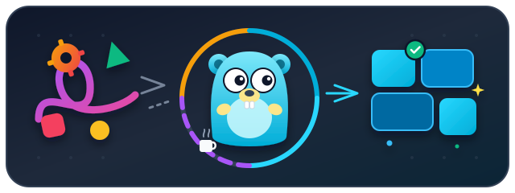

<div align="center">

  

  <h1>go-anything</h1>
  <p><strong>Миграция с любого языка на современный Go — шаг за шагом, модуль за модулем.</strong></p>
  <p>Замените рискованное полное переписывание системы пошаговой миграцией по паттерну «удушитель» (Strangler Fig),<br />подкрепленной доказательствами поведения, автоматизированными шлюзами качества и контролем со стороны человека.</p>

  <p>
    <a href="https://go.dev/"></a>
    <a href="LICENSE"></a>
    <a href="https://github.com/mohammedrefat/go-anything/releases"></a>
    <a href="#план-этапов-разработки-m0m7"></a>
  </p>

  <p>
    <a href="#быстрый-старт-за-5-минут">Быстрый старт</a> ·
    <a href="Docs/USER_GUIDE.md">Руководство пользователя</a> ·
    <a href="#как-это-работает">Как это работает</a> ·
    <a href="#план-этапов-разработки-m0m7">План этапов</a> ·
    <a href="GOVERNANCE.md">Управление</a> ·
    <a href="SECURITY.md">Безопасность</a> ·
    <a href="Docs/go-anything%20Architecture%20%26%20Implementation%20Plan%20(v3)%20(1).md">Архитектура</a>
  </p>

  <p>
    <strong>Переводы:</strong><br />
    <a href="README.md">English</a> ·
    <a href="README.es.md">Español</a> ·
    <a href="README.zh-CN.md">简体中文</a> ·
    <a href="README.ja.md">日本語</a> ·
    <a href="README.de.md">Deutsch</a> ·
    <a href="README.fr.md">Français</a> ·
    <a href="README.pt-BR.md">Português (Brasil)</a> ·
    <a href="README.ru.md">Русский</a> ·
    <a href="README.ar.md">العربية</a> ·
    <a href="README.hi.md">हिन्दी</a> ·
    <a href="README.ko.md">한국어</a>
  </p>

</div>

---

> [!NOTE]
> Данная локализованная документация соответствует релизу **v1.0.0** и может отставать от канонической англоязычной спецификации в [README.md](README.md) (v1.0.1+).

---

## Содержание

- [Как это работает](#как-это-работает)
- [Почему go-anything?](#почему-go-anything)
- [Ограничение гарантий эквивалентности (Parity Disclaimer)](#ограничение-гарантий-эквивалентности-parity-disclaimer)
- [Быстрый старт за 5 минут](#быстрый-старт-за-5-минут)
- [План этапов разработки (M0–M7)](#план-этапов-разработки-m0m7)
- [Рабочий процесс для автономных ИИ-агентов и MCP](#рабочий-процесс-для-автономных-ии-агентов-и-mcp)
- [Архитектура и ключевые принципы](#архитектура-и-ключевые-принципы)
- [Структура репозитория](#структура-репозитория)
- [Управление проектом и вклад](#управление-проектом-и-вклад)
- [Лицензия](#лицензия)

---

## Как это работает

`go-anything` выполняет миграцию приложений на Go **по одному модулю за раз** и строго доказывает идентичность поведения каждого модуля оригинальной системе до переключения рабочего трафика.

- **Это не механический транслятор AST-дерева:** Вы или ваш ИИ-ассистент создаете чистый, идиоматичный код на Go. `go-anything` берет на себя оркестрацию, изолированную песочницу, фиксацию поведения, дифференциальное воспроизведение и шлюзы качества.
- **Паттерн «удушитель» (Strangler Fig):** Исходное приложение остается в строю. Ограниченные модули последовательно заменяются за реверсивным прокси или сайдкаром с возможностью мгновенного отката.
- **Безотказная верификация (Fail-Closed):** Эквивалентность доказывается параллельным прогоном реального и синтезированного трафика через обе версии системы со строгим сравнением ответов по детерминированным правилам.


---

## Почему go-anything?

| Рискованная полная переписка | Проверенная пошаговая миграция (`go-anything`) |
| :--- | :--- |
| Единовременная замена всей кодовой базы | Перенос одной изолированной волны зависимостей за раз |
| Краевые случаи и баги обнаруживаются только в проде | Сверка с зафиксированными тестами до перенаправления трафика |
| Контекст и прогресс теряются в одноразовых чатах | Состояние надежно сохраняется в проверяемых JSON/JSONL файлах |
| Слепая уверенность в идентичности («тесты прошли») | Четкие границы эквивалентности, подкрепленные тестовыми векторами |
| Автономные агенты получают бесконтрольный доступ к деплою | Команды `approve`, `promote` и `lift` доступны исключительно человеку |

---

## Ограничение гарантий эквивалентности (Parity Disclaimer)

> [!IMPORTANT]
> **Эквивалентность имеет четкие границы.**
>
> Полное совпадение гарантируется **исключительно для записанных, наблюдаемых и сгенерированных фаззингом входных данных**. Успешное прохождение поведенческих проверок доказывает идентичность в рамках зафиксированного набора сценариев — это **не** является математической гарантией тождественности на неисследованных путях выполнения.
>
> `go-anything` использует двойной запуск (Dual-run) для автоматического выявления динамических полей (временные метки, случайные токены, UUID) и нормализует их, однако команда инженеров обязана проверить отчеты о расхождениях перед финальным переключением трафика.

---

## Быстрый старт за 5 минут

Пошаговое руководство от чистой машины до инициализации проекта, записи поведения, реализации модуля на Go, прохождения шлюза качества и воспроизведения тестов:

### Требования к окружению

- Установленный [Go 1.26+](https://go.dev/dl/), доступный в системном `PATH`.
- Установленный Git.

### Шаг 1: Установка `go-anything`

Клонируйте репозиторий и соберите бинарный файл CLI:

```bash
git clone https://github.com/mohammedrefat/go-anything.git
cd go-anything

# Установка CLI в $GOPATH/bin
go install ./cmd/go-anything

# Проверка установки
go-anything version
# Пример вывода: go-anything v1.0.0 (profile: full, jobs: 8)
```

---

### Шаг 2: Инициализация или модернизация рабочего пространства

Создайте рабочее пространство для миграции или модернизируйте существующий сервис. Для старого Go-сервиса команда `modernize` создаст эталонную копию `legacy/` и каркас `modern/`:

```bash
# Инициализация для проекта
go-anything init --source=go --name=sample-service /путь/к/сервису
cd /путь/к/сервису

# Проверка здоровья окружения и политик безопасности
go-anything doctor
```

Команда `go-anything doctor` проверяет:
- Хранилище состояний в `.go-anything/units/`
- Наличие `.go-anything/local/` в `.gitignore` (защита от случайной фиксации локальных блокировок и аренд)
- Правила маскирования конфиденциальных данных в `.go-anything/rules.json`
- Готовность песочницы изоляции процессов ОС

---

### Шаг 3: Просмотр модулей и волн зависимостей

Проверьте зарегистрированные модули, волны зависимостей и активные аренды:

```bash
go-anything status
```

Пример вывода:
```text
Workspace: sample-service (schemas: v1)
Dependency Waves:
  Wave 0:
    [Ready] unit-healthcheck (dependencies: none, risk: low)
    [Ready] unit-auth-token  (dependencies: none, risk: medium)
  Wave 1:
    [Planned] unit-user-api   (dependencies: [unit-auth-token], risk: high)
```

---

### Шаг 4: Запись поведенческих тестов (Изоляция и скрытие секретов)

Зафиксируйте поведение оригинального приложения. Команда `go-anything record` запускает процесс в защищенной песочнице, заменяет секреты в оперативной памяти и сохраняет очищенные JSONL-сценарии:

```bash
go-anything record \
  --unit unit-healthcheck \
  --cmd "./legacy-service --health" \
  --dir .
```

`go-anything` автоматически:
- Проводит двойной запуск для обнаружения изменяющихся полей (таймстампы, счетчики).
- Заменяет пароли, токены и куки с сохранением исходного формата данных.
- Сохраняет сценарии в файл `.go-anything/cases/unit-healthcheck.jsonl`.
- Переводит статус модуля из `Planned` в `Recorded`.

---

### Шаг 5: Реализация модуля на современном Go

Напишите код в каталоге `modern/` (или доверьте генерацию ИИ-агенту):

```go
// modern/health/main.go
package main

import (
    "encoding/json"
    "os"
)

type HealthResponse struct {
    Status string `json:"status"`
}

func main() {
    resp := HealthResponse{Status: "ok"}
    _ = json.NewEncoder(os.Stdout).Encode(resp)
}
```

Скомпилируйте приложение:
```bash
go build -o ./bin/modern-health ./modern/health/main.go
```

---

### Шаг 6: Параллельный детерминированный прогон (Replay)

Воспроизведите все зафиксированные кейсы против собранного Go-приложения:

```bash
go-anything replay \
  --unit unit-healthcheck \
  --target ./bin/modern-health \
  --dir .
```

Вывод:
```text
[REPLAY] Replaying 10 recorded cases for 'unit-healthcheck' across 8 workers...
  ✓ case-001: MATCH (0.8ms)
  ✓ case-002: MATCH (0.9ms)
  ...
  ✓ case-010: MATCH (0.7ms)
Replay complete: 10/10 passed (0 mismatches, 0 errors).
```

---

### Шаг 7: Верификация и прохождение шлюза качества

Запустите полный шлюз проверок (`build`, `vet`, `test -race`, `govulncheck`, `error_paths`, `api_compat`):

```bash
go-anything verify unit-healthcheck \
  --target ./bin/modern-health \
  --profile replay \
  --dir .
```

В CI-конвейерах или при работе ИИ-агентов через MCP (`run_gate`) подтверждающие улики привязываются к Git-коммиту в `.go-anything/evidence/`, а статус модуля повышается до `Verified`.

---

### Шаг 8: Одобрение инженером, переключение и демонтаж (Lift)

В этом примере флаг `--skip-shadow` пропускает проверку на теневом трафике и переводит модуль напрямую из состояния Verified в Approved. После этого инженер может переключить рабочий трафик без теневой проверки:

```bash
# 1. Одобрение инженером (строго CLI, закрыто для инструментов MCP)
go-anything approve unit-healthcheck --skip-shadow

# 2. Переключение основного маршрута на реализацию Go
go-anything promote unit-healthcheck

# 3. Полный демонтаж легаси-кода при нулевом откате
go-anything lift unit-healthcheck
```

---

## План этапов разработки (M0–M7)

Все запланированные этапы от базовой архитектуры до версии v1.0.0 полностью реализованы и протестированы:

| Этап | Релиз | Содержание и поставка | Статус критерия завершения |
| :--- | :--- | :--- | :--- |
| **M0: Фундамент** | `v0.0.x` | 10-состояний автомат, атомарный ввод-вывод, файловые блокировки, безопасный реджектор, песочница, скелет CLI, ADR-001/002. | ✅ **Пройден:** `init` и `doctor` завершаются без ошибок. |
| **M1: Прогон в песочнице** | `v0.0.x` | Двойной запуск для отлова динамических полей, мультимодальный компаратор (exact, json, numeric, regex), параллельный прогон. | ✅ **Пройден:** 100% совпадение в трех идентичных прогонах подряд. |
| **M2: Фронт-прокси и Lift** | `v0.0.x` | Реверсивный прокси, аварийный выключатель (`KILL_SWITCH=1`), сбор статистики откатов, команда `lift`. | ✅ **Пройден:** Полный цикл выполнен на тестовых CLI и HTTP сервисах. |
| **M3: Адаптер Go** | `v0.1.0` | Парсер AST Go, анализ типов, планировщик волн на графе вызовов, процесс `modernize`. | ✅ **Пройден:** Реальный Go-сервис модернизирован с 0 расхождений. |
| **M4: Шлюз качества и MCP** | `v0.1.0` | 6 инструментов проверки качества, движок скоринга, stdio MCP-сервер (8 инструментов) с санитизацией вывода. | ✅ **Пройден:** ИИ-агент автономно перенес целый модуль без помощи человека. |
| **M5: Теневой режим и перехват** | `v0.1.0` | Зеркалирование живого трафика, ограниченный пул воркеров с защитой от переполнения, безопасный режим GET/HEAD по умолчанию. | ✅ **Пройден:** Чистый теневой журнал в продакшене и кейс-стади. |
| **M6: Адаптер Python** | `v0.2.0` | Адаптер Python (AST-импорты, pytest, Subprocess, HTTP, C-Shared мосты). | ✅ **Пройден:** Python CLI и FastAPI-сервис успешно портированы. |
| **M7: TypeScript и стабилизация** | `v1.0.0` | Адаптер TypeScript/Node (ESM/CommonJS, Jest/Vitest), заморозка `schemas/v1/`, команда `migrate`, `GOVERNANCE.md`. | ✅ **Пройден:** Сложный многомодульный открытый проект переведен на Go с нулевым откатом. |

---

## Рабочий процесс для автономных ИИ-агентов и MCP

`go-anything` содержит встроенный сервер протокола Model Context Protocol (MCP), работающий через `stdio`:

```bash
go-anything mcp
```

### 8 стандартных инструментов MCP

Сервер MCP на стороне приложения жестко контролирует жизненный цикл из 10 состояний. Агенты не могут сфальсифицировать улики или пропустить шаги:

1. `status` — просмотр прогресса, следующего модуля в очереди волн, аренд и блокеров.
2. `claim_unit` — взятие готового модуля в работу с временной локальной арендой (`.go-anything/local/`).
3. `inspect_unit` — анализ исходного кода, очищенных тестов, семантических ловушек и ограничений.
4. `record_cases` — выполнение оригинального кода в песочнице, замена секретов и сохранение JSONL.
5. `verify_diff` — сборка целевого Go-кода, прогон тестов и вывод очищенных диффов.
6. `run_gate` — запуск полного конвейера из 6 проверок качества и запись улик с фиксацией коммита.
7. `mark_verified` — перевод модуля в статус `Verified` (требует подтвержденных улик для текущего HEAD).
8. `handoff` — формирование отчета `HANDOFF.md` с итогами сессии и следующими шагами.

> **Эксклюзивный контроль человека:** Сервер MCP **никогда** не предоставляет команды `approve`, `promote`, `lift` или прямое управление маршрутизацией.

---

## Архитектура и ключевые принципы

1. **Небольшие обратимые шаги:** Поэтапная замена по паттерну «удушитель». Старая версия всегда доступна для мгновенного отката вплоть до финального выполнения `lift`.
2. **Безотказное скрытие секретов в памяти (Fail-Closed):** Пароли, токены и ключи заменяются до записи на диск. Если конфиденциальные данные не могут быть безопасно разобраны, запись немедленно прерывается.
3. **Строгая изоляция в песочнице:** Linux-неймспейсы (Уровень 1) или процессная изоляция в macOS/Windows (Уровень 2) без доступа к сети по умолчанию.
4. **Детерминированные улики:** Тесты, диффы и скоринговые карты строго упорядочены по `case_id`, исключая влияние порядка выполнения.
5. **Локальность и нулевая телеметрия:** Все данные хранятся исключительно в `.go-anything/`. Никаких внешних сетевых запросов не выполняется.
6. **Независимая архитектура адаптеров:** Адаптеры взаимодействуют через фиксированный контракт `pkg/adapterkit` и обязаны на 100% проходить сертификационный набор `pkg/adapterkit/conformance`.

---

## Структура репозитория

```text
cmd/go-anything/        Точка входа CLI и stdio MCP-сервер
pkg/adapterkit/         Публичные контракты адаптеров (v1)
  └── conformance/      Официальный тестовый набор сертификации адаптеров
internal/               Ядро миграции:
  ├── analyzer/         Парсер AST исходного кода, вывод типов и граф вызовов
  ├── bench/            Тесты производительности и потребления памяти
  ├── comparator/       Мультирежимный анализатор различий (exact, json, numeric, regex)
  ├── gate/             Движок шлюза качества (build, vet, staticcheck, race, vuln)
  ├── mcp/              Сервер stdio MCP с санитизацией ответов
  ├── migrate/          Утилита миграции схем метаданных
  ├── planner/          Топологический планировщик волн зависимостей
  ├── recorder/         Запись тестов в песочнице с отловом динамических данных
  ├── redactor/         Безопасный реджектор секретов в оперативной памяти
  ├── replay/           Детерминированный параллельный движок воспроизведения
  ├── sandbox/          Неймспейсы Linux и процессная изоляция ОС
  ├── shadow/           Движок теневой репликации живого трафика
  └── state/            Жизненный цикл из 10 состояний, атомарный ввод-вывод и локи
adapters/               Языковые адаптеры:
  ├── source/           Адаптеры исходного кода (Go, Python, TypeScript)
  └── application/      Адаптеры приложений (CLI, HTTP, Foreign Library, Worker)
schemas/                Версионированные схемы JSON:
  ├── v1/               Стабильные замороженные схемы (manifest, units, rules и др.)
  └── v1alpha1/         Исходные схемы альфа-версии (обновляются через migrate)
Docs/                   Документация архитектуры, решений и кейсов:
  ├── USER_GUIDE.md     Полное руководство пользователя и справочник команд
  ├── decisions/        Записи архитектурных решений (ADR-001, ADR-002)
  └── case-studies/     Реальные примеры миграций (M3, M4, M5, M6, M7)
GOVERNANCE.md           Роли мейнтейнеров, консенсус, RFC и сертификация
SECURITY.md             Модель угроз, уровни песочниц и раскрытие уязвимостей
CONTRIBUTING.md         Подготовка окружения, стандарты кода и правила проверки
```

---

## Управление проектом и вклад

- **Модель управления:** Ознакомьтесь с [GOVERNANCE.md](GOVERNANCE.md) для информации о ролях мейнтейнеров, RFC и сертификации адаптеров.
- **Политика безопасности:** Ознакомьтесь с [SECURITY.md](SECURITY.md) для изучения модели угроз и правил сообщения об уязвимостях.
- **Подробное руководство:** Прочтите [Полное руководство пользователя](Docs/USER_GUIDE.md) с практическими уроками.
- **Участие в разработке:** Ознакомьтесь с [CONTRIBUTING.md](CONTRIBUTING.md) перед созданием пулл-реквестов.

Включение автоматических проверок git-коммитов:

```bash
git config core.hooksPath .githooks
```

---

## Лицензия

Проект `go-anything` распространяется под лицензией [Apache License 2.0](LICENSE). Сведения об авторах и заимствованиях доступны в файле [NOTICE](NOTICE).
