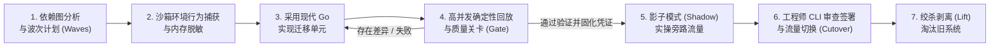

<div align="center">

  

  <h1>go-anything</h1>
  <p><strong>从任何语言渐进式迁移至现代 Go——一次迁移并验证一个单元。</strong></p>
  <p>告别高风险的“一次性重写”，采用增量式的绞杀者模式（Strangler Fig），<br />凭借行为测试证据留存、自动化质量关卡与人工介入审查，确保生产级安全平稳过渡。</p>

  <p>
    <a href="https://go.dev/"></a>
    <a href="LICENSE"></a>
    <a href="https://github.com/mohammedrefat/go-anything/releases"></a>
    <a href="#里程碑路线图-m0m7"></a>
  </p>

  <p>
    <a href="#5-分钟极速上手">快速开始</a> ·
    <a href="Docs/USER_GUIDE.md">用户操作指南</a> ·
    <a href="#工作原理">工作原理</a> ·
    <a href="#里程碑路线图-m0m7">里程碑路线</a> ·
    <a href="GOVERNANCE.md">项目治理</a> ·
    <a href="SECURITY.md">安全准则</a> ·
    <a href="Docs/go-anything%20Architecture%20%26%20Implementation%20Plan%20(v3)%20(1).md">架构设计</a>
  </p>

  <p>
    <strong>其他语言版本：</strong><br />
    <a href="README.md">English</a> ·
    <a href="README.es.md">Español</a> ·
    <a href="README.zh-CN.md">简体中文</a> ·
    <a href="README.ja.md">日本語</a> ·
    <a href="README.de.md">Deutsch</a> ·
    <a href="README.fr.md">Français</a> ·
    <a href="README.pt-BR.md">Português (Brasil)</a> ·
    <a href="README.ru.md">Русский</a> ·
    <a href="README.ar.md">العربية</a> ·
    <a href="README.hi.md">हिन्दी</a> ·
    <a href="README.ko.md">한국어</a>
  </p>

</div>

---

## 本页目录

- [工作原理](#工作原理)
- [为什么选择 go-anything？](#为什么选择-go-anything)
- [关于“等价性（Parity）”的明确免责声明](#关于等价性parity的明确免责声明)
- [5 分钟极速上手](#5-分钟极速上手)
- [里程碑路线图 (M0–M7)](#里程碑路线图-m0m7)
- [自主 AI Agent 与 MCP 工作流](#自主-ai-agent-与-mcp-工作流)
- [系统架构与设计原则](#系统架构与设计原则)
- [代码仓库结构导览](#代码仓库结构导览)
- [项目治理与贡献指南](#项目治理与贡献指南)
- [开源许可证](#开源许可证)

---

## 工作原理

`go-anything` 采用**一次一个单元**的方式将现有应用迁移至 Go，并在正式切换流量前，确保每一个单元的行为均与原始系统的真实记录严格一致。

- **非 AST 机械转译器：** 由开发者或 AI 编码 Agent 编写地道、现代的 Go 代码。`go-anything` 负责编排、沙箱隔离、行为捕获、差分回放与质量关卡守卫。
- **绞杀者模式（Strangler Fig）：** 原始应用始终在线运行。有限边界的单元在反向代理或侧车路由器后逐个被替换，随时可一键回退。
- **故障闭合（Fail-Closed）验证：** 将录制和模糊测试（fuzz）生成的请求同时注入两套实现，基于确定性比对规则验证输出的一致性。



---

## 为什么选择 go-anything？

| 传统高风险的一次性重写 | go-anything 渐进式验证迁移 |
| :--- | :--- |
| 一次性推翻并替换整套代码库 | 按照拓扑波次一次仅迁移一个受控依赖单元 |
| 往往在上线生产后才暴露出边缘案例与严重回归 | 流量切换前依据真实捕获的测试用例进行比对 |
| 迁移上下文与逻辑散落在临时对话窗口中 | 持久化状态存储在可审查、受版本控制的 JSON/JSONL 文件中 |
| 盲目假定代码等价（“单元测试都过了”） | 严格以实际捕获的测试向量与边界用例作为等价凭据 |
| 自主智能体拥有无限制的直接部署权限 | 关键操作 `approve`、`promote` 和 `lift` 严格限制人工在 CLI 中执行 |

---

## 关于“等价性（Parity）”的明确免责声明

> [!IMPORTANT]
> **等价性是有边界的。**
>
> 我们**仅针对已记录、已观测和已进行模糊测试的输入**主张等价性，绝不保证未覆盖的行为路径具有相同结果。通过行为校验仅证明在现有测试分布下的语义一致，并**非**对任意未测试代码路径在数学意义上的严格等价保证。
>
> `go-anything` 采用双运行（Dual-run）机制自动识别易变字段（如时间戳、随机 UUID、自增序列），并结合自动规则进行规范化，但在正式切换生产流量前，工程团队仍必须人工审查行为差异报告并审计用例覆盖度。

---

## 5 分钟极速上手

以下完整演练演示如何在一台干净的机器上初始化工作区、录制行为用例、编写 Go 单元、通过质量关卡并完成并发回放：

### 前置要求

- 安装并配置好 [Go 1.26+](https://go.dev/dl/)（确保在系统 `PATH` 中）。
- 安装 Git。

### 第 1 步：安装 `go-anything`

克隆仓库并编译安装 CLI：

```bash
git clone https://github.com/mohammedrefat/go-anything.git
cd go-anything

# 将 CLI 安装到 $GOPATH/bin
go install ./cmd/go-anything

# 校验安装版本
go-anything version
# 输出示例：go-anything v1.0.0 (profile: full, jobs: 8)
```

---

### 第 2 步：初始化或现代化工作区

创建一个新的迁移工作区，或对现有的 Go 服务执行就地现代化。对于老旧 Go 服务，`modernize` 会自动划分 `legacy/`（冻结的旧代码）与 `modern/`（现代 Go 目标框架）：

```bash
# 初始化工作区
go-anything init --source=go --name=sample-service /path/to/my-service
cd /path/to/my-service

# 检查工作区完整度与安全基线
go-anything doctor
```

`go-anything doctor` 会自动核验：
- `.go-anything/units/` 状态存储库完整性
- `.gitignore` 是否正确忽略 `.go-anything/local/`（防止意外提交临时租约与文件锁）
- `.go-anything/rules.json` 中的脱敏与归一化规则
- 系统沙箱运行环境的隔离完备度

---

### 第 3 步：查看迁移单元与依赖波次

查看已注册的单元、依赖波次顺序及当前租约状态：

```bash
go-anything status
```

输出示例：
```text
Workspace: sample-service (schemas: v1)
Dependency Waves:
  Wave 0:
    [Ready] unit-healthcheck (dependencies: none, risk: low)
    [Ready] unit-auth-token  (dependencies: none, risk: medium)
  Wave 1:
    [Planned] unit-user-api   (dependencies: [unit-auth-token], risk: high)
```

---

### 第 4 步：录制行为测试用例（沙箱隔离与脱敏）

在受控沙箱中执行原始程序并捕获真实行为。`go-anything record` 在内存中完成敏感凭证脱敏，并写入规范的 JSONL 格式用例：

```bash
go-anything record \
  --unit unit-healthcheck \
  --cmd "./legacy-service --health" \
  --dir .
```

`go-anything` 自动完成：
- 双次执行对比以检测动态易变字段（时间戳、随机数）。
- 保持格式的凭证伪造脱敏（密码、Token、Cookie）。
- 将清洗后的用例持久化至 `.go-anything/cases/unit-healthcheck.jsonl`。
- 将该单元状态由 `Planned` 推进为 `Recorded`。

---

### 第 5 步：编写现代 Go 单元实现

在 `modern/` 目录下编写 Go 单元代码（或由 AI 编码 Agent 编写）：

```go
// modern/health/main.go
package main

import (
    "encoding/json"
    "os"
)

type HealthResponse struct {
    Status string `json:"status"`
}

func main() {
    resp := HealthResponse{Status: "ok"}
    _ = json.NewEncoder(os.Stdout).Encode(resp)
}
```

编译 Go 可执行文件：
```bash
go build -o ./bin/modern-health ./modern/health/main.go
```

---

### 第 6 步：高并发确定性回放

针对编译产物并行回放全部录制用例：

```bash
go-anything replay \
  --unit unit-healthcheck \
  --target ./bin/modern-health \
  --dir .
```

输出示例：
```text
[REPLAY] Replaying 10 recorded cases for 'unit-healthcheck' across 8 workers...
  ✓ case-001: MATCH (0.8ms)
  ✓ case-002: MATCH (0.9ms)
  ...
  ✓ case-010: MATCH (0.7ms)
Replay complete: 10/10 passed (0 mismatches, 0 errors).
```

---

### 第 7 步：全面质量关卡检验 (Quality Gate)

执行全套自动化质量检验（`build`、`vet`、`test -race`、`govulncheck`、`error_paths`、`api_compat`）：

```bash
go-anything verify unit-healthcheck \
  --target ./bin/modern-health \
  --profile replay \
  --dir .
```

在自动化流水线或 MCP Agent 交互中（`run_gate`），与 Git Commit 绑定的证据将归档至 `.go-anything/evidence/`，并将状态推进至 `Verified`。

---

### 第 8 步：人工审查签署、路由切换与旧系统剥离

通过验证后，工程师在 CLI 中完成审批、切入影子流量、修改路由规则，并在流量平稳后剥离旧系统：

```bash
# 1. 人工审批（仅限 CLI，MCP 工具无权调用）
go-anything approve unit-healthcheck --notes "用例回放 100% 通过且质量关卡无告警"

# 2. 将路由平滑切换至现代 Go 实现
go-anything promote unit-healthcheck

# 3. 在回退流量归零后剥离旧系统桥接代码
go-anything lift unit-healthcheck
```

---

## 里程碑路线图 (M0–M7)

从初始基础架构到 v1.0.0 的全套里程碑已全部开发并通过验收：

| 里程碑 | 版本 | 核心范围与交付物 | 准出验收状态 |
| :--- | :--- | :--- | :--- |
| **M0: 基础底座** | `v0.0.x` | 10 状态机、原子 I/O、文件级互斥锁、内存故障闭合脱敏、沙箱系统、CLI 框架、ADR-001/002。 | ✅ **通过：** `init` 与 `doctor` 完整通过。 |
| **M1: 沙箱回放** | `v0.0.x` | 双运行易变字段检测、多模式比对器（exact、json、numeric、regex）、并发确定性回放引擎。 | ✅ **通过：** 连续 3 次回放达成 100% 绝对一致。 |
| **M2: 门面与剥离** | `v0.0.x` | 反向代理前门、紧急熔断开关（`KILL_SWITCH=1`）、回退流量监控及 `lift` 剥离命令。 | ✅ **通过：** 演示 CLI 与 HTTP 服务全生命周期通过。 |
| **M3: Go 适配器** | `v0.1.0` | Go AST 分析器、类型推断、调用图依赖波次规划、`modernize` 现代化工作流。 | ✅ **通过：** 真实生产 Go 服务实现 0 差异现代化。 |
| **M4: 质量门禁与 MCP** | `v0.1.0` | 6 项自动化质量关卡工具链、记分卡系统、stdio MCP 服务（8 核心工具）与 Payload 安全清洗。 | ✅ **通过：** AI Agent 无人协助自主完成完整单元迁移。 |
| **M5: 影子与流量录制** | `v0.1.0` | 实时旁路流量镜像、有界工作池与溢出统计、默认仅限幂等请求、线上真实流量回放。 | ✅ **通过：** 实操影子日志 0 异常并完成真实案例复盘。 |
| **M6: Python 适配器** | `v0.2.0` | Python 源码适配器（AST 导入分析、pytest 嗅探、Subprocess/HTTP 传输通道、C-Shared 支持）。 | ✅ **通过：** Python CLI 与 FastAPI 接口成功迁移。 |
| **M7: TypeScript 与冻结** | `v1.0.0` | TypeScript/Node 适配器（ESM/CommonJS、Jest/Vitest）、`schemas/v1/` 正式冻结、`GOVERNANCE.md`。 | ✅ **通过：** 开源复杂多模块项目全面剥离，零回退平稳运行。 |

---

## 自主 AI Agent 与 MCP 工作流

`go-anything` 原生内置基于 `stdio` 的模型上下文协议（Model Context Protocol, MCP）服务：

```bash
go-anything mcp
```

### 8 项标准 MCP 核心工具

MCP 服务端直接托管并强制执行 10 状态生命周期，Agent 无法跳过步骤或伪造验证证据：

1. `status` — 获取当前进度、依赖波次中的下一个可用单元、活动租约与阻碍项。
2. `claim_unit` — 获取处于 `Ready` 状态单元的限时排他租约（写入 `.go-anything/local/`）。
3. `inspect_unit` — 审查旧代码实现、脱敏用例、已知语义陷阱与系统约束。
4. `record_cases` — 在沙箱中执行原始程序，进行内存脱敏并生成 JSONL 用例。
5. `verify_diff` — 编译 Go 目标代码，并发回放所有用例并输出清洗后的差异比对。
6. `run_gate` — 触发完整 6 项质量门禁检验并归档与 Commit 绑定的证据。
7. `mark_verified` — 将单元标记为 `Verified`（必须具备与 HEAD Commit 严格关联的证据）。
8. `handoff` — 生成 `HANDOFF.md` 记录本次会话进展与下一步建议。

> **严格的人机边界控制：** MCP 服务**绝不**提供 `approve`、`promote`、`lift` 或任意线上路由变更高危操作。

---

## 系统架构与设计原则

1. **小步快跑、随时可逆：** 遵循绞杀者模式实现渐进式重构。在最终执行 `lift` 之前，旧系统永远作为毫秒级回退兜底。
2. **故障闭合的内存脱敏：** 令牌、私钥、Cookie 与卡号在进入磁盘前即完成替换。未定义模式或无法解析的内容将直接中止录制。
3. **严格的沙箱隔离：** Linux 系统采用原生命名空间（Tier 1）；macOS/Windows 采用基于干净进程与环境清洗的隔离策略（Tier 2）。默认禁用外网连接。
4. **完全确定性的测试证据：** 所有用例、差异报告与评分卡均依据 `case_id` 排序，杜绝并发执行时序对结果的影响。
5. **本地优先、零遥测收集：** 所有状态与数据严格保留在 `.go-anything/` 中，不向任何远程服务器发送遥测。
6. **解耦的适配器生态：** 语言适配器通过固化的 `pkg/adapterkit` 接口通讯，并且必须 100% 通过官方一致性测试套件 `pkg/adapterkit/conformance`。

---

## 代码仓库结构导览

```text
cmd/go-anything/        CLI 命令行入口与 MCP stdio 服务
pkg/adapterkit/         公开且固化的适配器接口合约 (v1)
  └── conformance/      官方适配器一致性与合规性测试套件
internal/               核心重构与迁移引擎：
  ├── analyzer/         源码语法树分析、类型推导与调用依赖图
  ├── bench/            性能基准、时延与内存分配测试器
  ├── comparator/       多模式差异比对器 (exact, json, numeric, regex)
  ├── gate/             质量关卡执行器 (build, vet, staticcheck, race, vuln)
  ├── mcp/              安全清洗的 stdio MCP 服务实现
  ├── migrate/          工作区元数据版本升级迁移工具
  ├── planner/          拓扑依赖分析与波次调度器
  ├── recorder/         沙箱隔离用例捕获与双运行易变字段检测
  ├── redactor/         故障闭合的凭证脱敏替换器
  ├── replay/           并发确定性测试回放器
  ├── sandbox/          Linux 命名空间与跨平台进程沙箱
  ├── shadow/           线上旁路流量镜像与有界工作池引擎
  └── state/            10 状态机生命周期、原子 I/O 与文件互斥锁
adapters/               各语言与运行时适配器：
  ├── source/           源码分析适配器 (Go, Python, TypeScript)
  └── application/      运行时应用适配器 (CLI, HTTP, Foreign Library, Worker)
schemas/                版本化 JSON 校验模式：
  ├── v1/               稳定冻结的正式 Schema (manifest, units, rules 等)
  └── v1alpha1/         早期测试版 Schema (支持通过 migrate 升级)
Docs/                   架构文档、设计决策与案例复盘：
  ├── USER_GUIDE.md     详尽的中文/英文全量用户使用手册
  ├── decisions/        架构决策记录 (ADR-001, ADR-002)
  └── case-studies/     官方实践复盘案例 (M3, M4, M5, M6, M7)
GOVERNANCE.md           维护者角色、共识机制、RFC 流程与认证标准
SECURITY.md             威胁模型、沙箱分级与漏洞负责任披露政策
CONTRIBUTING.md         本地开发环境搭建、编码规范与检验要求
```

---

## 项目治理与贡献指南

- **项目治理：** 查阅 [GOVERNANCE.md](GOVERNANCE.md) 了解维护者层级、共识机制、模式 RFC 流程与第三方适配器认证。
- **安全政策：** 查阅 [SECURITY.md](SECURITY.md) 了解系统威胁模型、沙箱隔离规范及私密漏洞披露通道。
- **完整操作手册：** 查阅 [用户操作手册](Docs/USER_GUIDE.md) 获取全面的实操教程与命令清单。
- **参与贡献：** 查阅 [CONTRIBUTING.md](CONTRIBUTING.md) 了解开发准则与环境准备。

启用本地自动化 Git 提交校验钩子：

```bash
git config core.hooksPath .githooks
```

---

## 开源许可证

`go-anything` 基于 [Apache License, Version 2.0](LICENSE) 开源协议分发。第三方致谢请参见 [NOTICE](NOTICE)。
